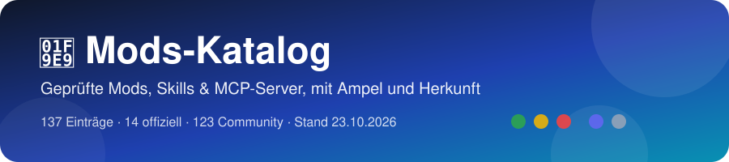

# 🧩 Mods-Katalog

Ergänzung zur [Watchlist](README.md): Plugins, Skills, Hooks, Mods und MCP-Server – jeweils mit **Herkunft** (offiziell oder Community) und **Sicherheits-Ampel**.

**Stand: 2026-10-29** · **138 Einträge** in 14 Gruppen · 14 × 🏛️ offiziell · 124 × 👥 Community · 20 × 🟢 · 97 × 🟡 · 21 × 🔴

> [!CAUTION]
> Plugins, Skills, Hooks und „Mods“ laufen **mit deinen Rechten** (Claude-Code-Mods laut offizieller Doku ohne Sandbox): Sie können Dateien lesen/schreiben, Befehle starten und Daten senden. Bewertet wurde nur durch Lesen von Code und Doku – **nichts wurde ausgeführt**. Keine Garantie: vor der Installation selbst prüfen, z. B. mit `claude plugin validate ./plugin`, Version pinnen, nichts per `curl | bash` installieren.

## 📚 Inhalt

| | |
| --- | --- |
| [**🏛️ Offizielle Mods**](#offiziell) 14 Einträge · Übersicht | [**🛡️ 1. Sicherheit & Kontrolle**](#sicherheit) 27 Einträge |
| [**💰 2. Kosten & Usage**](#kosten) 15 Einträge | [**🖥️ 3. Anzeige & UI**](#anzeige) 20 Einträge |
| [**🧠 4. Lernen & Regeln**](#lernen) 9 Einträge | [**🤝 5. Multi-Agent & Fremdmodelle**](#multi-agent) 9 Einträge |
| [**🎨 6. Frontend & Animation**](#frontend) 11 Einträge | [**🧩 7. Skills: Denken & Recherche**](#skills) 14 Einträge |
| [**🎬 8. MCP & Kreativ-Tools**](#mcp-kreativ) 10 Einträge | [**🗺️ 9. Visualisierung**](#visualisierung) 5 Einträge |
| [**🔌 10. MCP: SaaS-Anbindungen**](#mcp-saas) 3 Einträge | [**🏛️ 11. Offizielle Anthropic-Skills**](#anthropic-skills) 9 Einträge |
| [**📦 12. Sammlungen**](#sammlungen) 2 Einträge | [**🔍 13. Prüfwerkzeuge**](#pruefwerkzeuge) 2 Einträge |
| [**🔎 Weitere Funde**](#nebenfund) 2 Einträge | [**🧭 Legende**](#legende) Ampel &amp; Herkunft |

> [!TIP]
> **Legende**
> - Ampel:  Code gelesen und unauffällig, bekannte Herkunft oder rein lesend/anzeigend, kein Netz, keine Zusatzkosten ·  unbedenklich mit Auflagen (z. B. junges Einzel-Repo: Version pinnen; Token-Kosten; schreibt in Konfiguration; startet Prozesse) ·  vorerst nicht einrichten bzw. nur in einer Wegwerf-Umgebung (z. B. `curl | bash`-Installer, Telemetrie standardmäßig an, Daten gehen an fremde Server).
> - Herkunft:  = direkt von Anthropic (GitHub-Orgs `anthropics`/`anthropic-ai` oder in Claude Code eingebaut) ·  = alles von Dritten, auch Hersteller wie Cloudflare oder NVIDIA.
> - Herkunft sagt nichts über Sicherheit: auch offizielle Einträge haben eine eigene Ampel.

**Abschalten & Prüfen:** Offizielle Doku zu Mods: <https://code.claude.com/docs/en/plugins/mods/overview> · Mods sind ab Claude Code 2.1.287 standardmäßig an · einzeln abschalten über `/plugin`, für eine Sitzung mit `--safe-mode`, alle eigenen Hooks mit `"disableAllHooks": true` · ohne Ausführen prüfen mit `claude plugin validate ./mod`.

**Quellen:** Verzeichnisse wie claude-mods.com, claudemods.ai und claudemod.com sind 👥 Community-Seiten ohne Impressum und nur Hinweisquellen – ihr „verified“ oder „checked by hand“ ist kein Sicherheits-Audit. Jeder Eintrag hier wurde am Primär-Repo geprüft.

---

## 🏛️ Offizielle Mods (Übersicht)

Alle 14 Einträge mit , also direkt von Anthropic. Einige davon (z. B. Blast Radius, Replay Theater, Token Weather) sind laut README Beispiele aus `anthropics/claude-code-playground` und kein unterstütztes Produkt – die Ampel gilt deshalb wie bei Community-Code.

| Name | Ampel | Abschnitt |
| :-- | :-: | :-- |
| [Blast Radius](https://github.com/anthropics/claude-code-playground/tree/main/claude-code/mods/blast-radius) |  | [🛡️ 1. Sicherheit & Kontrolle](#sicherheit) |
| [Replay Theater](https://github.com/anthropics/claude-code-playground/tree/main/claude-code/mods/replay-theater) |  | [🛡️ 1. Sicherheit & Kontrolle](#sicherheit) |
| [You Should Know](https://code.claude.com/docs/en/plugins/mods/overview#mods-built-into-claude-code) (`cc-plugin-you-should-know`) |  | [🛡️ 1. Sicherheit & Kontrolle](#sicherheit) |
| [frontend-design](https://github.com/anthropics/skills/tree/main/skills/frontend-design) |  | [🏛️ 11. Offizielle Anthropic-Skills](#anthropic-skills) |
| [canvas-design · theme-factory · brand-guidelines](https://github.com/anthropics/skills/tree/main/skills/canvas-design) |  | [🏛️ 11. Offizielle Anthropic-Skills](#anthropic-skills) |
| [internal-comms · doc-coauthoring · discernment-nudge](https://github.com/anthropics/skills/tree/main/skills/doc-coauthoring) |  | [🏛️ 11. Offizielle Anthropic-Skills](#anthropic-skills) |
| [academy-guide · algorithmic-art · claude-api · mcp-builder · slack-gif-creator](https://github.com/anthropics/skills/tree/main/skills/claude-api) |  | [🏛️ 11. Offizielle Anthropic-Skills](#anthropic-skills) |
| [docx · pdf · pptx · xlsx](https://github.com/anthropics/skills/tree/main/skills/docx) |  | [🏛️ 11. Offizielle Anthropic-Skills](#anthropic-skills) |
| [skill-creator](https://github.com/anthropics/skills/tree/main/skills/skill-creator) |  | [🏛️ 11. Offizielle Anthropic-Skills](#anthropic-skills) |
| [web-artifacts-builder](https://github.com/anthropics/skills/tree/main/skills/web-artifacts-builder) |  | [🏛️ 11. Offizielle Anthropic-Skills](#anthropic-skills) |
| [webapp-testing](https://github.com/anthropics/skills/tree/main/skills/webapp-testing) |  | [🏛️ 11. Offizielle Anthropic-Skills](#anthropic-skills) |
| [template-skill](https://github.com/anthropics/skills/tree/main/template) |  | [🏛️ 11. Offizielle Anthropic-Skills](#anthropic-skills) |
| [Token Weather](https://github.com/anthropics/claude-code-playground/tree/main/claude-code/mods/token-weather) |  | [🔎 Weitere Funde](#nebenfund) |
| [plugin-authoring](https://code.claude.com/docs/en/plugins/mods/overview#mods-built-into-claude-code) (`cc-plugin-plugin-authoring`) |  | [🔎 Weitere Funde](#nebenfund) |

---

## 1. Sicherheit & Kontrolle (Guards, Review)

| Name | Herkunft | Typ | Wofür | Ampel |
| :-- | :-: | :-- | :-- | :-: |
| [Blast Radius](https://github.com/anthropics/claude-code-playground/tree/main/claude-code/mods/blast-radius) |  | Mod (tool.call-Guard + Pane) | Hält riskante Bash-Befehle an (`rm -r/-f`, `git reset --hard`, `git clean`, Force-Push, Migrationen), zeigt, was betroffen wäre, und verlangt Proceed oder Cancel |  |
| [Replay Theater](https://github.com/anthropics/claude-code-playground/tree/main/claude-code/mods/replay-theater) |  | Mod (Recorder + `/replay`-Pane) | Spielt nach jedem Turn die Datei-Edits von Claude Schritt für Schritt als Diff ab |  |
| [You Should Know](https://code.claude.com/docs/en/plugins/mods/overview#mods-built-into-claude-code) (`cc-plugin-you-should-know`) |  | Eingebauter Mod (Side-Agent) | Ein zweiter Agent liest Claudes Ausgaben mit und blendet Wichtiges über dem Prompt ein, z. B. Kostenhinweise |  |
| [launch-codes](https://github.com/OneWave-AI/claude-code-mods/tree/main/launch-codes) |  | Mod (tool.call-Guard Bash + Alarm-Pane) | Riskante Bash-Befehle (`rm -rf` auf riskante Pfade, Force-Push, `git reset --hard`, DROP/TRUNCATE, `supabase db reset`, `vercel --prod`, `chmod -R 777`, curl/wget in eine Shell) brauchen einen Einmal-Code |  |
| [security-audit-skill](https://github.com/cloudflare/security-audit-skill) (Skill `security-audit`) |  | Skill (Markdown + 2 Node-Validatoren ohne Abhängigkeiten) | Sicherheits-Audit eines Repos: viele parallele Subagents suchen Schwachstellen, belegen sie und schreiben einen Bericht |  |
| [reverse-skill](https://github.com/zhaoxuya520/reverse-skill) |  | Skill-Sammlung (599 Dateien) + Bootstrap-Skript | Router für Reverse Engineering und Pentests: Payload-Bibliotheken, Burp-MCP-Brücke, Kali-Werkzeuge |  |
| [secret-redactor (davila7)](https://github.com/davila7/claude-code-templates/tree/main/cli-tool/components/mods/security/secret-redactor) |  | Mod (`tool.call`-Hook nach dem Tool) | Schwärzt bekannte Key-/Token-Formate (AWS, Anthropic, OpenAI, GitHub, Google, Stripe, Slack, JWT, PEM, DB-URLs mit Passwort) in Tool-Ausgaben, bevor Claude sie sieht |  (fast grün) |
| [large-edit-confirmation](https://github.com/davila7/claude-code-templates/tree/main/cli-tool/components/mods/security/large-edit-confirmation) (davila7) |  | Mod (`tool.call`-Guard auf Edit/Write) | Fragt nach, bevor Claude eine Datei mit mehr als 1.000 Zeilen (einstellbar) per Edit oder Write ändert |  (fast grün) |
| [jev-auto-mode](https://github.com/davila7/claude-code-templates/tree/main/cli-tool/components/mods/security/jev-auto-mode) (davila7) |  | Mod (Permission-Layer) | JSON-Policy plus KI-Richter (TypeSafe „Jev“), der entscheidet, ob Tool-Calls laufen dürfen |  |
| [ash / claude-skills](https://github.com/randommonicle/claude-skills) (Reddit „43 Claude Code guardrails“) |  | Plugin: 56 Guardrail-Skills + 13 Hook-Aufrufe (Node) + Normen beim Sessionstart | Leitplanken aus echten Fehlern: push-gate fragt vor Push/Merge, Warnungen bei SQL, Secrets und kill, Linter nach jedem Edit |  |
| [Probity](https://github.com/nizos/probity) |  | Claude-Code-Plugin (PreToolUse-Hook) + npm-Paket `@nizos/probity` | Prüft vor jedem Bash/Write/Edit/NotebookEdit-Call Regeln aus `probity.config.ts` (z. B. TDD erzwingen, Befehle sperren) und blockt bei Verstoß |  |
| [anchorwatch-mod](https://github.com/anchorwatch-dev/anchorwatch/tree/main/plugins/anchorwatch-mod) |  | Mod (tool.call-Guard) | Blockt `rm -rf` auf riskante Pfade, Force-Push, `DROP TABLE`, Pipe-in-Shell-Downloads und `cat .env`, bevor sie laufen |  (fast grün) |
| [guardrails (arasovic)](https://github.com/arasovic/claude-code-mods/tree/main/guardrails) |  | Mod (tool.call-Guard Bash) | Verweigert `cf deploy/migrate/init`, Attribution-Zeilen in Commits/PRs und Branches mit Präfix `claude/`, je per Schalter |  (fast grün) |
| [loop-guard](https://github.com/arasovic/claude-code-mods/tree/main/loop-guard) |  | Mod (Fehler-Zähler + versteckte Notiz) | Scheitert derselbe Schritt zweimal, bekommt Claude eine versteckte Notiz, den Ansatz zu wechseln |  (fast grün) |
| [secret-guard](https://github.com/arasovic/claude-code-mods/tree/main/secret-guard) |  | Mod (Redaction + Lese-Sperre) | Maskiert Schlüssel in Tool-Ausgaben, blockt `.env`-Lesen und Befehle, die Geheimnisse ausgeben |  (fast grün) |
| [assertion-guardian](https://github.com/ccdwyer/claude-mods) |  | Mod (Edit-Guard für Tests) | Verweigert Test-Edits, die Assertions entfernen, Tests überspringen oder Erwartungswerte ändern |  |
| [collision-guard](https://github.com/nateherkai/claude-code-mods/tree/main/collision-guard) |  | Mod (Edit-Guard + Abfrage) | Fragt nach, bevor Claude eine Datei ändert, die ein anderer offener Chat gerade geändert hat |  |
| [recording-mode](https://github.com/nateherkai/claude-code-mods/tree/main/recording-mode) |  | Mod (Anzeige-Maske) | Maskiert Schlüssel, Namen und Geldbeträge auf dem Bildschirm und hält private Dateien zu, solange man aufnimmt |  |
| [env (davekiss)](https://github.com/davekiss/env) |  | Mod (eigene Tools + Eingabe-Pane) | Claude sieht nur die Namen der `.env`-Schlüssel und fragt Werte über ein Pane ab, das es selbst nicht lesen kann |  (strenge Auflagen) |
| [git-gates](https://github.com/bahaospanov/skills) |  | Mod (tool.call-Guard git) | Blockt Commit, Push und Merge, solange die letzte Nachricht es nicht verlangt, und prüft Commit-Messages |  (fast grün) |
| [harness-mods](https://github.com/ucsandman/Agnostic-AI/tree/main/engine/mods) |  | Mod-Paar (Runtime-Adapter + Guards) | Routing der Subagent-Modelle, Geheimnis-Redaction, Lese-Cache und Subagent-Abrechnung, je Guard im Modus classic/shadow/mod |  (strenge Auflagen) |
| [honmoon-redact](https://github.com/pleaseai/honmoon/tree/main/packages/claude-plugin) |  | Mod (Redaction + Lese-Sperre) für ein lokales Gateway | Schwärzt Geheimnisse und PII in Tool-Ausgaben und Prompts und blockt das Lesen von Schlüsseldateien |  |
| [pii-guard](https://github.com/danyuchn/pii-guard) |  | Mod + lokaler Python-Dienst | Reversible PII-Schwärzung (auf Taiwan-Daten ausgelegt) für Tool-Ergebnisse, Prompts und Writes, alles über Loopback |  |
| [secret-redactor (ray-amjad)](https://github.com/ray-amjad/claude-code-mods) |  | Mod (Redaction), laut Seite | Ersetzt Geheimnisse, Mails und IPs durch Platzhalter, bevor das Modell sie sieht |  (vorerst, nicht prüfbar) |
| [taxi-speedcam](https://github.com/devbrother2024/devbrothers-mods) |  | Mod (tool.call-Guard + Abfrage) | Fängt Force-Push, `rm -rf`, DB-Wipes und Prod-Deploys ab und fragt nach |  (fast grün) |
| [toolgate](https://github.com/RiskAverseTech/toolgate) |  | Mod / PreToolUse-Hook / MCP-Proxy | Fragt TypeSafes Modell „Jev“ pro Tool-Aufruf sieben Risikofragen und erlaubt, fragt nach oder blockt |  (vorerst) |
| [wp-credential-guard](https://github.com/nathanonn/agent-skills) |  | Mod (Redaction + Rückersetzung) | Maskiert WordPress-Logins für das Modell und setzt die echten Werte erst in Bash-Befehle wieder ein |  |

[↑ Inhalt](#-inhalt)

---

## 2. Kosten & Usage

| Name | Herkunft | Typ | Wofür | Ampel |
| :-- | :-: | :-- | :-- | :-: |
| [Cache Tax](https://github.com/karanb192/cache-tax) |  | Mod (prompt.submit-Guard + `/keepwarm`, `/cache-tax`) | Warnt vor einem „kalten“ Prompt-Cache, zeigt die geschätzten Kosten für das erneute Einlesen und kann den Cache mit Pings warmhalten |  |
| [burn-meter](https://github.com/OneWave-AI/claude-code-mods/tree/main/burn-meter) |  | Mod (Band über dem Prompt + Pane) | Live-Feuerbalken für die Session-Kosten, Plan-Limits mit Reset-Zeit, Kosten in Burritos umgerechnet |  (fast grün) |
| [session-wrapped](https://github.com/OneWave-AI/claude-code-mods/tree/main/session-wrapped) |  | Mod (`/wrapped`-Pane + PNG) + 2 Python-Skripte | „Spotify Wrapped“ für Session, Woche und Monat (Tool-Calls, Tests, Kosten), dazu eine teilbare PNG-Karte |  |
| [context-lens](https://github.com/Arunjay4213/claude-mods/tree/main/plugins/context-lens) (+ quota-meter, token-ledger, budget-guard) |  | 4 Mods aus einer Sammlung (Statuszeilen + Panes, `/context-lens`, `/quota`, `/ledger`, `/guard`) | context-lens: Kontextfüllung und Wachstum pro Turn mit Balken je Kategorie. quota-meter: Plan-Fenster mit Reset-Countdown. token-ledger: Kosten und Tokens pro Turn. budget-guard: stoppt die Session über einem Dollar- oder Plan-Limit |  |
| [effort-cycle](https://github.com/Anerco/claude-code-effort-cycle) |  | Mod (Tasten Ctrl+↑/↓, Effort-Anzeige im Footer und in den Subagent-Zeilen) | Stellt den Reasoning-Effort pro Agent um und zeigt ihn als farbige Skala |  |
| [rtk](https://github.com/rtk-ai/rtk) („Rust Token Killer“) |  | Rust-Binary + PreToolUse-Hook (`rtk init -g`) | Kürzt die Ausgabe von Shell-Befehlen (git, Tests, Build), damit weniger Tokens im Kontext landen |  |
| [prompt-cache-control](https://github.com/davila7/claude-code-templates/tree/main/cli-tool/components/mods/observability/prompt-cache-control) (davila7) |  | Mod (Band + Pane `/cache`, Toasts) | Zeigt live Cache-Treffer, Cache-Ablauf (TTL) und Compaction-Einstellungen |  (fast grün) |
| [claude-code-templates-CLI](https://github.com/davila7/claude-code-templates) (`npx claude-code-templates`) |  | Installer-CLI (npm 1.30.0) für 45 Mods und weitere Komponenten | Installiert Mods per `--mod <kategorie>/<name>` nach `.claude/skills/<name>/` |  im Default / 🟡 mit Auflagen |
| [context-mode](https://github.com/mksglu/context-mode) |  | MCP-Server + Hooks (Plugin, npm `context-mode`) | Hält rohe Tool-Ausgaben aus dem Kontext: führt Befehle in Sandbox-Prozessen aus, indiziert Ergebnisse in SQLite-FTS5 und gibt nur Auszüge zurück |  |
| [caveman](https://github.com/JuliusBrussee/caveman) |  | Skill + Plugin, dazu CLI, Proxy, MCP und Cloud („six rocks“) | Lässt den Agenten in extrem knapper „Höhlenmenschen“-Sprache antworten und komprimiert Ein- und Ausgaben, um Tokens zu sparen |  (vorerst; nur Plugin 🟡) |
| [Chisle](https://github.com/JayPokale/Chisle) (Schreibweise so korrekt, npm `chisle`; nicht „Chisel“) |  | Plugin (Skills, Hooks, MCP-Proxy), Installer für 13 Agenten | Spart Tokens auf drei Wegen: knappe Prosa, YAGNI-Code, Kompression von Tool-Ausgaben |  |
| [context-bar](https://github.com/hamzafer/claude-code-mods/tree/main/mods/context-bar) |  | Mod (Band über dem Prompt) | Zeigt das Kontextfenster als gestapelten Balken, eine Farbe je Kategorie |  (fast grün) |
| [fast-jev-compaction](https://github.com/tamaratran/fast-jev-compaction) |  | Mod (ersetzt Compaction) | Löscht bei der Compaction veraltete Tool-Aufrufe statt zusammenzufassen, der Rest bleibt wörtlich |  (vorerst) |
| [effortless](https://github.com/HeyCubit/effortless) |  | Mod (prompt.submit + Bänder) | Wählt je Prompt die Effort-Stufe und zeigt, wie lange der Prompt-Cache warm bleibt |  (strenge Auflagen) |
| [context-attachment-manager](https://github.com/chipfighter/context-attachment-manager) |  | Mod + lokaler Proxy | Wählt aus, welche früheren Bilder mit der nächsten Nachricht mitgehen, der Rest wird zu Platzhaltern |  (vorerst) |

[↑ Inhalt](#-inhalt)

---

## 3. Anzeige & UI (Panels, Themes, Dateibaum)

| Name | Herkunft | Typ | Wofür | Ampel |
| :-- | :-: | :-- | :-- | :-: |
| [Claude Skins](https://github.com/hellosverre/claude-skins) |  | Mod (UI-Reskin) + Skill `skin-designer` | Themes für Tool-Zeilen, Spinner und Antwort-Gutter, wechselbar mit `/skin` |  (fast grün) |
| [Filetree](https://github.com/data-goblin/claude-code-filetree) |  | Mod (Seitenpane) | Dateibaum rechts. Zeigt, welche Dateien Claude liest, schreibt oder committet, dazu Git-Status und Zeilen-Diffs |  |
| [Savvy Progress](https://github.com/JohnnyVizz/claude-kit/tree/main/plugins/savvy-progress) |  | Mod (Band + Agents-Panel) + 2 MCP-Tools | Fortschrittsbalken über dem Prompt und Live-Panel aller Subagents mit Modell, Fortschritt, Kontext und geschätzten Kosten |  |
| [Terminal Browser](https://github.com/zenbu-labs/terminal-browser) (Plugin unter [`claude-code-plugin/`](https://github.com/zenbu-labs/terminal-browser/tree/main/claude-code-plugin)) |  | Mod + **externe Electron-App** + Skill | Echter Browser im Terminal neben dem Chat (`/browser`), über das Kitty-Grafikprotokoll |  (vorerst) |
| [Flightdeck](https://github.com/scasella/claude-flightdeck) |  | Mod (Live-Pane + Statuszeile, `/flightdeck`) | Dashboard: Modell-Vitals (ttft, tok/s), „Architect“-Konsultationen, jede Permission-Prüfung (Gate), Subagent-Karten und Swimlanes, Turn-Beleg, Session-Log |  (fast grün) |
| [agent-narrator](https://github.com/OneWave-AI/claude-code-mods/tree/main/agent-narrator) |  | Mod (Pane, `/narrate`) | Übersetzt jeden Agenten-Schritt in einen Satz in Alltagssprache und schätzt die gesparte Zeit |  (fast grün) |
| [inner-monologue](https://github.com/OneWave-AI/claude-code-mods/tree/main/inner-monologue) |  | Mod (Pane) | Schreibt trockene „innere Gedanken“ von Claude zu dem, was es gerade tut |  |
| [sportscaster](https://github.com/OneWave-AI/claude-code-mods/tree/main/sportscaster) |  | Mod (Pane + Ticker + Audio) | Kommentiert die Session wie eine Live-Sportübertragung, laut per TTS und mit generiertem Publikumsjubel |  |
| [code-pet](https://github.com/OneWave-AI/claude-code-mods/tree/main/code-pet) |  | Mod (Statuszeile + Pane) | Pixel-Haustier: frisst bei Tool-Calls, wird bei Fehlern krank, gerät bei destruktiven Befehlen in Panik |  (fast grün) |
| [boss-fight](https://github.com/OneWave-AI/claude-code-mods/tree/main/boss-fight) |  | Mod (Pane) | Fehlschlagende Tests erzeugen einen Pixel-Boss, jeder Testlauf mit Fixes trifft ihn |  (fast grün) |
| [inbox-alerts](https://github.com/OneWave-AI/claude-code-mods/tree/main/inbox-alerts) |  | Mod (Toasts + Statuszeile + Pane, `/alerts`) | Holt Gmail, Slack und Google Calendar über die claude.ai-Connectoren und zeigt neue Einträge im Terminal; `/alerts triage` übergibt sie an Claude |  (vorerst) |
| [agent-flow](https://github.com/Charlie0113-T/claude-agent-flow) |  | Mod (Pane, `/flow`, `/flow text`) | Live-Baum der Subagents einer Session neben dem Transkript |  (fast grün) |
| [cctop](https://github.com/tomstagl/cctop) |  | Rust-Programm (TUI-Dashboard) + Plugin (`/cctop`, Skills `cctop`, `cctop-insights`) | „btop“ für Claude Code: Kontext, Tokens, Kosten, Limits, Tools, Agents, Cache und Coach-Hinweise in einem Pane oder Terminal-Split |  |
| [statuspane](https://github.com/xuanji86/claude-statuspane) |  | Mod (schwebende Statuskarte + Progress-API) | Karte mit Modell, Kontext, Rate-Limits, Kosten, Verzeichnis/Branch, optional CI-Status, plus Fortschrittszeilen, die Skripte über JSON-Dateien melden |  |
| [firstmate-calm](https://github.com/kunchenguid/firstmate/tree/main/.claude/mods/firstmate-calm) |  | Mod (UI) | Blendet Tool-Zeilen aus und ersetzt den Spinner durch ein Segelboot, Umschalten mit `/calm` |  (fast grün) |
| [textfold](https://github.com/chenxiachan/textfold) |  | Mod (UI) | Zeigt jede Antwort in fünf Stufen, vom ganzen Text bis zu einem Satz, je eine Taste |  (fast grün) |
| [cc-stretch](https://github.com/pro-vi/cc-stretch) |  | Mod (UI) | Antworten kommen kurz, ein Klick auf eine Phrase klappt sie aus |  |
| [Habblaud](https://github.com/marmottajr/habblaud) |  | Mod + lokale Web-App (Node/Docker) | Ein Pixel-Büro, in dem jeder Claude-Code-Agent live zeigt, was er tut, mit Usage-Anzeige |  (strenge Auflagen) |
| [remctl](https://github.com/viticci/remctl) |  | Mod + CLI/MCP (macOS) | Zeigt die heutigen Apple-Erinnerungen über dem Prompt, dazu Tools, mit denen Claude sie verwaltet |  |
| [Storybloq](https://github.com/Storybloq/storybloq) |  | Mod (Pane) + npm-CLI | Board der Tickets und Issues aus `.story/` in einem Pane neben dem Transkript |  |

[↑ Inhalt](#-inhalt)

---

## 4. Lernen & Regeln (Memory/Workflow)

| Name | Herkunft | Typ | Wofür | Ampel |
| :-- | :-: | :-- | :-- | :-: |
| [Reflect](https://github.com/BayramAnnakov/claude-reflect) (Mod: [`mod/`](https://github.com/BayramAnnakov/claude-reflect/tree/main/mod) = `reflect-mod`) |  | Mod (Band) · alternativ Python-Plugin mit Settings-Hooks, Commands und Skill | Erkennt Korrekturen („nein, so nicht …“) und bietet per Button an, sie als Regel in `./CLAUDE.md` oder `~/.claude/CLAUDE.md` zu speichern |  |
| [i-have-adhd](https://github.com/ayghri/i-have-adhd) |  | Plugin (Output-Style-Skill + optionaler SessionStart-Hook) | Antworten kurz, klar und in Schritten, bis „stop adhd mode“ |  (fast grün) |
| [ponytail](https://github.com/DietrichGebert/ponytail) |  | Plugin (Regeln, 3 Hooks) + Mod „band“ | Bringt Claude zu minimalem Code mit wenigen Änderungen, mit Modus-Umschalter und Statistik |  |
| [book-to-skill](https://github.com/virgiliojr94/book-to-skill) |  | Skill (879 Zeilen) + Python-Extraktor | Macht aus einem Buch (PDF/EPUB) einen eigenen Skill mit Kernideen und Regeln |  |
| [GSD Core](https://github.com/open-gsd/gsd-core) (Nachfolger von gsd-build/get-shit-done) |  | Framework (Commands, Agents, Skills, rund 32 Hooks, MCP-Server), npm `@opengsd/gsd-core` | Spec-getriebene Entwicklung: Projekt in Phasen planen, ausführen und prüfen lassen |  |
| [Claude Auto Handoff](https://github.com/alexknowshtml/claude-auto-handoff) (alexknowshtml) |  | Mod (Function Hooks), `--plugin-dir` | Ersetzt Auto-Compact: kurz vor vollem Kontext schreibt Haiku eine Übergabe-Notiz, dann `/clear` und eine frische Session liest sie |  |
| [unlazy](https://github.com/Leonxlnx/unlazy) |  | Skill + Node-Checker, optionaler Stop-Hook | „Anti-Faulheit“: zwingt den Agenten, vorab Abnahme-Kriterien mit prüfbaren Checks festzulegen und erst bei bestandenen Checks „fertig“ zu melden |  |
| [time-machine](https://github.com/YeonwooSung/my-claude-code-mods) (agent-time-machine) |  | Mod (Timeline-Pane) | Jeder Tool-Aufruf auf einer verzweigten Zeitleiste mit Snapshots: ansehen, zurückholen, verzweigen, neu ausführen |  |
| [after](https://github.com/midudev/better-claude) (midudev) |  | Mod (Warteschlange) | Reiht Aufgaben für nach dem aktuellen Turn ein, ohne Claude mitten im Turn umzulenken |  |

[↑ Inhalt](#-inhalt)

---

## 5. Multi-Agent & Fremdmodelle (Subagents anderer Anbieter)

| Name | Herkunft | Typ | Wofür | Ampel |
| :-- | :-: | :-- | :-- | :-: |
| [BitFrost](https://github.com/SavaSoftworks/BitFrost) (Plugin unter [`plugins/bitfrost/`](https://github.com/SavaSoftworks/BitFrost/tree/main/plugins/bitfrost)) |  | Mod (Function Hooks `register.js`) + lokaler Daemon `bitfrostd` + CLI `bitfrost` + optionale ZCode-Bridge | Claude Code startet Subagents mit Modellen anderer Anbieter über deren eigene Apps: Codex (GPT), ZCode (GLM), experimentell opencode, Oh My Pi, Gemini CLI. Claude kann Status abfragen, Nachrichten schicken, stoppen und fortsetzen |  (Richtung 🔴 für sensible Repos) |
| [swarm](https://github.com/OneWave-AI/claude-code-mods/tree/main/swarm) |  | Mod (Pane) | Live-Ansicht eines Agent-Teams: Agenten, Nachrichten zwischen ihnen, Ereignisse |  (fast grün) |
| [agent-race](https://github.com/OneWave-AI/claude-code-mods/tree/main/agent-race) |  | Mod (Pane, `/race`) | Mehrere Sessions treten auf derselben Aufgabe gegeneinander an (Vergleich von Modellen oder Prompts) |  |
| [oh-my-claudecode](https://github.com/Yeachan-Heo/oh-my-claudecode) (OMC) |  | Plugin-Sammlung (~30 Hooks, Agents, Skills, Team-Modus) + npm `oh-my-claude-sisyphus` | Orchestrierung mehrerer Agents (Claude, Codex, Gemini) mit Keyword-Modi, Persistenz und Teams |  (strenge Auflagen) |
| [Orgtree](https://github.com/Maurdekye/orgtree) (v2, „Now an App“; aktuell v4.4.3) |  | Desktop-App (Electron mit Rust-Engine, Python, Node), steuert Claude Code, Codex, Gemini, OpenCode | Visueller Multi-Agent-Orchestrator: Agenten-Hierarchie auf einer Leinwand, Work Docket (Tickets), geteiltes Gedächtnis, mehrere Konten pro Anbieter |  |
| [Ouroboros](https://github.com/Q00/ouroboros) |  | „Agent OS“: Python-Paket `ouroboros-ai` + Claude-Plugin mit Hooks | Zerlegt Ziele per Interview in Specs und lässt Agenten sie in Schleifen umsetzen und prüfen |  (vorerst) im Default / 🟡 mit Auflagen |
| [Ruflo](https://github.com/ruvnet/ruflo) (früher Claude Flow, `ruvnet/claude-flow` leitet per 301 auf dieselbe Repo-ID 995029641 um; npm `ruflo` 3.59.17, intern `@claude-flow/cli`) |  | Agent-Harness: CLI + MCP-Server (README: 314 Tools), Hooks, Daemon, Hive-Mind/Swarm, Plugin-Marktplatz mit über 40 Plugins | Orchestriert viele Agenten (Swarm, Hive-Mind) mit Vektor-Gedächtnis, automatischem Routing und Hintergrund-Workern |  (vorerst; Plugin `ruflo-core` mit lokal gepinnter CLI 🟡) |
| [Shared Sessions](https://github.com/Paradigm-Study/claude-share) (`shared-session`) |  | Mod (Live-Sitzung teilen) | Teilt eine Sitzung per Link, andere treten aus ihrem Claude Code bei und prompten live mit |  (vorerst) |
| [shunt](https://github.com/pleaseai/shunt) (Mod) |  | Mod (Band) zu einem LLM-Gateway | Zeigt Restkontingent und Reset-Zeiten des Account-Pools aus dem shunt-Gateway |  |

[↑ Inhalt](#-inhalt)

---

## 6. Frontend & Animation (Skills)

| Name | Herkunft | Typ | Wofür | Ampel |
| :-- | :-: | :-- | :-- | :-: |
| [gsap-skills](https://github.com/greensock/gsap-skills) |  | 8 Skills (Markdown) + Claude-/Cursor-Plugin-Manifest | GSAP korrekt nutzen: core, timeline, scrolltrigger, plugins, utils, react, performance, frameworks (Vue/Nuxt/Svelte) |  |
| [threejs-skills](https://github.com/CloudAI-X/threejs-skills) |  | 13 Skills (Markdown) | three.js r186 + React Three Fiber 9.8/drei 10.7 + gltf-transform 4.5: Grundlagen, Geometrie, Materialien, Licht, Texturen, Animation, Loader, Shader/TSL, Postprocessing, Interaktion, Performance, R3F, Asset-Pipeline |  |
| [web-design-guidelines](https://github.com/vercel-labs/agent-skills/tree/main/skills/web-design-guidelines) |  | Skill (Markdown) | Prüft UI-Code gegen Vercels Web-Interface- und Barrierefreiheitsregeln |  |
| [vercel-composition-patterns](https://github.com/vercel-labs/agent-skills/tree/main/skills/composition-patterns) |  | Skill (Markdown) | React-Kompositionsmuster (Compound Components, keine Boolean-Prop-Flut) |  |
| [ui-ux-pro-max](https://github.com/nextlevelbuilder/ui-ux-pro-max-skill) |  | Skill + Plugin, lokales Python-Suchskript, optional CLI `uipro` | Design-Datenbank (Stile, Paletten, Schriftpaare, UX-Regeln) für Claude |  |
| [sleek-design-mobile-apps](https://github.com/sleekdotdesign/agent-skills) |  | Skill für kommerzielle Cloud-API | Mobile-App-Designs über sleek.design erzeugen |  |
| [ui-skills](https://github.com/ibelick/ui-skills) |  | 9 eigene Skills (Markdown) + Registry ui-skills.com, CLI `npx ui-skills`, Remote-MCP | Regeln für bessere UI (Typografie, Abstände, Animation, Barrierefreiheit). Primär-Repo ist ibelick/ui-skills |  (eigene Skills fast grün) |
| [img2threejs](https://github.com/img2threejs/img2threejs) |  | Skill + Python-Werkzeug „Forge“, Installer `npx img2threejs` | Baut aus einem Bild eine Three.js-3D-Szene |  |
| [fwc-swiftui-skills](https://github.com/FloWritesCode/fwc-swiftui-skills) |  | 2 Skills (Markdown) | SwiftUI-Hilfen für Liquid Glass und das iPhone-Duo-Layout (iOS 27.1 SDK) |  |
| [shadcn MCP](https://ui.shadcn.com/docs/mcp) |  | Lokaler MCP-Server in der offiziellen CLI (`npx shadcn@latest mcp`) | Claude sucht und installiert shadcn/ui-Komponenten aus Registries |  |
| [html-anything](https://github.com/nexu-io/html-anything) |  | Lokale Web-App (Next.js) + 81 Template-Skills | Lokaler Agent macht aus Markdown fertige HTML-Seiten (Slides, Berichte, Poster) |  (vorerst) App / 🟡 Templates |

[↑ Inhalt](#-inhalt)

---

## 7. Skills: Denken, Recherche & Skill-Verwaltung

| Name | Herkunft | Typ | Wofür | Ampel |
| :-- | :-: | :-- | :-- | :-: |
| [RedTeam](https://github.com/danielmiessler/LifeOS/tree/main/LifeOS/install/skills/RedTeam) (LifeOS) |  | Skill (Markdown, 2 Workflows), v1.1.17 | Stresstest für **Ideen, Pläne und Argumente**: zerlegt sie in Einzelthesen, lässt viele parallele Experten-Agenten angreifen und liefert Steelman plus stärkstes Gegenargument |  |
| [ArXiv](https://github.com/danielmiessler/LifeOS/tree/main/LifeOS/install/skills/ArXiv) (LifeOS) |  | Skill (Markdown, 3 Workflows), v1.0.9 | Sucht arXiv-Paper nach Thema, Kategorie oder ID und holt KI-Zusammenfassungen von AlphaXiv |  |
| [LifeOS](https://github.com/danielmiessler/LifeOS) (gesamt, früher „Personal AI Infrastructure“/PAI) |  | Kompletter Harness: 57 Skills, 60 Settings-Hooks, Agents, Statusline, Dashboard „Pulse“, Voice-Server | Persönliches KI-Betriebssystem rund um Claude Code (Gedächtnis, Ziele, Workflows, Dashboards) |  (vorerst) |
| [find-skills](https://github.com/vercel-labs/skills/tree/main/skills/find-skills) |  | Skill (Markdown) für die Skills-CLI `npx skills` | Sucht passende Skills über skills.sh bzw. `npx skills find` und schlägt Install-Befehle vor |  (vorerst) |
| [Skill Manager](https://github.com/abubakarsiddik31/skill-manager) |  | Desktop-App (Tauri/Rust), kein Skill | Ein Dashboard für die Skills von Claude Code, Codex, Cursor und OpenCode: anzeigen, suchen, (de)aktivieren, bearbeiten, löschen, aus Sammlungen installieren |  |
| [the-fool](https://github.com/Jeffallan/claude-skills/tree/main/skills/the-fool) (Jeffallan/claude-skills) |  | Skill (Markdown, 6 Referenzen), v1.0.0 | Advocatus Diaboli: prüft Pläne und Entscheidungen in 5 Modi (sokratische Fragen, Gegenthese, Pre-Mortem, Red Team, Evidenz-Check) und baut daraus eine stärkere Fassung |  |
| [CreateCLI](https://github.com/danielmiessler/LifeOS/tree/main/LifeOS/install/skills/CreateCLI) (LifeOS) |  | Skill (Markdown, 3 Workflows), v1.1.25 | Erzeugt fertige TypeScript-Kommandozeilen-Tools in drei Ausbaustufen, mit Doku und Konfiguration |  |
| [skillselion-mcp](https://github.com/skillselion/skillselion-mcp) |  | MCP-Server (npm, `npx -y skillselion-mcp`) + optionaler SessionStart-Hook | Sucht Skills auf skillselion.com und lädt sie **mitten in der Aufgabe** samt Skripten in die Session |  |
| [agent-teams-lite](https://github.com/Gentleman-Programming/agent-teams-lite) |  | 16 Skills (Markdown, SDD-Phasen als Subagents) + Install-Skripte | Spec-Driven Development: erkunden → vorschlagen → spezifizieren → entwerfen → Aufgaben → umsetzen → prüfen → archivieren |  |
| [academic-research-skills](https://github.com/Imbad0202/academic-research-skills) |  | Plugin: 5 Skills, 16 Commands, Agents, 2 Hooks | Forschungs-Pipeline: Recherche, Paper schreiben, simuliertes Peer-Review, Revision, Zitat-Prüfung |  |
| [academic-paper-skills](https://github.com/lishix520/academic-paper-skills) |  | 2 Skills (strategist, composer) + 4 lokale Python-Skripte | Fachartikel planen und schreiben mit Qualitäts-Checkpoints (v. a. Philosophie) |  |
| [tieline](https://github.com/knoxgraeme/tieline) |  | Skill + lokaler MCP-Server (npm `tieline` 0.2.2) | Verknüpft Produkt-Absicht (Fähigkeiten, User Stories, Akzeptanzkriterien) mit Code und Tests als Beleg |  |
| [no-ai-slop](https://github.com/petergyang/no-ai-slop) |  | Skill (Markdown, 97 Zeilen) + Codex-Plugin-Metadaten | Entfernt über 20 typische KI-Schreibmuster aus Texten |  |
| [humanizer](https://github.com/blader/humanizer) (WL-184) |  | Skill (Markdown, 1 `SKILL.md`, 397 Zeilen) als Claude-Plugin, v3.1.0 | Schreibt KI-klingende Texte natürlicher um (26 Muster nach Wikipedias „Signs of AI writing“), ohne den Inhalt zu ändern. Modi: eingefügter Text, Datei, eingebettet (PR/Commit-Text) |  |

[↑ Inhalt](#-inhalt)

---

## 8. MCP-Server & Kreativ-Tools (Video, 3D, Reverse Engineering)

| Name | Herkunft | Typ | Wofür | Ampel |
| :-- | :-: | :-- | :-- | :-: |
| [HyperFrames](https://github.com/heygen-com/hyperframes) |  | Plugin (7 Skills) + npm-CLI `hyperframes` | Claude baut Videos aus HTML/CSS/Animationen und rendert sie lokal zu MP4 (headless Chrome + FFmpeg), optional mit HeyGen-Stimmen, -Avataren und -Musik |  (vorerst) |
| [MCP for Blender](https://github.com/ahujasid/mcp-for-blender) (ex blender-mcp) |  | MCP-Server (uvx) + Blender-Addon | Claude baut 3D-Modelle und Szenen in Blender per Chat |  (vorerst) |
| [ghidra-mcp](https://github.com/bethington/ghidra-mcp) |  | MCP-Server (Ghidra-Extension + Python-Bridge), 200+ Tools | Claude bedient Ghidra (NSA-Reverse-Engineering): analysieren, umbenennen, typisieren, debuggen |  |
| [IDA MCP](https://github.com/HexRaysSA/ida-mcp) |  | MCP-Server + Claude-Plugin (offiziell Hex-Rays) | Claude arbeitet im kommerziellen Disassembler IDA Pro (≥ 9.4) |  |
| [universal-modder](https://github.com/rehan-remade/universal-modder) |  | Plugin (Skills + SessionStart-Hook + fal-Remote-MCP + `um`-CLI) | Claude modded PC-Spiele: Analyse, Reverse Engineering, KI-generierte Assets über fal, Tests im Spiel |  |
| [ElevenLabs MCP](https://elevenlabs.io/mcp) |  | Gehosteter MCP-Server (`https://api.elevenlabs.io/v1/mcp`) | Stimmen, Sprache, Musik und Voice-Agents aus Claude heraus |  |
| [Higgsfield MCP](https://higgsfield.ai/mcp) |  | Gehosteter MCP-Server (`https://mcp.higgsfield.ai/mcp`) | KI-Bilder, Videos, Upscaling, Stimmen und Ad-Workflows |  |
| [claude-video](https://github.com/bradautomates/claude-video) („Watch“, `/watch`) |  | Plugin (Skill + Python-Skripte, SessionStart-Hook) | Claude „schaut“ Videos: Download per yt-dlp, Einzelbilder per ffmpeg, Untertitel bzw. Transkript, optional Gemini schaut das ganze Video |  |
| [Brag](https://github.com/latent-spaces/brag) (`/brag`) |  | Skill bzw. Plugin (Markdown, Musik- und SFX-Assets, Python-Analyse) | Macht aus dem aktuellen Projekt ein kurzes Launch-Video mit Musik und Share-Text, gerendert mit HyperFrames |  |
| [Brag Slim](https://github.com/latent-spaces/brag/tree/main/skills/brag-slim) (`/brag-slim`) |  | Skill (eine Markdown-Datei, 105 Zeilen) | Wie Brag, aber ohne HyperFrames: rendert lokal mit FFmpeg, Playwright und TTS |  |

[↑ Inhalt](#-inhalt)

---

## 9. Visualisierung & Code-Verständnis

| Name | Herkunft | Typ | Wofür | Ampel |
| :-- | :-: | :-- | :-- | :-: |
| [archify](https://github.com/tt-a1i/archify) |  | Skill + lokaler Node-Renderer (CLI) | Architektur- und Ablaufdiagramme aus Beschreibung oder Code als HTML/SVG |  |
| [Architecture Dissector / Blueprint](https://github.com/flaviocopes/architecture-dissector) |  | macOS-App (ab macOS 15) + Skill (32 Zeilen) + CLI `blueprint` | Zerlegt ein Repo in eine interaktive Architekturkarte |  |
| [codebase-memory-mcp](https://github.com/DeusData/codebase-memory-mcp) |  | MCP-Server (natives Binary, Hintergrund-Daemon) + Skill, 3 Agents, Hooks | Indexiert den Code als Graph, damit Claude schneller und mit weniger Tokens sucht |  |
| [mermaid-diagrams](https://github.com/DZunke/dotfiles/tree/master/.claude/skills/mermaid) (DZunke/dotfiles) |  | Skill (Markdown, 23 Beispiele, 1 Vorlage) | Erzeugt Mermaid-Diagramme (Flussdiagramm, Sequenz, Klassen, C4, Gantt usw.) aus Beschreibung oder Code, prüft sie mit `mmdc` und rendert auf Wunsch SVG, PNG oder PDF |  |
| [Context Timeline](https://github.com/davila7/claude-code-templates/blob/main/cli-tool/components/hooks/monitoring/context-timeline.py) (aitmpl.com, davila7) |  | Settings-Hook (Python, SessionStart/PreToolUse/PostToolUse/Stop) + lokaler HTTP-Daemon | Zeitleiste aller Tool-Calls und Subagents plus Kontext-Füllstand im Browser (localhost:7878) |  wie ausgeliefert |

[↑ Inhalt](#-inhalt)

---

## 10. MCP-Server: SaaS-Anbindungen (Automatisierung, Analytics)

| Name | Herkunft | Typ | Wofür | Ampel |
| :-- | :-: | :-- | :-- | :-: |
| [Zapier MCP](https://zapier.com/mcp) |  | Gehosteter MCP-Server (`https://mcp.zapier.com/api/v1/connect`) | Claude bedient über Zapier über 9.000 Apps (Gmail, Slack, CRM …) |  |
| [PostHog MCP](https://posthog.com/docs/model-context-protocol) |  | Gehosteter MCP-Server (`https://mcp.posthog.com/mcp`) | Analytics, Feature-Flags, Fehler und SQL in PostHog per Chat |  |
| [ToolJet MCP](https://github.com/ToolJet/tooljet-mcp) |  | MCP-Server + Plugin (Skill `tooljet-app-builder`) | Claude baut und pflegt ToolJet-Apps (Seiten, Queries, ToolJet-DB) über ToolJets APIs |  |

[↑ Inhalt](#-inhalt)

---

## 11. Offizielle Anthropic-Skills

| Name | Herkunft | Typ | Wofür | Ampel |
| :-- | :-: | :-- | :-- | :-: |
| [frontend-design](https://github.com/anthropics/skills/tree/main/skills/frontend-design) |  | Skill (Markdown) | Eigenständige, nicht generische Web-Oberflächen bauen |  |
| [canvas-design · theme-factory · brand-guidelines](https://github.com/anthropics/skills/tree/main/skills/canvas-design) |  | 3 Skills (Markdown, Fonts) | Poster/Grafiken, 10 fertige Themes, Anthropic-Markenstil |  |
| [internal-comms · doc-coauthoring · discernment-nudge](https://github.com/anthropics/skills/tree/main/skills/doc-coauthoring) |  | 3 Skills (Markdown) | Interne Mitteilungen, gemeinsames Schreiben von Specs, kritische Rückfragen |  |
| [academy-guide · algorithmic-art · claude-api · mcp-builder · slack-gif-creator](https://github.com/anthropics/skills/tree/main/skills/claude-api) |  | 5 Skills, teils mit Skripten | Academy-Kurse, p5.js-Kunst, Claude-API/Agent-SDK, MCP-Server bauen, Slack-GIFs |  |
| [docx · pdf · pptx · xlsx](https://github.com/anthropics/skills/tree/main/skills/docx) |  | 4 Skills mit 50 Skript-Dateien (Plugin `document-skills`) | Office-Dateien und PDFs erstellen, bearbeiten, umrechnen |  |
| [skill-creator](https://github.com/anthropics/skills/tree/main/skills/skill-creator) |  | Skill + 10 Skripte | Eigene Skills bauen, testen und per Messlauf verbessern |  |
| [web-artifacts-builder](https://github.com/anthropics/skills/tree/main/skills/web-artifacts-builder) |  | Skill + 2 Shell-Skripte | Komplexe React-Artefakte bauen und zu einer HTML-Datei bündeln |  |
| [webapp-testing](https://github.com/anthropics/skills/tree/main/skills/webapp-testing) |  | Skill + 4 Python-Skripte (Playwright) | Lokale Web-Apps im Browser testen |  |
| [template-skill](https://github.com/anthropics/skills/tree/main/template) |  | Vorlage (nur Frontmatter) | Gerüst für eigene Skills |  |

[↑ Inhalt](#-inhalt)

---

## 12. Subagents & Plugin-Sammlungen

| Name | Herkunft | Typ | Wofür | Ampel |
| :-- | :-: | :-- | :-- | :-: |
| [wshobson/agents](https://github.com/wshobson/agents) (Marketplace `claude-code-workflows`) |  | Plugin-Marketplace: 94 Plugins, 202 Subagents, 185 Skills, 105 Commands (gegen Repo geprüft) | Kein einzelner Skill, sondern ein Regal: Man installiert einzelne Themen-Plugins (z. B. `python-development` = 3 Agents, 1 Command, 16 Skills) |  |
| [claude_subagents](https://github.com/davila7/claude_subagents) (davila7) |  | Demo-Repo: 7 Subagents (`.claude/agents/`) + Mini-Web-App | Übungsplatz zum Artikel „Keep your Claude Code context clean with Subagents“: sauberer vs. geforkter Kontext, Ketten bis Tiefe 5 |  zum Lernen / 🟡 zum Übernehmen |

[↑ Inhalt](#-inhalt)

---

## 13. Prüfwerkzeuge (Hilfen, keine Mods)

| Name | Herkunft | Typ | Wofür | Ampel |
| :-- | :-: | :-- | :-- | :-: |
| [SkillSpector](https://github.com/NVIDIA/SkillSpector) |  | Security-Scanner (Python-CLI, optional MCP/Docker) | Prüft Skills vor der Installation auf 71 Risikomuster (Prompt Injection, Datenabfluss, Lieferkette …) und gibt einen Risiko-Score 0–100 |  (fast grün) |
| [Caliper](https://github.com/edonadei/caliper) |  | Eval-Werkzeug (PyPI `caliper-eval` 0.19.0) + Skill `grill-skill` | Misst, ob ein Skill wirklich hilft: echte Agent-Läufe mit und ohne Skill (Ablation), Trefferquote, Tokens, Zeit |  |

[↑ Inhalt](#-inhalt)

---

## Weitere Funde

| Name | Herkunft | Typ | Wofür | Ampel |
| :-- | :-: | :-- | :-- | :-: |
| [Token Weather](https://github.com/anthropics/claude-code-playground/tree/main/claude-code/mods/token-weather) |  | Mod (Band) | Live-„Wettervorhersage“ für das Kontextfenster |  |
| [plugin-authoring](https://code.claude.com/docs/en/plugins/mods/overview#mods-built-into-claude-code) (`cc-plugin-plugin-authoring`) |  | Eingebauter Skill | Damit baut Claude Mods auf Zuruf („Build your own mod“ im Video) |  |

[↑ Inhalt](#-inhalt)

---

Inhalt der Liste (Texte, Bewertungen, Banner): [CC BY 4.0](LICENSE). Die verlinkten Projekte haben ihre eigenen Lizenzen. Markennamen gehören ihren Inhabern.

