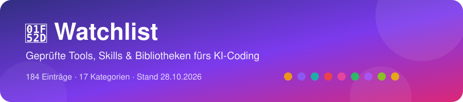

# Watchlist

Kuratierte Watchlist: seriöse Tools, Bibliotheken, Skills & Mods fürs KI-Coding – jeweils mit kurzer Erklärung, offiziellem Link und Einschätzung zu Vertrauen und Sicherheit.

**Stand: 2026-10-30** · 191 Einträge in 17 Kategorien · 138 Plugins/Skills/Hooks mit Sicherheits-Ampel: [🧩 MODS.md](MODS.md)

> [!CAUTION]
> **Keine Garantie.** Diese Liste ist eine persönliche, sorgfältig recherchierte Sammlung – aber kein Sicherheits-Audit. Projekte ändern sich schnell: **vor jeder Installation selbst prüfen** (Lizenz, Herkunft, Berechtigungen, Telemetrie) und **nichts ungeprüft ausführen**, insbesondere keine `curl | bash`-Installer. Alle Angaben ohne Gewähr.

> Sortierung: nach Kategorie, darin nach Status (empfohlen → Kandidat → beobachten), dann ID.
> Ganz oben: **⭐ Frameworks & Bibliotheken** – alles, was als Code-Baustein in eigene Apps eingebaut wird, mit „Wofür“ für Einsteiger.

## Inhaltsverzeichnis

| | |
| :-- | :-- |
| [**⭐ Frameworks & Bibliotheken**](#frameworks) 26 Einträge | [**🧠 Agent-Skills & Workflows**](#agent-skills) 26 Einträge |
| [**🧩 Plugins & Skill-Verzeichnisse**](#plugins) 7 Einträge | [**🎛️ Agent-Orchestrierung & -Ops**](#orchestrierung) 10 Einträge |
| [**📦 Sandboxing & Isolation**](#sandboxing) 9 Einträge | [**💾 Agent-Memory**](#memory) 10 Einträge |
| [**🛡️ Agent-Guardrails & Security**](#security) 12 Einträge | [**🔬 Reverse Engineering**](#reverse-engineering) 7 Einträge |
| [**🎨 Design für Agents & Visualisierung**](#design) 13 Einträge | [**🧪 Dev-Tooling & Testing**](#dev-tooling) 14 Einträge |
| [**🏗️ App-Builder & Agents**](#app-builder) 11 Einträge | [**🔎 Recherche & LLM-Routing**](#recherche) 6 Einträge |
| [**🤖 KI-Modelle & Medien (Bild/Video/Audio)**](#modelle) 15 Einträge | [**🖥️ Self-Hosting & Betrieb**](#selfhosting) 3 Einträge |
| [**💼 Self-Hosting: Business-Apps**](#business) 8 Einträge | [**🗓️ Planung & Aufgaben**](#planung) 9 Einträge |
| [**📚 Lernen & Wissen**](#lernen) 5 Einträge |  |

Textliste (für Skripte)

1. [⭐ Frameworks & Bibliotheken](#frameworks) (26)
   - [Animation, Scroll & 3D](#fw-animation) (9)
   - [UI-Komponenten](#fw-ui) (8)
   - [Weitere Code-Bibliotheken](#fw-code) (9)
2. [🧠 Agent-Skills & Workflows](#agent-skills) (26)
3. [🧩 Plugins & Skill-Verzeichnisse](#plugins) (7)
4. [🎛️ Agent-Orchestrierung & -Ops](#orchestrierung) (10)
5. [📦 Sandboxing & Isolation](#sandboxing) (9)
6. [💾 Agent-Memory](#memory) (10)
7. [🛡️ Agent-Guardrails & Security](#security) (12)
8. [🔬 Reverse Engineering](#reverse-engineering) (7)
9. [🎨 Design für Agents & Visualisierung](#design) (13)
10. [🧪 Dev-Tooling & Testing](#dev-tooling) (14)
11. [🏗️ App-Builder & Agents](#app-builder) (11)
12. [🔎 Recherche & LLM-Routing](#recherche) (6)
13. [🤖 KI-Modelle & Medien (Bild/Video/Audio)](#modelle) (15)
14. [🖥️ Self-Hosting & Betrieb](#selfhosting) (3)
15. [💼 Self-Hosting: Business-Apps](#business) (8)
16. [🗓️ Planung & Aufgaben](#planung) (9)
17. [📚 Lernen & Wissen](#lernen) (5)

Gesamt: 191 Einträge

> [!TIP]
> **Legende**  
> Status:  = gleich nutzen ·  = gut, gezielt einsetzen ·  = im Blick behalten ·  = aussortiert  
> Vertrauen:     
> Sicherheits-Ampel (Plugins/Skills/Hooks, siehe [MODS.md](MODS.md)): 🟢 unbedenklich · 🟡 nur mit Auflagen · 🔴 vorerst nicht installieren  
> Jede Zeile: **Eintrag & Bewertung** (ID, Link, GitHub-Sterne, Status, Vertrauen) · **Worum geht’s** (Erklärung, Haken, 🏷️ Kategorie-Tag, 🗓️ zuletzt geprüft).

> [!WARNING]
> **Sicherheitsprüfung 🔴 – nicht ungeprüft installieren:**  
> - [WL-049 LifeOS](#agent-skills): curl\|bash-Installer, ~40 Auto-Hooks  
> - [WL-051 HyperFrames](#fw-code): Telemetrie an, ungepinntes Skills-Update  
> - [WL-079 MCP for Blender](#design): Socket ohne Auth, curl\|sh, Selbst-Update  
> - [WL-121 html-anything (App)](#design): startet Claude Code mit bypassPermissions  
> - [WL-149 caveman (CLI)](#security): Telemetrie an, Proxy, sucht Logins – nur Plugin 🟡  
> - [WL-157 Ouroboros](#agent-skills): curl-Pipe-Installer, Telemetrie, Hook auf jedem Prompt  
> - [WL-006 davila7 – Context-Timeline-Hook](#agent-skills): CORS *, keine Auth  

## ⭐ Frameworks & Bibliotheken

> [!TIP]
> Code-Bausteine, die Claude direkt in deine eigenen Apps einbaut (per `npm install` / `pip install`). Pro Aufgabe reicht meist **eine** Bibliothek – z. B. GSAP *oder* anime.js, shadcn/ui *oder* Mantine *oder* MUI.

### Animation, Scroll & 3D

| Eintrag & Bewertung | Worum geht’s |
| :-- | :-- |
| **WL-034** [greensock/GSAP](https://github.com/greensock/GSAP)    `candidate` · `hoch` | **Wofür:** Animationen auf Webseiten (Profi-Standard, auch Scroll-Effekte). Profi-Standard für Web-Animation, ~30k★; seit Webflow-Übernahme komplett gratis inkl. aller Plugins (ScrollTrigger, SplitText …). **Lizenz:** eigene Webflow-„Standard No-Charge“-Lizenz, nicht OSI, nicht GPL-kompatibel; einzig verboten: ein visuelles Animations-Builder-Tool bauen, das mit Webflow konkurriert. npm 3.15.0, Push 2026-04-13. Offizielle Claude-Skills `greensock/gsap-skills` → vor Installation prüfen. 🏷️ `frontend/animation` · 🗓️ 2026-10-23 |
| **WL-035** [motiondivision/motion](https://github.com/motiondivision/motion)    `candidate` · `hoch` | **Wofür:** Animationen in React- und JavaScript-Apps. Ex-Framer-Motion, ~34k★, MIT, aktiv; einfache deklarative Animationen in React, auch Vanilla-JS-API. Guter Einstieg neben WL-037. 🏷️ `frontend/animation` · 🗓️ 2026-10-23 |
| **WL-036** [juliangarnier/anime (anime.js)](https://github.com/juliangarnier/anime)    `candidate` · `hoch` | **Wofür:** Leichte Animationen im Browser (schlanke GSAP-Alternative). Schlanke GSAP-Alternative, ~74k★, MIT, v4 (npm 4.5.0), Push 2026-08-21. Pro Projekt GSAP *oder* anime.js. 🏷️ `frontend/animation` · 🗓️ 2026-10-23 |
| **WL-037** [formkit/auto-animate](https://github.com/formkit/auto-animate)    `candidate` · `hoch` | **Wofür:** Automatische sanfte Übergänge mit einer Zeile Code. Eine Zeile Code → Listen/Elemente bekommen sanfte Übergänge (Hinzufügen, Löschen, Sortieren). ~14k★, MIT, Push 2026-07-10, keine Netzwerkzugriffe. **Bester Einstieg für Anfänger.** 🏷️ `frontend/animation` · 🗓️ 2026-10-23 |
| **WL-038** [LottieFiles/dotlottie-web](https://github.com/LottieFiles/dotlottie-web)    `candidate` · `mittel` | **Wofür:** Fertige Lottie-Animationen (Vektor-Animationsdateien) abspielen. Spielt fertige Animationsdateien ab (Icons, Erfolgs-Haken). ~1k★, MIT, aktiv; Nachfolger von `lottie-web` (verlangsamt, letzter Push 2025-09). Animationen selbst kommen aus LottieFiles-Bibliothek/Editor — Spieler braucht kein Konto. 🏷️ `frontend/animation` · 🗓️ 2026-10-23 |
| **WL-039** [darkroomengineering/lenis](https://github.com/darkroomengineering/lenis)    `candidate` · `mittel` | **Wofür:** Butterweiches Scrollen auf Webseiten. Butterweiches Scrollen, ~17k★, MIT, aktiv; oft kombiniert mit GSAP ScrollTrigger (WL-034). Für Formular-Apps übertrieben. 🏷️ `frontend/scroll` · 🗓️ 2026-10-23 |
| **WL-040** [mrdoob/three.js](https://github.com/mrdoob/three.js)    `watching` · `hoch` | **Wofür:** 3D im Browser. Die 3D-Bibliothek fürs Web, ~117k★, MIT, sehr aktiv. Nur einbinden, wenn 3D wirklich gebraucht wird (mehr Ladezeit). Community-Skills `CloudAI-X/threejs-skills` → vor Installation prüfen. 🏷️ `frontend/3d` · 🗓️ 2026-10-23 |
| **WL-041** [pmndrs/react-three-fiber + pmndrs/drei](https://github.com/pmndrs/react-three-fiber)    `watching` · `hoch` | **Wofür:** 3D im Browser, gebaut mit React. three.js als React-Bausteine (~33k★, MIT) plus Helfer-Sammlung drei (https://github.com/pmndrs/drei, ~10k★, MIT). Nur sinnvoll mit React und echtem 3D-Bedarf. 🏷️ `frontend/3d` · 🗓️ 2026-10-23 |
| **WL-042** [pixijs/pixijs](https://github.com/pixijs/pixijs)    `watching` · `hoch` | **Wofür:** Schnelle 2D-Grafik und Mini-Spiele im Browser. Sehr schnelle 2D-Grafik per WebGL/WebGPU, ~48k★, MIT, aktiv; eher für Spiele/Visualisierungen. 🏷️ `frontend/2d-webgl` · 🗓️ 2026-10-23 |

### UI-Komponenten

| Eintrag & Bewertung | Worum geht’s |
| :-- | :-- |
| **WL-110** [shadcn/ui](https://github.com/shadcn-ui/ui)    `candidate` · `hoch` | **Wofür:** Fertige Bausteine (Buttons, Formulare, Menüs) zum Reinkopieren in React-Apps. Kein fertiges Paket, sondern Bauteile (Buttons, Formulare, Dialoge), die als eigener Code in dein Projekt kopiert werden – die Basis für ein eigenes Design-System. Fast alle neuen UI-Sammlungen bauen darauf auf. ~126k★, MIT, Push 2026-10-23. **Install (offiziell):** `npx shadcn@latest init · Claude-Code-Anbindung (offizieller MCP): npx shadcn@latest mcp init --client claude`. Offiziell: https://ui.shadcn.com. **Haken:** Offizieller MCP-Server und „Registry“: Claude kann Bauteile per Sprache suchen und einbauen, auch aus Fremd-Registries (Magic UI, React Bits, Bklit). Nur React + Tailwind. 🏷️ `frontend/ui-components` · 🗓️ 2026-10-23 |
| **WL-111** [Magic UI](https://github.com/magicuidesign/magicui)    `candidate` · `hoch` | **Wofür:** Animierte Bausteine für Landingpages. Über 150 animierte Bausteine (Glanz-Effekte, Laufbänder, animierte Zahlen) zum Kopieren in React-Seiten. ~22.8k★, MIT, Push 2026-10-17. **Install:** Per shadcn-CLI, Anleitung: magicui.design/docs/installation. Offiziell: https://magicui.design. **Haken:** Basiert auf shadcn/ui + Tailwind + Motion. Grundbibliothek gratis; zusätzlich kostenpflichtiges „Pro“-Angebot (pro.magicui.design), nicht nötig. 🏷️ `frontend/ui-components` · 🗓️ 2026-10-23 |
| **WL-112** [React Bits](https://github.com/DavidHDev/react-bits)    `candidate` · `hoch` | **Wofür:** Auffällige animierte Effekte, Texte und Hintergründe für React. Große Sammlung auffälliger animierter Effekte, Texte und Hintergründe für React-Seiten. ~50.1k★, MIT + Commons Clause, Push 2026-10-19. **Install (offiziell):** `npx shadcn@latest add @react-bits/SplitText-TS-TW (Beispiel; Anleitung reactbits.dev/get-started/installation)`. Offiziell: https://reactbits.dev. **Haken:** Lizenz: in eigenen (auch kommerziellen) Seiten erlaubt, aber die Bauteile selbst nicht weiterverkaufen. Funktioniert über die shadcn-MCP auch direkt aus Claude Code. Es gibt eine Pro-Seite (/pro). 🏷️ `frontend/ui-components` · 🗓️ 2026-10-23 |
| **WL-114** [Bklit UI](https://github.com/bklit/bklit-ui)    `candidate` · `mittel` | **Wofür:** Animierte Diagramme und Daten-Bausteine für React. Schöne, animierte Diagramme und Daten-Bausteine (Linien-, Balkendiagramme) für React, mit Studio zum Ausprobieren. ~1.8k★, MIT, Push 2026-10-23. **Install (offiziell):** `npx shadcn@latest init && npx shadcn@latest add @bklit/line-chart`. Offiziell: https://ui.bklit.com. **Haken:** Jung (seit 01/2026), aber sehr aktiv, im Vercel-OSS-Programm. shadcn-Registry. 🏷️ `frontend/ui-components` · 🗓️ 2026-10-23 |
| **WL-115** [Mantine](https://github.com/mantinedev/mantine)    `candidate` · `hoch` | **Wofür:** Kompletter Baukasten mit 100+ Bausteinen für React-Apps. Komplette React-Bausteinkiste mit über 100 Komponenten und vielen Helfern (Formulare, Datum, Benachrichtigungen) – fertig gestylt, ohne Tailwind. ~31.9k★, MIT, Push 2026-10-21. **Install (offiziell):** `npm install @mantine/core @mantine/hooks (Anleitung: mantine.dev/getting-started)`. Offiziell: https://mantine.dev. **Haken:** Gut für Dashboards und Formular-Apps. Kein eigenes shadcn-Registry-System. 🏷️ `frontend/ui-components` · 🗓️ 2026-10-23 |
| **WL-116** [Material UI (MUI)](https://github.com/mui/material-ui)    `candidate` · `hoch` | **Wofür:** Bausteine im Google-Material-Design für React. Der Klassiker: React-Bausteine im Google-„Material Design“-Look, sehr ausgereift und weit verbreitet. ~99.3k★, MIT, Push 2026-10-23. **Install (offiziell):** `npm install @mui/material @emotion/react @emotion/styled (Anleitung: mui.com/material-ui/getting-started/installation)`. Offiziell: https://mui.com. **Haken:** Kern gratis; einige erweiterte Bausteine (MUI X Pro/Premium, z. B. Daten-Tabellen) kosten Geld. Look wirkt schnell nach „Google-App“. 🏷️ `frontend/ui-components` · 🗓️ 2026-10-23 |
| **WL-164** [thesysdev/openui (OpenUI)](https://github.com/thesysdev/openui)    `candidate` · `mittel` | **Wofür:** KI-Antworten als echte Oberfläche anzeigen (Diagramme, Formulare, Tabellen statt nur Text). OpenUI ist ein offener Standard plus Bibliothek für „Generative UI“: das Sprachmodell beschreibt in einer kompakten Sprache (OpenUI Lang), welche Bausteine es zeigen will, und die App rendert sie mit eigenen Komponenten. Für React, Vue, Svelte und Angular. ~14.1k★, MIT, seit 12/2024, Push 2026-10-26. **Install (offiziell):** `npx @openuidev/cli@latest create --name genui-chat-app` bzw. `npm install @openuidev/react-lang @openuidev/react-ui`; Claude-Code-Skill: `npx skills add thesysdev/skills --skill openui`. Offiziell: https://www.openui.com. **Haken:** Firma Thesys dahinter (seriös, aber kommerzielles Interesse); nur sinnvoll für Apps mit eigenem KI-Chat. Skill-Teil → vor Installation prüfen. 🏷️ `frontend/ui-components` · 🗓️ 2026-10-26 |
| **WL-113** [Kokonut UI (+ Pro)](https://github.com/kokonut-labs/kokonutui)    `watching` · `mittel` | **Wofür:** Schicke fertige Bausteine (Tailwind/shadcn-Stil). Schicke Bausteine auf Basis von shadcn/ui, Tailwind und Motion. ~2.2k★, MIT (Gratis-Teil), Push 2026-10-23. **Install:** Doku: kokonutui.com/docs (shadcn-CLI). Offiziell: https://kokonutui.com. **Haken:** Gratis-Version MIT. kokonutui.pro ist kostenpflichtig: 119 $ einmalig (Aktionspreis, sonst 159 $), Vorlagen einzeln 49–59 $, laut AGB keine Erstattung. Für das Starterpaket nur die Gratis-Variante. 🏷️ `frontend/ui-components` · 🗓️ 2026-10-23 |

### Weitere Code-Bibliotheken

| Eintrag & Bewertung | Worum geht’s |
| :-- | :-- |
| **WL-161** [FFmpeg](https://ffmpeg.org/)    `recommended` · `hoch` | **Wofür:** Video und Audio umwandeln, schneiden, Bilder oder Ton aus Videos ziehen, neu kodieren. Das kostenlose Open-Source-Standardwerkzeug (Programm `ffmpeg` + Bibliotheken libav*) für Video und Audio, seit 2000. Fast jede Video-App nutzt es im Hintergrund, auch mehrere Einträge unserer Mods-Liste: der Video-Schau-Skill claude-video (`/watch`, holt Videos mit yt-dlp und zieht mit FFmpeg Einzelbilder heraus) und die Video-Render-Skills wie HyperFrames (WL-051). Aktuell 9.0.2, GitHub-Spiegel ~65.7k★ (Entwicklung auf git.ffmpeg.org), Push 2026-10-24. **Install (offiziell):** Windows `winget install Gyan.FFmpeg` (Build von gyan.dev, auf ffmpeg.org verlinkt) · macOS `brew install ffmpeg` · Linux `sudo apt install ffmpeg`. Download-Seite: https://ffmpeg.org/download.html. **Lizenz:** LGPL 2.1+; Builds mit GPL-Teilen (z. B. x264, so auch Gyan „full“) stehen unter GPL. Für eigene Nutzung egal, beim Weitergeben in einer App die Lizenzpflichten beachten (https://ffmpeg.org/legal.html). **Haken:** Reines Kommandozeilen-Werkzeug ohne Oberfläche, Claude schreibt die Befehle. Nur aus offiziellen Quellen holen (ffmpeg.org bzw. die dort verlinkten Builds, winget/brew/apt) – keine „ffmpeg“-Downloads von fremden Seiten oder als .exe aus Videos/Foren. 🏷️ `ai-models/tooling` · 🗓️ 2026-10-24 |
| **WL-024** [stryker-mutator/stryker-js](https://github.com/stryker-mutator/stryker-js)    `candidate` · `hoch` | **Wofür:** Prüfen, ob Tests wirklich Fehler finden (Mutation-Testing). Mutation-Testing für JS/TS: baut gezielt kleine Fehler ein und zeigt, welche Tests sie nicht fangen — prüft, ob von Agents geschriebene Tests wirklich etwas testen. Seit 2016, ~3.2k★, Apache-2.0, Push 2026-10-10. 🏷️ `dev-tooling/testing` · 🗓️ 2026-10-15 |
| **WL-051** [HyperFrames](https://github.com/heygen-com/hyperframes)     `candidate` · `mittel` | **Wofür:** Videos und Motion Graphics aus HTML-Code rendern. Open-Source-Werkzeug von HeyGen: Claude baut Erklärvideos/Motion Graphics als HTML-Code, HyperFrames rendert sie lokal zu MP4. ~70.5k★, Apache-2.0, Push 2026-10-23. **Haken:** Firma HeyGen (seriös, aber kommerzielles Interesse). Rendern lokal, kein Konto nötig. Platz 1 bei skillselion (514k Installs). Sehr schnelles Wachstum seit 03/2026. Skill-Teil → vor Installation prüfen. **Sicherheitsprüfung 🔴 (vorerst):** Telemetrie standardmäßig an (PostHog), `hyperframes skills update` installiert ungepinnt per `npx … --global --yes`. 🟡 nur mit `HYPERFRAMES_NO_TELEMETRY=1`, nur Plugin, HeyGen bewusst. 🏷️ `design-for-agents/video` · 🗓️ 2026-10-23 |
| **WL-067** [Puppeteer](https://github.com/puppeteer/puppeteer)    `candidate` · `hoch` | **Wofür:** Browser per Code fernsteuern (Testen, Screenshots, PDFs). Steuert Chrome/Firefox per Code: Seiten öffnen, klicken, Screenshots, PDFs. Damit kann Claude deine App im Browser testen. ~95.7k★, Apache-2.0, Push 2026-10-23. **Haken:** Vom Chrome-Team, seit 2017. Lädt beim Installieren einen Chrome (~170 MB). 🏷️ `dev-tooling/browser-automation` · 🗓️ 2026-10-23 |
| **WL-082** [Unsloth](https://github.com/unslothai/unsloth)    `candidate` · `hoch` | **Wofür:** Offene KI-Sprachmodelle lokal anpassen (Finetuning). Werkzeug, um offene KI-Sprachmodelle auf dem eigenen Rechner zu nutzen und schnell anzupassen (Finetuning). ~78.5k★, Apache-2.0, Push 2026-10-23. **Haken:** NVIDIA-GPU nötig; große Modelle brauchen sehr viel Speicher. 🏷️ `ai-models/llm-runtime` · 🗓️ 2026-10-23 |
| **WL-175** [LightRAG](https://github.com/HKUDS/LightRAG)    `candidate` · `hoch` | **Wofür:** Eigene Dokumente für eine KI durchsuchbar machen (RAG mit Wissensgraph). Python-Bibliothek und Server der Universität Hongkong (HKUDS): liest deine Dokumente ein, baut daraus ein Netz aus Begriffen und ihren Beziehungen (Wissensgraph) und findet beim Fragen die passenden Stellen – genauer als reine Ähnlichkeitssuche. Mit Web-Oberfläche und API; Forschungsarbeit auf der EMNLP 2025 (arxiv 2410.05779). ~40.4k★, MIT, seit 10/2024, Push 2026-10-22. **Install (offiziell):** `uv tool install "lightrag-hku[api]"` (oder `pip install "lightrag-hku[api]"`), dann `.env` mit KI-Modell und Embedding-Modell ausfüllen und `lightrag-server` starten. Offiziell: https://github.com/HKUDS/LightRAG. **Haken:** Braucht ein KI-Modell und ein Embedding-Modell (Cloud-API kostet, lokal z. B. über Ollama). Der Server lauscht standardmäßig auf allen Netzwerk-Adressen (0.0.0.0) ohne Passwort → vor dem Start Login in `.env` setzen oder auf 127.0.0.1 beschränken. Lohnt sich erst bei vielen Dokumenten. 🏷️ `agent-memory` · 🗓️ 2026-10-27 |
| **WL-063** [AirLLM](https://github.com/lyogavin/airllm)    `watching` · `mittel` | **Wofür:** Sehr große KI-Modelle auf kleiner Grafikkarte ausführen. Lässt sehr große KI-Modelle auf kleinen Grafikkarten laufen, indem es sie Stück für Stück lädt. ~40.4k★, Apache-2.0, Push 2026-10-23. **Haken:** Sehr langsam (Schicht für Schicht); Einzelperson; für Claude-Code-Setup nur Nische (lokale Modelle). 🏷️ `ai-models/llm-runtime` · 🗓️ 2026-10-23 |
| **WL-102** [E2B](https://github.com/e2b-dev/E2B)    `watching` · `hoch` | **Wofür:** Code per SDK sicher in einer Cloud-Sandbox ausführen. Cloud-Sandboxen: Agent-Code läuft auf E2B-Servern in einer abgeschotteten Mini-VM, inklusive Notebook-Modus für Datenanalyse. ~14.5k★, Apache-2.0, Push 2026-10-23. **Install (offiziell):** `npm i @e2b/code-interpreter (Doku: e2b.dev/docs) – braucht E2B-Konto + API-Key`. Offiziell: https://e2b.dev. **Haken:** Cloud-Dienst mit Konto; Gratis-Kontingent, Produktion kostet Monatsgebühr; Sitzungen max. 24 h. Self-Hosting nur aufwendig (Terraform). Eher für eigene Agent-Apps als für den normalen Claude-Code-Alltag. 🏷️ `agent-sandbox/cloud` · 🗓️ 2026-10-23 |
| **WL-106** [Cloudflare Sandbox SDK](https://github.com/cloudflare/sandbox-sdk)    `watching` · `hoch` | **Wofür:** Sandbox-Container per SDK im Cloudflare-Netz starten. Container direkt im Cloudflare-Netz, in denen Agenten Befehle ausführen können. ~1.2k★, nicht eindeutig (NOASSERTION), Push 2026-10-23. **Install (offiziell):** `npm i @cloudflare/sandbox (braucht Cloudflare-Konto, Workers)`. Offiziell: https://sandbox.cloudflare.com/. **Haken:** Cloud-Dienst, nur für Leute, die schon mit Cloudflare Workers bauen. 🏷️ `agent-sandbox/cloud` · 🗓️ 2026-10-23 |

## 🧠 Agent-Skills & Workflows

<b>26 Einträge – 3 empfohlen, 14 Kandidat, 9 beobachten</b> – antippen zum Aufklappen

| Eintrag & Bewertung | Worum geht’s |
| :-- | :-- |
| **WL-001** [mattpocock/skills](https://github.com/mattpocock/skills)    `recommended` · `hoch` | v1.3.1 (2026-10-04): `/implement-spec`, `/pr`, `/retro`; GLOSSARY.md; Grill→Spec→Tickets→Implement→PR→Retro. Primärquelle Matt Pocock; ~292k★, MIT, aktiv (Push 2026-10-13). Erneut in TNNT-Repo-Rundschau 2026-10-09; Matt-Short zu `/retro` 2026-10-13. Neu im Repo: `/wayfinder` (große Vorhaben als Karte aus Entscheidungs-Tickets im Issue-Tracker; Matt-Short 2026-10-16: klein = direkt, mittel = `/grill-me`, groß = Wayfinder). Erneut in TNNT-GitHub-Top 2026-10-16. Offizielle Startseite: https://www.aihero.dev/skills (auch `claude plugins install mattpocock-skills`); ~301.6k★, Push 2026-10-22. 🏷️ `agent-skills` · 🗓️ 2026-10-23 |
| **WL-005** [anthropics/financial-services](https://github.com/anthropics/financial-services)    `recommended` · `hoch` | Offizielles Anthropic Financial-Services-Skills-Repo; passend für Finanz-Anwendungen. ~40k★, Apache-2.0, Push 2026-09-21; erneut bei TNNT 2026-10-14 (10 Finanz-Agents). 🏷️ `skills/finance` · 🗓️ 2026-10-15 |
| **WL-165** [anthropics/skills](https://github.com/anthropics/skills)    `recommended` · `hoch` | Das offizielle Skill-Repo von Anthropic: Beispiel-Skills (Design, Entwicklung, Kommunikation), der `skill-creator` zum Bauen eigener Skills und die Dokument-Skills (Word, PDF, PowerPoint, Excel), die Claude selbst intern nutzt. Die Referenz, wie gute Skills aussehen. ~184k★, Push 2026-10-09. **Install (offiziell):** `/plugin marketplace add anthropics/skills`, dann `/plugin install document-skills@anthropic-agent-skills` bzw. `example-skills@anthropic-agent-skills`. **Lizenz:** Beispiel-Skills Apache-2.0; die Dokument-Skills (docx/pdf/pptx/xlsx) nur „source-available“, also lesen und nutzen, aber nicht als eigenes Produkt weitergeben. **Haken:** Lückenschluss – stand bisher nur im Mods-Katalog. 🏷️ `agent-skills` · 🗓️ 2026-10-26 |
| **WL-003** [humanlayer/skills (`/show-me`)](https://github.com/humanlayer/skills)    `candidate` · `hoch` | Inspiration für Matts `/pr`; optional wenn Matt allein nicht reicht. 🏷️ `agent-skills` · 🗓️ 2026-10-07 |
| **WL-006** [davila7/claude-code-templates](https://github.com/davila7/claude-code-templates)     `candidate` · `hoch` | CLI/Templates hinter aitmpl.com; Skill-Discovery neben mattpocock/skills. **Sicherheitsprüfung 🔴 Context-Timeline-Hook:** lokaler Server ohne Auth mit `Access-Control-Allow-Origin: *` → nicht einsetzen; auch `npx claude-code-templates --mod` nicht ungepinnt (Tracking). 🏷️ `skills/tooling` · 🗓️ 2026-10-23 |
| **WL-007** [affaan-m/ECC](https://github.com/affaan-m/ECC)    `candidate` · `mittel` | Agent harness (Plan/TDD/Skills); viral ★ — Qualität vor Adoption; Überlapp zu sandcastle. Refresh 2026-10-23: ~287k★ (starkes Hype-Signal), MIT, Push 2026-10-20, Website ecc.tools; Install laut README `npx ecc-universal@2.2.3 install --guided`. Nur Teile nutzen, nicht parallel zu superpowers/mattpocock-skills. 🏷️ `agent-harness/skills` · 🗓️ 2026-10-23 |
| **WL-008** [alirezarezvani/claude-skills](https://github.com/alirezarezvani/claude-skills)    `candidate` · `mittel` | Große Skill-Sammlung; Fundgrube neben WL-001, nicht Ersatz; Trust per Skill. 🏷️ `skills` · 🗓️ 2026-10-07 |
| **WL-017** [addyosmani/agent-skills](https://github.com/addyosmani/agent-skills)    `candidate` · `hoch` | Addy Osmani, ~103k★, MIT, aktiv. 25 Skills/9 Commands (`/spec`→`/ship`, `/review`, `/webperf`). Ergänzung zu WL-001, kein Ersatz: Lifecycle überlappt stark, daher einzelne Skills per `--skill` picken statt Komplett-Install. 🏷️ `agent-skills` · 🗓️ 2026-10-08 |
| **WL-018** [cursor/plugins → pstack](https://github.com/cursor/plugins/tree/main/pstack)   `candidate` · `hoch` | Lauren Tans (poteto) Skill-Stack in der offiziellen Cursor-Org (Matt-Pocock-Live 2026-10-03; auch TNNT-Repo-Rundschau 2026-10-09). Claude-Code-Port `michael-denyer/pstack-claude` (~3.3k★, MIT) ist inoffiziell. **Lizenz geklärt 2026-10-23:** pstack-Ordner MIT (© Lauren Tan); cursor/plugins ~13.7k★ (Repo-Root ohne Lizenz), pstack zuletzt geändert 2026-10-22.. 🏷️ `agent-skills/workflow` · 🗓️ 2026-10-23 |
| **WL-027** [obra/superpowers](https://github.com/obra/superpowers)    `candidate` · `hoch` | Jesse Vincent (Prime Radiant): Skill-Framework, das vor dem Coden nach dem Ziel fragt, Spec in kurzen Stücken zeigt, dann Plan → TDD → Subagents. ~302k★, MIT, seit 2025-10, Push 2026-10-10, im offiziellen Claude-Marketplace. **Alternative zu WL-001, nicht zusätzlich:** gleicher Ablauf, Skills feuern automatisch — pro Projekt nur eins von beiden. Logo-Abruf meldet die Version an den Hersteller → `SUPERPOWERS_DISABLE_TELEMETRY=1`. 🏷️ `agent-skills/workflow` · 🗓️ 2026-10-19 |
| **WL-162** [google/elephant-goldfish-model (EGM)](https://github.com/google/elephant-goldfish-model)    `candidate` · `hoch` | Planungs-Workflow aus Google: eine „Elefant“-Sitzung kennt das ganze Projekt und schreibt mit dir den Plan, danach prüfen „Goldfisch“-Subagents ohne Vorwissen (sehen nur Plan und Code, nicht euren Chat) den Plan in mehreren Runden, bevor gebaut wird. Dazu Bootstrap (README je Ordner), Brainstorm, Entwurf, Review und „Drift“-Abgleich App gegen Plan. ~1.2k★, Apache-2.0, seit 09/2026, Push 2026-10-25. **Install (offiziell):** `claude plugin marketplace add google/elephant-goldfish-model && claude plugin install egm@egm`. Offiziell: https://egm.dev. **Haken:** Lohnt sich laut Google nur für große, teure Features, nicht für kleine Fixes. Konkurrenz zu superpowers/GSD/Ouroboros – pro Projekt nur einen Workflow. Schreibt laut Video eine Zeile in CLAUDE.md, die neuere Claude-Code-Versionen falsch beschreibt (Subagents dürfen inzwischen selbst Subagents starten) → nach Install prüfen. → vor Installation prüfen. 🏷️ `agent-skills/workflow` · 🗓️ 2026-10-26 |
| **WL-163** [android/skills](https://github.com/android/skills)    `candidate` · `hoch` | Offizielle Skills vom Android-Team bei Google: Anleitungen nach den Best Practices von developer.android.com, damit Claude Android-Apps sauber baut (Jetpack Compose, Architektur, Tests). ~9.8k★, Apache-2.0, seit 03/2026, Push 2026-10-23. **Install (offiziell):** `/plugin marketplace add android/skills`, dann `/plugin install android-skills@android-skills`. **Haken:** Nur relevant, wenn Android-Apps gebaut werden. → vor Installation prüfen. 🏷️ `skills` · 🗓️ 2026-10-26 |
| **WL-167** [vercel-labs/agent-skills](https://github.com/vercel-labs/agent-skills)    `candidate` · `hoch` | Vercels offizielle Skill-Sammlung: React- und Next.js-Best-Practices, Web-Design-Richtlinien, React-Native-Regeln, View-Transitions, Kompositions-Muster und Vercel-Deploy/Optimierung. ~33k★, Push 2026-10-14. **Install (offiziell):** `npx skills add vercel-labs/agent-skills` (einzeln mit `--skill react-best-practices`). Offiziell: https://skills.sh/vercel-labs/agent-skills. **Haken:** Keine Lizenzdatei im Repo; Vercel-Skills setzen teils ein Vercel-Konto voraus. Nur einzelne Skills picken. → vor Installation prüfen. 🏷️ `skills` · 🗓️ 2026-10-26 |
| **WL-181** [twostraws/SwiftUI-Agent-Skill](https://github.com/twostraws/SwiftUI-Agent-Skill)    `candidate` · `hoch` | Skill „SwiftUI Pro“ von Paul Hudson (Hacking with Swift, bekannter Swift-Lehrer): bringt Claude aktuelle SwiftUI-Regeln bei und prüft iPhone-/Mac-Code auf veraltete APIs, Bedienbarkeit (Accessibility) und Performance; Befehl `/swiftui-pro`. Weitere Skills vom selben Autor für SwiftData, Concurrency und Testing. ~6.4k★, MIT, seit 03/2026, Push 2026-10-26. **Install (offiziell):** `npx skills add https://github.com/twostraws/swiftui-agent-skill --skill swiftui-pro` oder in Claude Code `/plugin marketplace add twostraws/SwiftUI-Agent-Skill`, dann `/plugin install swiftui-pro@swiftui-agent-skill`. **Haken:** Nur relevant, wenn iOS-/Mac-Apps gebaut werden; überschneidet sich mit WL-158 – nur einen nehmen. Am 2026-10-16 nur wegen „kein Swift-Projekt“ (Projekt-Fit) abgelehnt, nach der Regel vom 23.10. (alles Seriöse fürs Claude-Code-Setup) neu bewertet. → vor Installation prüfen. 🏷️ `skills` · 🗓️ 2026-10-27 |
| **WL-184** [blader/humanizer](https://github.com/blader/humanizer)    `candidate` · `mittel` | Skill, der KI-Texte natürlicher klingen lässt: Er erkennt typische Muster von KI-Schreibe (Floskeln, übertriebene Gedankenstriche, geschwollene Formulierungen u. a.) und schreibt sie um, damit der Text nach Mensch klingt. Reines Markdown (der Skill ist eine einzige SKILL.md, kein Programmcode, schickt nichts nach außen) – nur für Texte nützlich (README, Doku, Posts), nicht für Code. **Herkunft:** 👥 Community (Siqi Chen, Einzelautor). ~61.6k★, MIT, seit 01/2026, Push 2026-10-16. **Install:** `/plugin marketplace add blader/humanizer`, dann `/plugin install humanizer@humanizer` (braucht Claude Code ab 2.1.142); vorher `claude plugin validate` laufen lassen. **Haken:** Ähnlich wie WL-141 (no-ai-slop) – nur einen von beiden nehmen. Sehr viele Sterne für einen Ein-Datei-Skill (Hype-Signal). **Sicherheitsprüfung 🟢 (geprüft 28.10., Stand v3.1.0):** Auflagen: die geprüfte SKILL.md von Stand `8c307f3` (v3.1.0) als Kopie nutzen statt `/plugin install` vom neuesten Stand; kein `npx skills add`; den Datei-Modus nur bei Dateien unter Versionskontrolle (Git) nutzen und danach den Diff prüfen. 🏷️ `skills` · 🗓️ 2026-10-28 |
| **WL-188** [morganlinton/BeautifulRust](https://github.com/morganlinton/BeautifulRust)    `candidate` · `mittel` | Drei Skills, die Claude sauberes, „idiomatisches“ Rust beibringen: `rust-best-practices` (lädt automatisch, sobald Rust geschrieben wird), `rust-review` (Prüfbericht mit Regel und Lösung je Fund) und `rust-port` (überträgt C/C++/Python/Go/JS nach Rust, Tests zuerst). Dazu eine fertige clippy-Konfiguration für CI. Inhalt aus bekannten Quellen zusammengefasst (Google Rust Style Guide, offizielle Rust API Guidelines, Effective Rust, Microsoft Pragmatic Rust Guidelines). Reiner Markdown-Skill, kein Programmcode. **Herkunft:** 👥 Community (Einzelautor Morgan Linton). ~1.4k★, MIT, seit 23.10.2026, Push 2026-10-28. Offiziell: https://www.beautifulrust.dev. **Install (offiziell):** `/plugin marketplace add morganlinton/BeautifulRust`, dann `/plugin install beautiful-rust@beautiful-rust` (oder `npx skills add morganlinton/BeautifulRust`). **Haken:** Erst eine Woche alt; Wirkungs-Test nur vom Autor selbst (29/30 statt 24/30 Prüfpunkte). Nur relevant für Rust-Projekte. → vor Installation prüfen (Skill-Teil). 🏷️ `skills` · 🗓️ 2026-10-29 |
| **WL-190** [Jakeschincariol/arena-skill](https://github.com/Jakeschincariol/arena-skill)    `candidate` · `mittel` | Skill „Arena“ für bessere Antworten statt immer neu fragen: `/arena` gibt dieselbe Aufgabe an viele Unter-Agenten (Standard 100, mit `--quick` 16), jeder mit einer anderen Denk-Strategie. Danach treten die Antworten im K.-o.-Turnier gegeneinander an (angreifen, verteidigen, verbessern), ein Richter bewertet nach festem Schema, am Ende bleibt eine Antwort übrig – zusammen mit den Angriffen, die sie überstanden hat. Gelesen: SKILL.md + `bracket.py` nutzen nur Python-Standardbibliothek, keine Netzaufrufe, alles landet in `.arena/`; eine Lösung wird nicht von selbst angewendet. **Herkunft:** 👥 Community (Jake Schincariol, Einzelautor). ~1.1k★, MIT, ein einziger Commit `df07b8e` (27.09.2026). **Install (festgelegt):** `git clone https://github.com/Jakeschincariol/arena-skill.git && cd arena-skill && git checkout df07b8e && cp -r skills/arena ~/.claude/skills/` (braucht Python 3.8+). **Haken:** Hohe Token-Kosten – rund 595 Agenten-Aufrufe bei 100 Agenten, 91 mit `--quick`. Springt auch ohne `/arena` an, wenn man eine Antwort „schlecht“ nennt oder „nochmal“ sagt (fragt dann laut SKILL.md vorher nach). Nur ein Commit, seitdem nichts gepflegt; im normalen Rechte-Modus Hunderte Datei-Freigaben. Kopie `hs487667/arena-skill` nicht nutzen. Sicherheitsprüfung ausstehend. 🏷️ `skills` · 🗓️ 2026-10-30 |
| **WL-049** [LifeOS (früher Personal AI Infrastructure / PAI)](https://github.com/danielmiessler/LifeOS)     `watching` · `mittel` | Großes „Rundum-Gerüst“ für Claude Code & Co.: Es lernt deine Ziele (TELOS), macht aus jeder Aufgabe überprüfbare Kriterien und arbeitet sie Schritt für Schritt mit Beweisen ab; dazu Gedächtnis, Hooks, Skills, Dashboards, Sprachausgabe. ~19.6k★, MIT, Push 2026-09-04. **Haken:** Sehr tiefer Eingriff in ~/.claude (Hooks, Settings, Skills, Gedächtnis), Install per „curl \| bash“ bzw. „Agent installiert sich selbst“ → nie ungeprüft. Viele eigene Kunstbegriffe (Euphoric Surprise, Hill Climbing) = Komplexität. Nicht mit superpowers/mattpocock/skills mischen. Seriöser Autor. → vor Installation prüfen. **Sicherheitsprüfung 🔴: curl\|bash-Installer, ~40 Auto-Hooks – nicht installieren.** 🏷️ `agent-harness/skills` · 🗓️ 2026-10-23 |
| **WL-135** [GSD Core (Get Shit Done)](https://github.com/open-gsd/gsd-core)    `watching` · `mittel` | Arbeitsablauf für Claude Code in fünf Schritten: besprechen, planen, ausführen, prüfen, ausliefern – jeder Schritt mit frischem Kontext, damit lange Projekte nicht „zerfasern“. ~10.8k★, MIT, Push 2026-10-23. **Install (offiziell):** `npx @opengsd/gsd-core@latest`. Offiziell: https://opengsd.net. **Haken:** Das bekannte Repo gsd-build/get-shit-done (64k★, früher glittercowboy) ist seit 31.05.2026 archiviert und verweist auf open-gsd/gsd-core. Konkurrenz zu superpowers (WL-027) – pro Projekt nur ein Workflow. Installer schreibt Commands/Skills → vor Installation prüfen. 🏷️ `agent-skills/workflow` · 🗓️ 2026-10-23 |
| **WL-141** [petergyang/no-ai-slop](https://github.com/petergyang/no-ai-slop)    `watching` · `mittel` | Skill, der über 20 typische „KI-Floskeln“ aus Texten entfernt, damit sie nach Mensch klingen. ~12.7k★, MIT, Push 2026-09-02. Offiziell: https://creatoreconomy.so/p/use-my-no-ai-slop-skill-to-remove-20-ai-slop-patterns. **Haken:** Aus Greg Isenberg Video 9_SZFIW7tus. Reiner Skill → vor Installation prüfen. 🏷️ `skills` · 🗓️ 2026-10-23 |
| **WL-157** [Q00/ouroboros](https://github.com/Q00/ouroboros)     `watching` · `mittel` | Klärt vor dem Bauen per Interview alle Entscheidungen, prüft danach die fertige App gegen den Plan und schickt Fehler zurück an den Agenten. ~6.3k★, MIT, Push 2026-10-23. **Haken:** Konkurrenz zu superpowers/GSD, pro Projekt nur einen Workflow nutzen. → vor Installation prüfen. **Sicherheitsprüfung 🔴 (vorerst) im Default / 🟡 gepinnt:** curl-Pipe-Installer von `main`, PostHog-Telemetrie standardmäßig an, Hook auf jedem Prompt. 🏷️ `agent-skills/workflow` · 🗓️ 2026-10-23 |
| **WL-158** [FloWritesCode/fwc-swiftui-skills](https://github.com/FloWritesCode/fwc-swiftui-skills)    `watching` · `mittel` | Skills für iPhone-Apps (SwiftUI, Liquid-Glass-Design von iOS 26, Layouts für faltbare iPhones). ~435★, MIT, Push 2026-10-08. **Haken:** Nur relevant, wenn iOS-Apps gebaut werden. → vor Installation prüfen. 🏷️ `skills` · 🗓️ 2026-10-23 |
| **WL-171** [coreyhaines31/marketingskills](https://github.com/coreyhaines31/marketingskills)    `watching` · `mittel` | Skill-Sammlung für Marketing: Landingpages besser konvertieren lassen (CRO), Werbetexte, SEO, Analytics und Wachstum. ~56.6k★, MIT, Push 2026-10-22. **Install (offiziell):** `npx skills add coreyhaines31/marketingskills` (einzeln z. B. `--skill cro copywriting`). **Haken:** Einzelautor; Nische (nur bei eigenen Webseiten/Produkten), einzelne Skills vor Gebrauch lesen. → vor Installation prüfen. 🏷️ `skills` · 🗓️ 2026-10-26 |
| **WL-172** [K-Dense-AI/scientific-agent-skills](https://github.com/K-Dense-AI/scientific-agent-skills)    `watching` · `mittel` | Große Skill-Bibliothek für Wissenschaft: 177 Skills und über 100 Forschungs-Datenbanken (Biologie, Chemie, Medizin, Wirkstoffsuche). ~54.6k★, MIT, v2.72, Push 2026-10-19. **Install (offiziell):** `npx skills add K-Dense-AI/scientific-agent-skills`. **Haken:** Nur für Forschungs-Arbeit; Firma K-Dense bewirbt eigene Bezahl-Plattform. Am 2026-10-20 noch wegen „kein Projekt-Fit“ abgelehnt – nach der neuen Regel (alles Seriöse fürs Claude-Code-Setup) neu bewertet. → vor Installation prüfen. 🏷️ `skills` · 🗓️ 2026-10-26 |
| **WL-183** [agentskills/agentskills (Agent Skills)](https://agentskills.io)    `watching` · `hoch` | Die offizielle Beschreibung des Skill-Formats (Spezifikation): Was in eine SKILL.md gehört (Name, Beschreibung, Anleitung), welche Ordner dazukommen dürfen und wie Agents Skills stufenweise laden. Ein Nachschlagewerk zum Lesen, wenn man eigene Skills baut – nichts zum Installieren. **Herkunft:** 👥 Community – das Format wurde laut README ursprünglich von Anthropic entwickelt und als offener Standard freigegeben, die eigene (verifizierte) GitHub-Org `agentskills` ist aber nicht die Anthropic-Org. ~26.7k★, Apache-2.0 (Doku CC-BY-4.0), Push 2026-08-09. GitHub: https://github.com/agentskills/agentskills. **Haken:** Nur Lesestoff; praktische Beispiele stehen in WL-165. 🏷️ `agent-skills` · 🗓️ 2026-10-28 |
| **WL-189** [t3dotgg/tstack](https://github.com/t3dotgg/tstack)    `watching` · `mittel` | Die Skills, die Theo Browne (t3.gg, Ping Labs) täglich nutzt, für Claude Code und Codex: Pull-Requests sauber anlegen (`file-pr`), durch CI und Review-Bots begleiten und echte Funde reparieren (`babysit-pr`), alte PRs aktualisieren (`modernize`), fremde PRs übernehmen (`takeover`) und Änderungen von mehreren Modellen verschiedener Anbieter prüfen lassen (`council`, `sol-loop`). `full-send` geht bis zum Merge ohne Aufsicht. **Herkunft:** 👥 Community (Theo Browne, bekannter Entwickler/YouTuber). ~2.3k★, MIT, seit 24.10.2026, Push 2026-10-28. **Install (offiziell):** `git clone https://github.com/t3dotgg/tstack` und `cp -R tstack/skills/* ~/.claude/skills/` (besser nur einzelne Skill-Ordner kopieren). **Haken:** Braucht eine angemeldete GitHub-CLI (`gh`) – die Skills handeln also mit deinen GitHub-Rechten; `full-send` merged ohne Rückfrage → nur `full-stop` oder einzelne Skills nehmen. `council`/`sol-loop` brauchen Modelle anderer Anbieter (Kosten extra). Sehr jung; überschneidet sich mit `/pr` aus WL-001. → vor Installation prüfen (Skill-Teil). 🏷️ `agent-skills/workflow` · 🗓️ 2026-10-29 |

## 🧩 Plugins & Skill-Verzeichnisse

<b>7 Einträge – 1 empfohlen, 2 Kandidat, 4 beobachten</b> – antippen zum Aufklappen

| Eintrag & Bewertung | Worum geht’s |
| :-- | :-- |
| **WL-002** [Claude Code native skills/doctor](https://code.claude.com/docs/en/skills)   `recommended` · `hoch` | Kein Clone-Repo: `/init`, prompt-audit, skill doctor, settings. Official Features. 🏷️ `agent-runtime` · 🗓️ 2026-10-07 |
| **WL-028** [anthropics/claude-plugins-official](https://github.com/anthropics/claude-plugins-official)    `candidate` · `hoch` | Offizielles, von Anthropic gepflegtes Verzeichnis geprüfter Claude-Code-Plugins (`/plugin install <name>@claude-plugins-official`). ~43k★, Apache-2.0, Push 2026-10-18. Gute erste Anlaufstelle vor Drittanbieter-Marketplaces; Aufnahme heißt aber nicht, dass jedes Plugin für sensible Projekte unbedenklich ist. 🏷️ `plugin-directory` · 🗓️ 2026-10-19 |
| **WL-168** [anthropics/knowledge-work-plugins](https://github.com/anthropics/knowledge-work-plugins)    `candidate` · `hoch` | Offizielle Anthropic-Plugins, die Claude zum Fachmann für eine Rolle machen (z. B. Vertrieb, Marketing, Recht, Finanzen, Support), mit Skills, Konnektoren und Slash-Befehlen. Gebaut für Claude Cowork, läuft auch in Claude Code. ~33.1k★, Apache-2.0, Push 2026-10-26. **Install (offiziell):** `claude plugin marketplace add anthropics/knowledge-work-plugins`, dann z. B. `claude plugin install sales@knowledge-work-plugins`. **Haken:** Eher für Büro-Arbeit als fürs Programmieren; Konnektoren brauchen Zugriff auf eigene Dienste. → vor Installation prüfen. 🏷️ `plugin-directory` · 🗓️ 2026-10-26 |
| **WL-078** [ComposioHQ/awesome-claude-skills](https://github.com/ComposioHQ/awesome-claude-skills)    `watching` · `mittel` | Kuratierte Linkliste mit Claude-Skills und Tools – gut zum Stöbern. ~77.8k★, keine Lizenz, Push 2026-09-18. **Haken:** Firma Composio wirbt darin auch für eigene Integrationen; Einträge einzeln prüfen. 🏷️ `plugin-directory` · 🗓️ 2026-10-23 |
| **WL-108** [botdirectory.ai](https://github.com/elie222/botdirectory.ai)    `watching` · `mittel` | Ein offenes Verzeichnis mit fertigen Prompt-Vorlagen für Dauer-Bots (Grok Bot, Rakazo u. a.), z. B. „Agent Smith“ räumt den Bot-Arbeitsplatz auf, „YouTube Research Analyst“ wertet Videos aus. ~275★, MIT, Push 2026-10-23. **Install:** Kein Install: Vorlage öffnen, Prompt kopieren bzw. „Add to Grok Bot“ (Link führt zur x.ai-Share-Seite). Offiziell: https://botdirectory.ai. **Haken:** Betreiber: Firma von (Elie Steinbock, auch Rakazo). Laut eigener Aussage nur ein Index, keine Prüfung – jede Vorlage vor Gebrauch lesen, v. a. Rechte/Integrationen. Für Claude Code nur als Ideenquelle (Prompts lassen sich als Skill/Routine nachbauen). 🏷️ `plugin-directory` · 🗓️ 2026-10-23 |
| **WL-169** [anthropics/claude-plugins-community](https://github.com/anthropics/claude-plugins-community)    `watching` · `mittel` | Das zweite offizielle Plugin-Verzeichnis von Anthropic, aber mit Plugins, die Dritte eingereicht haben (schreibgeschützter Spiegel, Einreichung über clau.de/plugin-directory-submission). ~4.8k★, Apache-2.0, Push 2026-10-26. **Install (offiziell):** `/plugin marketplace add anthropics/claude-plugins-community`. Erst WL-028 (offizielles Verzeichnis) nutzen. 🏷️ `plugin-directory` · 🗓️ 2026-10-26 |
| **WL-170** [wshobson/agents](https://github.com/wshobson/agents)    `watching` · `mittel` | Großer Plugin-Marktplatz eines Einzelautors: 94 Plugins mit rund 200 Agents, 185 Skills und 105 Befehlen (Python, JavaScript, Code-Review, Tests, Infrastruktur, Security), für Claude Code, Codex, Cursor und weitere. ~41.7k★, MIT, Push 2026-10-26. **Install (offiziell):** `/plugin marketplace add wshobson/agents`, dann einzelne Plugins installieren (z. B. `/plugin install python-development@claude-code-workflows`). **Haken:** Sehr groß → nur gezielt einzelne Plugins, sonst Kontext-Ballast; Überlapp mit WL-001/WL-017. → vor Installation prüfen. 🏷️ `plugin-directory` · 🗓️ 2026-10-26 |

## 🎛️ Agent-Orchestrierung & -Ops

<b>10 Einträge – 3 Kandidat, 7 beobachten</b> – antippen zum Aufklappen

| Eintrag & Bewertung | Worum geht’s |
| :-- | :-- |
| **WL-004** [mattpocock/sandcastle](https://github.com/mattpocock/sandcastle)    `candidate` · `hoch` | AFK Multi-Agent; erst nach stabiler Skill-Nutzung. Refresh 2026-10-23: ~8.6k★, MIT, Push 2026-10-20; Install `npm install --save-dev @ai-hero/sandcastle && npx sandcastle init`. Noch vor 1.0 (Review codeline.co 05/2026), braucht Docker/Podman + API-Key. Siehe auch Gruppe Sandboxing & Isolation. 🏷️ `agent-orchestration` · 🗓️ 2026-10-23 |
| **WL-010** [paperclipai/paperclip](https://github.com/paperclipai/paperclip)    `candidate` · `mittel` | OSS Agent-Org/Tasks/Permissions; ~102k★, MIT, sehr aktiv, aber ~6.000 offene Issues — Reife weiter prüfen; erneut bei TNNT 2026-10-14. 🏷️ `agent-ops` · 🗓️ 2026-10-15 |
| **WL-186** [anthropics/single-agent-loop-kit](https://github.com/anthropics/single-agent-loop-kit)    `candidate` · `hoch` | Offizielles Anthropic-Starterpaket zum Artikel „Building agents: When to fold subagents into your main agent loop“ (22.10.2026): Ein Skill, der ein bestehendes System mit vielen Subagents prüft und Schritt für Schritt zu **einer** Agenten-Schleife mit Skills und nachladbaren Tools umbaut – jeder Schritt wird vorher und nachher mit denselben Tests (Evals) gemessen, ein Subagent fliegt nur raus, wenn die Zahlen es zeigen. Kernaussagen des Artikels: lieber ein Modell mit einem Kontext, Abläufe als Skills, mehr als 30–50 Tools verschlechtern die Tool-Wahl; Anthropic hat den Systemprompt von Claude Code für neue Modelle um über 80 % gekürzt. Nützlich, wenn man eigene Agenten-Teams baut. **Herkunft:** 🏛️ offiziell (Anthropic). ~390★, Apache-2.0, seit 15.10.2026, Push 2026-10-21. Offiziell: https://claude.com/resources/articles/building-agents-when-to-fold-subagents-into-your-main-agent-loop. **Install (offiziell):** `git clone https://github.com/anthropics/single-agent-loop-kit`, dann `cp -r single-agent-loop-kit/skill <dein-repo>/.claude/skills/single-agent-loop` und in Claude Code „Run the single-agent-loop skill.“ sagen; Gratis-Test ohne API-Schlüssel: `KIT_MODEL=fake python3 evals/run_eval.py --variant smoke` im Beispiel `examples/support-desk`. **Haken:** Referenz-Implementierung, laut README „nicht gepflegt, keine Beiträge“; zielt auf Agenten, die man selbst auf der Claude-Plattform baut; echte Eval-Läufe kosten API-Guthaben (der Skill nennt vorher eine Token-Schätzung). → vor Installation prüfen (Skill-Teil). 🏷️ `agent-orchestration` · 🗓️ 2026-10-29 |
| **WL-023** [mvschwarz/openrig](https://github.com/mvschwarz/openrig)    `watching` · `mittel` | Feste Agent-Teams aus Claude Code/Codex mit Rollen und geteiltem Kontext. ~7k★, Apache-2.0, sehr aktiv. Überlappt WL-004 sandcastle und WL-010 paperclip; schreibt Provider-Hooks, kann Permission-Prompts umgehen, `curl \| sh`-Install, Windows nur über WSL2. Erst relevant, wenn Multi-Agent ansteht. 🏷️ `agent-orchestration` · 🗓️ 2026-10-12 |
| **WL-064** [Buzz (Block)](https://github.com/block/buzz)    `watching` · `mittel` | Team-Arbeitsplatz von Jack Dorseys Firma Block, in dem Menschen und KI-Agenten miteinander chatten, Code verwalten und Agents anlegen. ~36.3k★, Apache-2.0, Push 2026-10-23. **Haken:** Seriöse Firma (Block, auch „goose“), aber sehr jung (seit 03/2026) und will ganze Plattform ersetzen → viel Umstellung. 🏷️ `agent-ops` · 🗓️ 2026-10-23 |
| **WL-076** [herdr](https://github.com/herdrdev/herdr)    `watching` · `mittel` | Terminal-Programm, das viele parallel laufende Coding-Agent-Sitzungen übersichtlich verwaltet (wird auch von LifeOS genutzt). ~45.5k★, Apache-2.0, Push 2026-10-23. **Haken:** Sehr jung (seit 03/2026), Hype-Wachstum. 🏷️ `agent-orchestration` · 🗓️ 2026-10-23 |
| **WL-109** [Rakazo](https://github.com/elie222/rakazo)    `watching` · `mittel` | Selbst gehostete Open-Source-Alternative zu Grok Bot: dauerhafte KI-Kollegen mit eigenem Rechner, Routinen und Handy-App, mit frei wählbarem Modell. ~5.4k★, Apache-2.0, Push 2026-10-23. **Install (offiziell):** `curl -fsSLO https://raw.githubusercontent.com/elie222/rakazo/main/infra/compose/install-images.sh && bash install-images.sh (Docker nötig)`. Offiziell: https://rakazo.com. **Haken:** Erst seit 13.08.2026, Beta. Wirbt mit Login per Claude-Pro/Max-Abo: Das verstößt laut Anthropic-Regeln (Stand 02/2026) gegen die Nutzungsbedingungen, es drohen Sperren → nur mit API-Key oder lokalem Modell nutzen. Android-App als APK außerhalb des Play Store. 🏷️ `agent-ops` · 🗓️ 2026-10-23 |
| **WL-118** [1jehuang/jcode](https://github.com/1jehuang/jcode)    `watching` · `mittel` | Ein eigenes, sehr schnelles Agent-Programm (in Rust) als Alternative zu Claude Code, das viele Agenten parallel mit wenig Arbeitsspeicher laufen lässt. ~21.2k★, MIT, Push 2026-10-23. **Install (offiziell):** `curl -fsSL https://jcode.sh/install \| bash`. Offiziell: https://jcode.sh. **Haken:** Kein Claude-Code-Zusatz, sondern Ersatz. Wirbt mit „Claude OAuth“-Login: Claude-Abo in Fremd-Tools verstößt gegen Anthropic-Bedingungen (Sperrgefahr) → nur mit API-Key. Schnell gewachsen (seit 01/2026), Benchmarks sind Eigenangaben. 🏷️ `agent-orchestration` · 🗓️ 2026-10-23 |
| **WL-119** [omnigent-ai/omnigent](https://github.com/omnigent-ai/omnigent)    `watching` · `mittel` | Eine Steuerzentrale über mehreren Coding-Agenten (Claude Code, Codex, Cursor …): Sitzungen am Handy weiterführen, Agenten gegenseitig prüfen lassen, Regeln und Kostenlimits setzen. ~11k★, Apache-2.0, Push 2026-10-23. **Install (offiziell):** `curl -fsSL https://raw.githubusercontent.com/omnigent-ai/omnigent/main/scripts/install_oss.sh \| sh`. Offiziell: https://omnigent.ai. **Haken:** Jung (seit 06/2026), sehr aktiv. Installer bringt laut README auch die Databricks-CLI mit. Für Einsteiger zu groß; Überlapp mit sandcastle/openrig. 🏷️ `agent-orchestration` · 🗓️ 2026-10-23 |
| **WL-180** [cathrynlavery/codex-skill](https://github.com/cathrynlavery/codex-skill)    `watching` · `mittel` | Holt für Claude Code eine „zweite Meinung“ von OpenAIs Codex: Ein Hook schickt jeden Plan, den Claude im Plan-Modus erstellt, automatisch an Codex zur Prüfung, bevor du ihn freigibst; dazu manuelle Rückfragen an Codex. Prüfungen laufen nur lesend (`--sandbox read-only`). ~219★, MIT, Push 2026-09-20. **Install (offiziell):** `claude plugin marketplace add cathrynlavery/codex-skill && claude plugin install codex-skill@codex-skill` (vorher `npm install -g @openai/codex`). **Haken:** Braucht OpenAI-Zugang (Codex CLI mit API-Schlüssel oder ChatGPT-Konto) – jede Prüfung kostet dort extra; der Plan geht dabei an OpenAI. Hook auf jedem Plan → vor Installation prüfen. Gleiche Autorin wie WL-029. 🏷️ `agent-orchestration` · 🗓️ 2026-10-27 |

## 📦 Sandboxing & Isolation

<b>9 Einträge – 3 Kandidat, 6 beobachten</b> – antippen zum Aufklappen

| Eintrag & Bewertung | Worum geht’s |
| :-- | :-- |
| **WL-099** [Claude Code Sandbox (eingebaut) + anthropics/sandbox-runtime](https://github.com/anthropics/sandbox-runtime)    `candidate` · `hoch` | Claude Code kann sich selbst einzäunen: Befehle dürfen nur in deinem Projektordner schreiben und nur freigegebene Webseiten erreichen. Ohne Docker, direkt auf dem eigenen Rechner. ~5.7k★, Apache-2.0, Push 2026-10-23. **Install:** In Claude Code: /sandbox (Doku: code.claude.com/docs/en/sandboxing). Einzeln als Tool: npm install -g @anthropic-ai/sandbox-runtime. Offiziell: https://code.claude.com/docs/en/sandboxing. **Haken:** Offiziell von Anthropic. Leichtester Einstieg, aber schwächere Mauer als eine VM. Repo heißt jetzt anthropics/sandbox-runtime (früher anthropic-experimental). 🏷️ `agent-sandbox` · 🗓️ 2026-10-23 |
| **WL-100** [Claude Code Devcontainer (offiziell)](https://github.com/anthropics/claude-code/tree/main/.devcontainer)   `candidate` · `hoch` | Eine fertige „Bastelkiste“ für VS Code: Claude Code läuft in einem Container mit Firewall, die nur nötige Adressen durchlässt. Dein restlicher Rechner bleibt außen vor. ~153k (Claude-Code-Repo)★, proprietär (Anthropic-Nutzungsbedingungen), Push 2026-10-22. **Install:** VS Code + Erweiterung „Dev Containers“, Ordner .devcontainer aus dem Repo übernehmen, „Reopen in Container“ (Anleitung: code.claude.com/docs/en/devcontainer). Offiziell: https://code.claude.com/docs/en/devcontainer. **Haken:** Braucht Docker. Schützt laut Doku nicht vor allem: Bei bösartigen Repos kann der Container trotzdem Zugangsdaten im Container abgreifen. Anleitung codewithandrea.com erklärt das Schritt für Schritt. 🏷️ `agent-sandbox` · 🗓️ 2026-10-23 |
| **WL-101** [Docker Sandboxes (sbx)](https://github.com/docker/sbx-releases)    `candidate` · `hoch` | Docker startet für jeden Agenten eine eigene Mini-VM mit eigenem Kernel. Claude darf darin alles, dein Rechner bleibt unberührt; danach löschst du die Kiste einfach. ~470 (Release-Repo)★, proprietär (kostenlos nutzbar), Push 2026-10-23. **Install:** macOS: brew trust docker/tap && brew install docker/tap/sbx · Windows: winget install Docker.sbx · Linux: curl -fsSL https://get.docker.com \| sudo SBX=1 sh · dann: sbx run claude (Doku: docs.docker.com/ai/sandboxes). Offiziell: https://www.docker.com/products/docker-sandboxes/. **Haken:** Lokal gratis, auch kommerziell; Cloud-Sandboxen kosten ab 0,07 $/Std. Achtung: Darin läuft Claude standardmäßig mit --dangerously-skip-permissions (die Sandbox ist die Sicherung). CLI ist nicht Open Source. Guide: dev.to/pradumnasaraf. 🏷️ `agent-sandbox` · 🗓️ 2026-10-23 |
| **WL-075** [Daytona](https://github.com/daytonaio/daytona)    `watching` · `mittel` | Sichere Sandboxen, in denen KI-generierter Code laufen kann, ohne deinen Rechner zu gefährden. ~71.5k★, keine LICENSE-Datei im Repo erkennbar (früher AGPL-3.0) → klären, Push 2026-07-24 (archiviert). **Haken:** Vor allem Cloud-Dienst (kostenpflichtig nach Gratis-Guthaben); Code geht zu Daytona. Für Einzelpersonen eher Claude-Code-Sandbox nutzen. **Korrektur 2026-10-23:** Repo ist seit Juni 2026 archiviert (letzter Push 2026-07-24), Entwicklung läuft privat weiter → nur noch Cloud-Dienst (SaaS). Status bleibt watching, keine Empfehlung zum Selbst-Hosten. Gruppe → Sandboxing & Isolation. 🏷️ `agent-sandbox` · 🗓️ 2026-10-23 |
| **WL-103** [Modal](https://github.com/modal-labs/modal-client)    `watching` · `hoch` | Cloud-Rechner mit starken Grafikkarten auf Abruf, auch als Sandbox für Agenten. Für KI-Training und schwere Rechenjobs. ~527 (SDK)★, Apache-2.0 (nur SDK), Push 2026-10-23. **Install (offiziell):** `pip install modal && modal setup (Doku: modal.com/docs)`. Offiziell: https://modal.com. **Haken:** Reiner Cloud-Dienst mit Konto; GPU-Zeit kann teuer werden. Für normales Claude Code nicht nötig. 🏷️ `agent-sandbox/cloud` · 🗓️ 2026-10-23 |
| **WL-104** [Upstash Box](https://github.com/upstash/box)    `watching` · `mittel` | Cloud-Kiste, in der Claude Code direkt mitläuft: Repo klonen, Fehler fixen, Pull-Request öffnen – alles in der Cloud. ~42 (SDK)★, MIT (nur SDK), Push 2026-10-22. **Install (offiziell):** `npm i @upstash/box (Doku: upstash.com/docs/box) – braucht Upstash-Konto`. Offiziell: https://upstash.com/docs/box. **Haken:** Der verlinkte „Best Sandbox“-Artikel stammt von Upstash selbst und setzt das eigene Produkt auf Platz 1 – Werbung, keine neutrale Liste. SDK sehr jung. Code + GitHub-Token liegen beim Anbieter. 🏷️ `agent-sandbox/cloud` · 🗓️ 2026-10-23 |
| **WL-105** [Vercel Sandbox](https://github.com/vercel/sandbox)    `watching` · `hoch` | Abgeschottete Mini-VMs bei Vercel, um KI-generierten Code auszuführen und Vorschauen zu zeigen. ~215 (SDK)★, Apache-2.0 (nur SDK), Push 2026-10-22. **Install (offiziell):** `npm i @vercel/sandbox (braucht Vercel-Konto/Projekt)`. Offiziell: https://vercel.com/docs/vercel-sandbox. **Haken:** Cloud-Dienst; sinnvoll nur, wenn man ohnehin bei Vercel hostet. 🏷️ `agent-sandbox/cloud` · 🗓️ 2026-10-23 |
| **WL-107** [superagent-ai/vibekit](https://github.com/superagent-ai/vibekit)    `watching` · `niedrig` | Lässt Claude Code & Co. in einer sauberen Sandbox laufen und schwärzt dabei geheime Daten. ~1.9k★, MIT, Push 2026-01-13. Offiziell: https://vibekit.sh. **Haken:** Seit 9 Monaten kein Push mehr. Docker Sandboxes / Devcontainer sind die besser gepflegten Alternativen. 🏷️ `agent-sandbox` · 🗓️ 2026-10-23 |
| **WL-178** [akitaonrails/ai-jail](https://aijail.io)    `watching` · `mittel` | Kleines Programm, das Coding-Agents (Claude Code, Codex & Co.) in einen abgeschotteten Bereich sperrt: Der Agent darf nur im Projektordner schreiben, damit z. B. ein vertippter Löschbefehl nichts außerhalb kaputt macht. Unter Linux mit bubblewrap/Landlock/seccomp, unter macOS mit sandbox-exec. ~1.4k★, GPL-3.0, seit 03/2026, Push 2026-10-25. **Install (offiziell):** `brew tap akitaonrails/tap && brew install ai-jail` oder `cargo install --locked ai-jail`. Offiziell: https://aijail.io. **Haken:** Kein Windows. Laut Autor selbst „nicht 100 % sicher“: schützt vor Versehen, nicht vor bösartigem Code (dafür eine Wegwerf-VM nehmen); Zugangsdaten des Agents bleiben standardmäßig erreichbar. Einzelautor (Fabio Akita). Für Claude Code zuerst die eingebaute Sandbox (WL-099) bzw. Devcontainer (WL-100) nehmen. 🏷️ `agent-sandbox` · 🗓️ 2026-10-27 |

## 💾 Agent-Memory

<b>10 Einträge – 3 Kandidat, 7 beobachten</b> – antippen zum Aufklappen

| Eintrag & Bewertung | Worum geht’s |
| :-- | :-- |
| **WL-021** [thedotmack/claude-mem](https://github.com/thedotmack/claude-mem)    `candidate` · `mittel` | Session-Gedächtnis über Hooks: zeichnet Agent-Aktionen auf, fasst sie per KI zusammen, spielt Kontext in neue Sessions ein. ~100k★, Apache-2.0, sehr aktiv, seit 2025-08. **Auflage:** Standard ist gehosteter Dienst „CMEM Pro“ mit Login — nur mit `--provider host` bzw. `CLAUDE_MEM_ONLINE_OPTIN=false` lokal nutzen; nie in Sessions mit sensiblen Daten, weil alles mitgeschrieben wird. Bietet auch Grok-Bot-Install (liest Chat-Logs) — nicht ohne Prüfung. Update 2026-10-22: ~102k★, Push 2026-10-22; TNNT-Interview mit dem Macher (2026-10-21) zeigt geteiltes Gedächtnis zwischen Claude, ChatGPT und GrokBot, lokal oder eigener Server — Auflage bleibt. 🏷️ `agent-memory` · 🗓️ 2026-10-22 |
| **WL-050** [Telos](https://github.com/danielmiessler/Telos)    `candidate` · `hoch` | Vorlage (Markdown), in die du Mission, Ziele, Probleme und Werte schreibst – für dich, ein Team oder Projekt. Die KI kann damit Entscheidungen an deinen echten Zielen ausrichten. ~1.6k★, MIT, Push 2026-01-09. **Haken:** Reine Textvorlage, kein Code. Enthält dann persönliche Daten → nur privat speichern, nie in öffentliche Repos. Seit Jan. 2026 kein Push (fertige Vorlage, kein Problem). In LifeOS bereits eingebaut. 🏷️ `agent-memory` · 🗓️ 2026-10-23 |
| **WL-084** [EmbeddingGemma 2 (Google)](https://huggingface.co/google/embeddinggemma-2)   `candidate` · `hoch` | Kleines Google-Modell, das Texte in „Bedeutungs-Zahlen“ übersetzt – Grundlage für lokale Suche nach Sinn und Agent-Gedächtnis. Hugging Face ~193k Downloads, Apache-2.0, Push 2026-10. **Haken:** Läuft lokal; nur Baustein, kein fertiges Tool. 🏷️ `ai-models/embeddings` · 🗓️ 2026-10-23 |
| **WL-013** [vectorize-io/hindsight](https://github.com/vectorize-io/hindsight)    `watching` · `mittel` | Agent-Memory-Backend; kein aktueller Projekt-Schmerz. Für Claude-Code-Sessions ist WL-021 der konkretere Kandidat. ~52.5k★, MIT, Push 2026-10-21; Firma Vectorize dahinter, Cloud-Variante optional. Erneut bei TNNT 2026-10-21 — Bewertung unverändert. 🏷️ `agent-memory` · 🗓️ 2026-10-22 |
| **WL-026** [basicmachines-co/basic-memory](https://github.com/basicmachines-co/basic-memory)    `watching` · `mittel` | Agent-Gedächtnis als normale Markdown-Dateien auf der Platte, per MCP für Claude/Cursor lesbar — lokaler und durchschaubarer als WL-021. ~4.2k★, seit 2024-12, aktiv. **Haken:** AGPL-3.0 (kein Code in eigene Apps übernehmen), README wirbt stark für bezahlte Cloud, aktuelle Version braucht Vorab-Release von FastMCP. 🏷️ `agent-memory` · 🗓️ 2026-10-15 |
| **WL-065** [TencentDB Agent Memory](https://github.com/TencentCloud/TencentDB-Agent-Memory)    `watching` · `mittel` | Gemeinsames Langzeit-Gedächtnis für alle KI-Agenten eines Teams. ~29.9k★, Tencent-eigene Lizenz (NOASSERTION), Push 2026-10-21. **Haken:** Eigene Lizenz von Tencent prüfen; Cloud-Variante = Daten bei Tencent Cloud. Für Einzelpersonen claude-mem/basic-memory (WL-021/026) einfacher. 🏷️ `agent-memory` · 🗓️ 2026-10-23 |
| **WL-077** [Graphify](https://github.com/Graphify-Labs/graphify)    `watching` · `niedrig` | Macht aus Code, Doku und Datenbank-Schemas einen durchsuchbaren Wissens-Graphen für Agents. ~133.7k★, Apache-2.0, Push 2026-10-22. **Haken:** 133k★ in 6 Monaten = starkes Hype-Signal; Firma mit Cloud-Angebot. Erst prüfen. 🏷️ `agent-memory` · 🗓️ 2026-10-23 |
| **WL-123** [mksglu/context-mode](https://github.com/mksglu/context-mode)    `watching` · `niedrig` | Spart Kontext: Große Tool-Ausgaben (Logs, Webseiten) werden in einem Nebenprozess verarbeitet, nur das Wichtige landet bei Claude; dazu ein Sitzungs-Gedächtnis. ~31.9k★, Elastic License 2.0 (source-available), Push 2026-10-23. **Install:** In Claude Code: /plugin marketplace add mksglu/context-mode und /plugin install context-mode@context-mode. Offiziell: https://context-mode.com. **Haken:** Status watching/niedrig, **Sicherheitsprüfung ausstehend** (Plugin mit Hooks). Lizenz bestätigt ELv2: Privat/firmenintern nutzen ist erlaubt, nur nicht als Hosting-Dienst anbieten → rechtlich fürs Starterpaket ok. Weiter Warnsignal: Firmenlogos (Google, Meta, NVIDIA) im README ohne Beleg (Links ins Leere). Greift über Hooks tief ein → erst selbst prüfen. Bisher „ignored“, Vorschlag: „watching“. 🏷️ `agent-memory` · 🗓️ 2026-10-23 |
| **WL-150** [CodeAbra/iai-personal-memory-engine (IAI-PME)](https://github.com/CodeAbra/iai-personal-memory-engine)    `watching` · `niedrig` | Lokales Langzeit-Gedächtnis für Claude Code als MCP-Server: speichert jede Sitzung wörtlich auf deinem Rechner und gibt beim nächsten Gespräch automatisch die passenden Erinnerungen mit. ~912★, MIT, Push 2026-10-22. **Install (offiziell):** `python3.12 -m pip install -U iai-pme, dann in Claude Code: /plugin marketplace add CodeAbra/iai-personal-memory-engine und /plugin install iai-memory@iai-pme`. **Haken:** Kein Konto, keine Telemetrie, Embeddings laufen lokal. Es gibt aber einen täglichen Versions-Check und eine nächtliche „Konsolidierung“ über dein Claude-Abo, die standardmäßig an ist (abschalten mit IAI_MCP_REM_DISABLED=1). Faktisch ein Einzelprojekt: 196 von ca. 250 Commits stammen vom Autor, existiert seit 05/2026. Werbesprache wie „never forgets“, Benchmarks laut README „für die eigene Neugier“. Zum Vergleich: claude-mem (WL-021) hat 102k★ und Apache-2.0, basic-memory (WL-026) 4.3k★ und AGPL. Beide sind ausgereifter, deshalb kein Ersatz. Plugin mit Hooks → vor Installation prüfen. 🏷️ `agent-memory` · 🗓️ 2026-10-23 |
| **WL-187** [Notion MCP (offizieller Remote-Server)](https://developers.notion.com/guides/mcp/get-started-with-mcp)   `watching` · `hoch` | Der offizielle, von Notion gehostete MCP-Server: Claude Code kann damit deine Notion-Seiten und -Datenbanken durchsuchen, lesen und beschreiben. Im Video zeigen Andrew Warner und Nathan Baschez, wie man Notion als gemeinsames Gedächtnis für mehrere Agents nutzt (Claude, ChatGPT, GrokBot u. a.): ein „Operating Guide“ als zentrale Anleitung, strukturierte Datenbanken, dazu Notions offizieller Agent-Setup-Prompt (https://developers.notion.com/prompts/setup). **Herkunft:** 👥 Community (offiziell von Notion, nicht von Anthropic). **Install (offiziell):** `claude mcp add --transport http notion https://mcp.notion.com/mcp`, dann in Claude Code `/mcp` → Notion → im Browser anmelden (mit `--scope user` für alle Projekte). **Haken:** Nur sinnvoll, wenn man Notion ohnehin nutzt; Daten liegen in der Notion-Cloud, der Agent darf alles lesen/ändern, was dein Konto darf → nur einen eigenen Arbeitsbereich freigeben, nie für sensible Daten. Den alten lokalen Server `makenotion/notion-mcp-server` (Integration-Token) nicht mehr nehmen – laut Notion nicht mehr aktiv gepflegt. Jedes MCP kostet Kontext (mit `/context` prüfen). 🏷️ `agent-memory` · 🗓️ 2026-10-29 |

## 🛡️ Agent-Guardrails & Security

<b>12 Einträge – 5 Kandidat, 7 beobachten</b> – antippen zum Aufklappen

| Eintrag & Bewertung | Worum geht’s |
| :-- | :-- |
| **WL-033** [vercel-labs/deepsec](https://github.com/vercel-labs/deepsec)    `candidate` · `hoch` | Sicherheits-Scanner von Vercel Labs: kostenloser Muster-Scan (`deepsec scan`), dann KI-Prüfung der Treffer (`process`, `revalidate`), Ergebnis als Markdown-Bericht; Zustand nur im Ordner `.deepsec/`; `process --diff` prüft nur Änderungen (z. B. nach jedem Feature). ~8.2k★, Apache-2.0, seit 2026-04, Push 2026-09-29. **Auflagen:** Standard schickt Modell-Aufrufe über Vercel AI Gateway → eigenen Anthropic-Key nutzen; Code geht an den Modell-Anbieter; KI-Läufe können teuer werden → immer `--max-cost-usd` setzen und mit kleinem Modul starten. Refresh 2026-10-23: ~8.25k★, Push unverändert 2026-09-29. 🏷️ `security/code-scanning` · 🗓️ 2026-10-23 |
| **WL-144** [NVIDIA/SkillSpector](https://github.com/NVIDIA/SkillSpector)    `candidate` · `hoch` | Sicherheits-Scanner von NVIDIA, der Agent-Skills vor der Installation auf Schadcode, Prompt-Injection und Datenabfluss prüft. ~21.1k★, Apache-2.0, Push 2026-10-23. Offiziell: https://docs.nvidia.com/skills/scanning-agent-skills. **Haken:** Offizielles NVIDIA-Repo. Ideal als Werkzeug für Sicherheitsprüfungen; ersetzt aber keine menschliche Durchsicht. 🏷️ `security/code-scanning` · 🗓️ 2026-10-23 |
| **WL-147** [usestrix/strix](https://github.com/usestrix/strix)    `candidate` · `mittel` | KI-Penetrationstester: greift deine eigene App wie ein Hacker an und bestätigt echte Sicherheitslücken. ~71.4k★, Apache-2.0, Push 2026-10-23. Offiziell: https://strix.ai. **Haken:** Nur gegen eigene Apps einsetzen (rechtlich!). Kostet API-Tokens (Test: 3,55 $ pro Lauf, 6,3 Mio. Tokens). 🏷️ `security/code-scanning` · 🗓️ 2026-10-23 |
| **WL-166** [trailofbits/skills](https://github.com/trailofbits/skills)    `candidate` · `hoch` | Skills und Plugins der bekannten Sicherheitsfirma Trail of Bits: Code auf Schwachstellen prüfen, Audits, Tests und sichere Entwicklung mit KI. ~7.8k★, CC-BY-SA-4.0, Push 2026-10-24. **Install (offiziell):** `/plugin marketplace add trailofbits/skills`, dann über `/plugin` einzelne Plugins wählen. Siehe auch `trailofbits/claude-code-config` (empfohlene Sicherheits-Einstellungen). **Haken:** Teils sehr fachlich; Lizenz verlangt Namensnennung und gleiche Lizenz bei Weitergabe veränderter Skills. → vor Installation prüfen. 🏷️ `security/code-scanning` · 🗓️ 2026-10-26 |
| **WL-185** [microsoft/TokenEconomizer](https://github.com/microsoft/TokenEconomizer)    `candidate` · `hoch` | Plugin von Microsoft Research (mit UC Berkeley), das Claude Code billiger macht, ohne dass du anders arbeitest: Es lernt aus deinen bisherigen Sitzungen in einem Repo und (1) merkt sich wiederkehrende Fakten als „Micro-Skills“ (z. B. „hier heißt es `python -m pytest`“) und gibt sie jeder neuen Sitzung mit, (2) schaltet Tools (auch MCP-Tools) ab, die über mehrere Sitzungen nie benutzt wurden, und (3) schubst Claude an, wenn es sich in einer Fehlerschleife festfährt (bricht nie selbst ab). Laut Paper 18–31 % weniger Kosten auf SWE-Bench, ohne schlechtere Ergebnisse. Alles Gelernte bleibt lokal in `~/.tokeneconomizer`, kein eigener API-Schlüssel nötig (läuft über dein Claude-Login). **Herkunft:** 👥 Community (Microsoft, nicht Anthropic). ~450★, Apache-2.0, seit 13.10.2026, Push 2026-10-29. Offiziell: https://tokeneconomizer.github.io (Paper arXiv 2610.22732). **Install (offiziell):** `git clone https://github.com/microsoft/TokenEconomizer.git`, dann `claude plugin marketplace add "$PWD/TokenEconomizer"` und `claude plugin install tokeneconomizer@tokeneconomizer`; in Claude Code `/tokeneconomizer:status` und einmal `/tokeneconomizer:toolprune refresh-catalog` (Ordner muss liegen bleiben, Update per `git pull`). **Haken:** Sehr jung (2 Wochen alt); laut README nur mit Claude Code 2.1.300–2.1.310 getestet; braucht Python 3.10+; greift über Hooks ein und ändert beim Tool-Abschalten deine Claude-Code-Einstellungen (mit einem Befehl umkehrbar); die Prüf-Aufrufe (Fakten, Schleifen-Richter) kosten selbst ein wenig vom Abo. Ergänzt rtk (WL-074) und caveman (WL-149), statt sie zu ersetzen. → vor Installation prüfen (Plugin mit Hooks). 🏷️ `agent-guardrails/token` · 🗓️ 2026-10-29 |
| **WL-019** [coldteadotai/abide](https://github.com/coldteadotai/abide)    `watching` · `mittel` | Prüft jede Agent-Edit gegen Regeln aus AGENTS.md. 564★, MIT, erst 3 Wochen alt; braucht bezahlten TypeSafe-Key und schickt Diffs an TypeSafe — nicht für sensiblen Code ohne Prüfung. 🏷️ `agent-guardrails` · 🗓️ 2026-10-08 |
| **WL-020** [RiskAverseTech/toolgate](https://github.com/RiskAverseTech/toolgate)    `watching` · `niedrig` | Tool-Call-Firewall (destruktiv, Exfiltration, Secrets) als Claude-Code-Hook oder MCP-Proxy; Konzept passt gut, aber 12★ und 3 Wochen alt, abhängig von TypeSafe-API. 🏷️ `agent-guardrails` · 🗓️ 2026-10-08 |
| **WL-048** [SecLists](https://github.com/danielmiessler/SecLists)    `watching` · `hoch` | Riesige Sammlung von Testlisten für Sicherheitsprüfungen (häufige Passwörter, Pfade, Angriffs-Muster), um die EIGENE App auf Schwachstellen abzuklopfen. ~74.3k★, MIT, Push 2026-10-23. **Haken:** Seriöser Standard bei Pentestern (OWASP-nah), aber nur für eigene Systeme. Enthält Web-Shells/Payloads → Virenscanner schlagen an; nicht in Projekt-Repos kopieren. Für Einsteiger erst mit deepsec (WL-033) starten. 🏷️ `security/wordlists` · 🗓️ 2026-10-23 |
| **WL-074** [rtk (Rust Token Killer)](https://github.com/rtk-ai/rtk)    `watching` · `mittel` | Hook, der Terminal-Ausgaben kürzt, bevor Claude sie liest – soll Tokens sparen. ~84.4k★, Apache-2.0, Push 2026-10-23. **Haken:** Unabhängige Tests (JetBrains 07/2026, Glia, arXiv) fanden KEINE Kostenersparnis, teils +6–8 % Kosten. Greift per PreToolUse-Hook in jeden Bash-Befehl ein → vor Installation prüfen. 🏷️ `agent-guardrails/token` · 🗓️ 2026-10-23 |
| **WL-149** [JuliusBrussee/caveman](https://github.com/JuliusBrussee/caveman)     `watching` · `mittel` | Lässt Claude knapp wie ein Höhlenmensch antworten und spart so Tokens. ~114.6k★, Apache-2.0, Push 2026-10-23. Offiziell: https://docs.caveman.so/caveman. **Haken:** Wirbt mit 65 % Ersparnis, unabhängiger Test: ~33 % weniger Input-Tokens. 114k Sterne in 6 Monaten = Hype. Enthält Proxy → vor Installation prüfen. **Sicherheitsprüfung 🔴 (vorerst; nur das Plugin 🟡):** CLI mit Telemetrie standardmäßig an (Supabase, mit IP), sucht nach vorhandenen Logins und bringt einen Proxy mit. Nur Plugin: `/plugin marketplace add JuliusBrussee/caveman` + `/plugin install caveman@caveman`, gepinnt auf v4.0.1. 🏷️ `agent-guardrails/token` · 🗓️ 2026-10-23 |
| **WL-152** [nizos/probity](https://github.com/nizos/probity)    `watching` · `mittel` | Wacht per Hooks darüber, dass Claude Code testgetrieben arbeitet: blockiert verbotene Muster und Commits, solange Tests fehlschlagen. ~234★, MIT, Push 2026-10-12. **Haken:** Aus dem Reddit-Hooks-Thread, dort vom Autor selbst genannt. Klein und jung (seit 04/2026). Hook-Plugin → vor Installation prüfen. 🏷️ `agent-guardrails` · 🗓️ 2026-10-23 |
| **WL-155** [JayPokale/Chisle](https://github.com/JayPokale/Chisle)    `watching` · `niedrig` | Spart Tokens: knappere Antworten, kein unnötiger Code, gekürzte Tool-Ausgaben. ~709★, MIT, Push 2026-10-23. **Haken:** Gleiche Idee wie caveman, die Ersparnis ist ein Eigentest des Autors. Nur eins von beiden nehmen. → vor Installation prüfen. 🏷️ `agent-guardrails/token` · 🗓️ 2026-10-23 |

## 🔬 Reverse Engineering

> [!WARNING]
> **Nur für eigene Software oder wo erlaubt – Lizenz/Recht des Herstellers beachten.**

<b>7 Einträge – 2 Kandidat, 5 beobachten</b> – antippen zum Aufklappen

| Eintrag & Bewertung | Worum geht’s |
| :-- | :-- |
| **WL-085** [Ghidra (NSA)](https://github.com/NationalSecurityAgency/ghidra)    `candidate` · `hoch` | Profi-Werkzeug, das fertige Programme zurück in lesbaren Code übersetzt (Reverse Engineering), z. B. für Sicherheitsprüfungen. ~93.5k★, Apache-2.0, Push 2026-10-22. **Haken:** Nur für eigene oder erlaubte Software (AGB/Urheberrecht). Java-Programm, Einarbeitung nötig. 🏷️ `security/reverse-engineering` · 🗓️ 2026-10-23 |
| **WL-086** [ILSpy](https://github.com/icsharpcode/ILSpy)    `candidate` · `hoch` | Zeigt den Quellcode von .NET-Programmen, z. B. um eigene Apps zu debuggen. ~26.8k★, MIT, Push 2026-10-23. **Haken:** Seit 2011; nur eigene/erlaubte Software. 🏷️ `dev-tooling/reverse-engineering` · 🗓️ 2026-10-23 |
| **WL-032** [morluto/rea](https://github.com/morluto/rea)    `watching` · `mittel` | MCP-Server (~170 Tools) + global installierter Skill: verfolgt Klicks bis zum Request, sichert Belege, labelt Funde als gesehen/vermutet/unbekannt; Site-Checkup und Key-Leak-Suche. MIT, seit 2026-04, sehr aktiv. **Vorsicht:** ~327k★ in 6 Monaten (+~49k seit 2026-10-16) = Hype-Signal; tiefer Eingriff in Claude-Ordner; laut README nur für Software, die man besitzt oder prüfen darf — Fremd-Apps nachbauen kann gegen AGB/Urheberrecht verstoßen. Erst Audit, dann ggf. auf eigene Apps. Quellen: AI LABS 2026-10-15, TNNT 2026-10-15/16, GitHub Trending #1. TNNT 2026-10-19 zeigt v. a. Klone fremder Apps inkl. Premium-Features → Rechtsrisiko bestätigt, Status bleibt watching. Update 2026-10-23: ~371k★ (+~44k seit 22.10.), #1 im GitHub-Topic developer-tools; AI Search 2026-10-06 zeigt das KI-Reverse-Engineering-Umfeld (Ghidra WL-085, ghidra-mcp WL-089, IDA MCP WL-090) → Hype-Signal steigt, Status bleibt watching. 🏷️ `security/reverse-engineering` · 🗓️ 2026-10-23 |
| **WL-089** [ghidra-mcp (bethington)](https://github.com/bethington/ghidra-mcp)    `watching` · `mittel` | Lässt Claude das Reverse-Engineering-Werkzeug Ghidra bedienen (über 200 Werkzeuge). ~5.9k★, Apache-2.0, Push 2026-10. **Haken:** Einzelperson; MCP-Teil → vor Installation prüfen; nur für eigene/erlaubte Software. 🏷️ `security/reverse-engineering` · 🗓️ 2026-10-23 |
| **WL-090** [IDA MCP (Hex-Rays)](https://github.com/HexRaysSA/ida-mcp)    `watching` · `hoch` | Offizieller Weg, damit Claude den Profi-Disassembler IDA bedienen kann. ~1.4k★, MIT, Push 2026-10. **Haken:** Offiziell vom Hersteller, aber IDA Pro ist kostenpflichtig; MCP → vor Installation prüfen. 🏷️ `security/reverse-engineering` · 🗓️ 2026-10-23 |
| **WL-091** [Cpp2IL](https://github.com/SamboyCoding/Cpp2IL)    `watching` · `mittel` | Übersetzt Unity-Spiele (IL2CPP) zurück in lesbaren Code. ~3.1k★, MIT, Push 2026-10. **Haken:** Laut Repo „work in progress“, Einzelperson; nur erlaubte Software. 🏷️ `dev-tooling/reverse-engineering` · 🗓️ 2026-10-23 |
| **WL-177** [morluto/awesome-reverse-engineering](https://github.com/morluto/awesome-reverse-engineering)    `watching` · `mittel` | Kuratierte Linkliste zum Reverse Engineering: Werkzeuge und Lernmaterial für Programmdateien, Apps, Firmware, Dateiformate und Netzwerkprotokolle, jeweils mit kurzer Beschreibung (u. a. Ghidra WL-085, Kurse wie pwn.college oder „Reverse Engineering for Beginners“). Reine Liste, nichts zu installieren. ~1.3k★, CC0-1.0, seit 09.10.2026, Push 2026-10-25. **Haken:** Sehr jung; von den Machern von rea (WL-032), das ganz oben als „Featured“ beworben wird. Die verlinkten Werkzeuge einzeln prüfen; nur für eigene oder erlaubte Software. 🏷️ `security/reverse-engineering` · 🗓️ 2026-10-27 |

## 🎨 Design für Agents & Visualisierung

<b>13 Einträge – 1 empfohlen, 5 Kandidat, 7 beobachten</b> – antippen zum Aufklappen

| Eintrag & Bewertung | Worum geht’s |
| :-- | :-- |
| **WL-009** [pbakaus/impeccable](https://github.com/pbakaus/impeccable)    `recommended` · `hoch` | Design-Skill+CLI gegen AI-Frontend-Slop: 1 Skill, 24 Commands, 59 Detektoren; `npx impeccable install`; Apache-2.0; ~80k★, Push 2026-10-12; Primärquelle TNNT-Interview mit Paul Bakaus (2026-10-12). 🏷️ `design-for-agents` · 🗓️ 2026-10-13 |
| **WL-025** [google-labs-code/stitch-skills (+ `@google/stitch` CLI)](https://github.com/google-labs-code/stitch-skills)    `candidate` · `hoch` | Offizielle Google-Labs-Skills für Stitch (KI-Design-App), seit 2026-10-01 auch als CLI direkt aus Claude Code/Cursor nutzbar. ~8.5k★, Apache-2.0. Ergänzt WL-009 Impeccable (Impeccable lokal = Kritik/Feinschliff, Stitch = Entwürfe erzeugen). **Auflage:** Google-Login nötig, Entwürfe und Dev-Server-Snapshots gehen an Google → nicht für Apps mit sensiblen Daten. 🏷️ `design-for-agents` · 🗓️ 2026-10-15 |
| **WL-029** [cathrynlavery/diagram-design](https://github.com/cathrynlavery/diagram-design)    `candidate` · `mittel` | Agent-Skill, der Diagramme als eine eigenständige HTML+SVG-Datei im eigenen Stil zeichnet (45 Typen, Import aus draw.io/Mermaid/Excalidraw, Export PNG/SVG). ~58k★ in 6 Monaten (Hype-Tempo), MIT, CI, Push 2026-10-16. Reiner Skill, kein Netzwerkzugriff nötig. 🏷️ `skills/visualization` · 🗓️ 2026-10-19 |
| **WL-030** [dembrandt/dembrandt (+ dembrandt-skills)](https://github.com/dembrandt/dembrandt)    `candidate` · `mittel` | Liest das Design-System einer laufenden Seite aus (Farben, Schrift, Abstände) und schreibt es als `design.md`, nach der sich der Agent richtet; Vorher/Nachher-Scan fängt versehentliche Design-Änderungen. CLI + MCP, lokal über Playwright-Chromium. ~3.7k★, MIT, seit 2025-11, Push 2026-10-11; Skills-Repo erst 119★. Ergänzt WL-009 Impeccable (Kritik) um ein festes Stil-Dokument. Nur auf eigene Apps anwenden. 🏷️ `design-for-agents` · 🗓️ 2026-10-19 |
| **WL-079** [MCP for Blender (ex blender-mcp)](https://github.com/ahujasid/mcp-for-blender)     `candidate` · `mittel` | Verbindet Claude mit dem 3D-Programm Blender: Claude baut 3D-Modelle und Szenen per Chat. ~32.1k★, MIT, Push 2026-10-20. **Haken:** Community-Projekt, nicht offiziell von Blender; führt beliebigen Python-Code in Blender aus; Repo wurde umbenannt; Telemetrie prüfen. **Sicherheitsprüfung 🔴 (vorerst):** Standard-Telemetrie, `curl \| sh`-Installer, Socket ohne Auth für beliebiges Python, Selbst-Update von `main`. 🏷️ `design-for-agents/3d` · 🗓️ 2026-10-23 |
| **WL-182** [text-to-cad](https://www.texttocad.dev)    `candidate` · `mittel` | Plugin mit 12 CAD-Skills: Claude baut 3D-Modelle aus Text-Beschreibungen (per Code) und gibt sie als STEP, STL, 3MF, GLB oder DXF aus, bis hin zu G-Code für 3D-Drucker; mit lokalem Viewer, der die Modelle im Chat bzw. Browser zeigt. ~23.4k★, MIT, seit 04/2026, Push 2026-10-27. **Install (offiziell):** `claude plugin marketplace add earthtojake/text-to-cad#latest && claude plugin install text-to-cad@earthtojake` (braucht `uv`). Offiziell: https://www.texttocad.dev. **Haken:** Sehr schnelles Wachstum seit 04/2026 (Hype-Signal); Einzelautor; keine Genauigkeits-Messungen – Maße vor dem Drucken immer selbst prüfen. Startet einen lokalen Server und lädt beim ersten Lauf das Programm cadgen nach → vor Installation prüfen. Am 2026-10-12 nur wegen „kein Projekt-Fit“ abgelehnt, nach der Regel vom 23.10. (alles Seriöse fürs Claude-Code-Setup) neu bewertet. 🏷️ `design-for-agents/3d` · 🗓️ 2026-10-27 |
| **WL-046** [Architecture Dissector](https://github.com/flaviocopes/architecture-dissector)    `watching` · `mittel` | Mac-App, die als Bild zeigt, wie deine App aufgebaut ist: Bausteine, Abläufe und gespeicherte Daten. Den „Bauplan“ schreibt dein Coding-Agent, die App zeichnet ihn. ~9★, MIT, Push 2026-10-08. **Haken:** Sehr neu (seit 05.10.), nur 9★, aber bekannter Autor (Flavio Copes, Lehrbuch-Autor). Liest Ordner nur lesend, Daten bleiben lokal. Prüft täglich GitHub auf Updates (Auto-Update). Nur macOS. Bringt einen Agent-Skill mit → vor Installation prüfen. 🏷️ `skills/visualization` · 🗓️ 2026-10-23 |
| **WL-053** [The Kitchen (dqnamo)](https://www.dqnamo.com/kitchen)   `watching` · `niedrig` | Sammlung verspielter, hochwertiger React-UI-Bausteine (Kassettenplayer, Beleg-Drucker beim Checkout, Halten-zum-Bestätigen), Code zum Kopieren direkt auf der Seite. unklar (keine Lizenz angegeben). **Haken:** Kein öffentliches Repo, keine Lizenz → rechtlich nur zum Anschauen/Lernen, nicht 1:1 übernehmen. Einzelperson. Short nutzt „Kommentiere BLOCKS“-Köder. 🏷️ `design-inspiration` · 🗓️ 2026-10-23 |
| **WL-121** [nexu-io/html-anything](https://github.com/nexu-io/html-anything)     `watching` · `mittel` | Ein Editor, in dem dein lokaler Agent (z. B. Claude Code) aus Text schöne HTML-Seiten macht: Artikel, Folien, Poster, Social-Media-Karten – mit 75 Vorlagen. ~9.2k★, Apache-2.0, Push 2026-10-13. **Install (offiziell):** `git clone https://github.com/nexu-io/html-anything && cd html-anything && pnpm install && pnpm -F @html-anything/next dev`. Offiziell: https://open-design.ai/html-anything/. **Haken:** Nutzt dein eingeloggtes Claude-Code-Programm selbst (erlaubt). Jung (seit 05/2026), stark auf chinesische Plattformen ausgerichtet. Vorlagen sind Skills → vor Installation prüfen. **Sicherheitsprüfung 🔴 (vorerst) App / 🟡 Templates:** App startet Claude Code mit `bypassPermissions`, ohne dass das README es sagt. 🏷️ `design-for-agents` · 🗓️ 2026-10-23 |
| **WL-153** [img2threejs](https://github.com/img2threejs/img2threejs)    `watching` · `mittel` | Baut aus einem Foto ein 3D-Objekt, das komplett aus Code besteht (Three.js), z. B. für animierte Landingpages. ~19k★, Apache-2.0, Push 2026-10-21. **Haken:** Verbraucht laut Video sehr viele Tokens und braucht lange. Seit 07/2026. Passt zu three.js (WL-040). → vor Installation prüfen. 🏷️ `frontend/3d-generator` · 🗓️ 2026-10-23 |
| **WL-156** [ibelick/ui-skills](https://github.com/ibelick/ui-skills)    `watching` · `mittel` | Bibliothek mit Design-Skills verschiedener Autoren. Per MCP oder Terminal sucht der Agent selbst die passenden Skills. ~10.1k★, MIT, Push 2026-10-20. **Haken:** Skills von Fremd-Autoren, jeden einzeln prüfen (z. B. mit NVIDIA SkillSpector). → vor Installation prüfen. 🏷️ `design-for-agents` · 🗓️ 2026-10-23 |
| **WL-173** [nexu-io/open-design (OpenDesign)](https://github.com/nexu-io/open-design)    `watching` · `mittel` | Open-Source-Alternative zu Claude Design: gemeinsamer Arbeitsbereich, in dem du mit deinem Coding-Agent (Claude Code, Codex, Cursor …) Prototypen, Webseiten, Dashboards, Präsentationen und Videos entwirfst; lokal, nutzt den Agent auf deinem Rechner. ~104k★, Apache-2.0, erst seit 04/2026, Push 2026-10-26. **Install:** Desktop-App/CLI laut https://open-design.ai, Claude-Code-Anbindung `od mcp install claude`. **Haken:** Explosives Sterne-Wachstum (Hype-Signal); offizieller Schnell-Installer ist `curl … \| sh` → nicht ungeprüft ausführen; wirbt mit Bezahl-Credits; gleiche Firma wie WL-121 html-anything, dessen App Claude Code mit `bypassPermissions` startet → erst selbst prüfen. 🏷️ `design-for-agents` · 🗓️ 2026-10-26 |
| **WL-191** [elayadesign/ai-design-skills](https://github.com/elayadesign/ai-design-skills)    `watching` · `niedrig` | Sammlung von Design-Skills für KI-Coding-Tools; bisher steckt nur ein Skill drin: `landing-page-design` baut eine Landingpage von Grund auf (Rückfragen, Seitenaufbau, Werbetexte, Schriften, Abstände, Animationen). Reines Markdown (eine SKILL.md, 431 Zeilen), kein Programmcode. **Vertrauen:** niedrig bis mittel. **Herkunft:** 👥 Community (Elaya, Konto mit 3 Repos). ~12.7k★, MIT, 8 Commits, Push 2026-10-27. **Install (festgelegt):** `git clone https://github.com/elayadesign/ai-design-skills.git /tmp/ai-design-skills && cd /tmp/ai-design-skills && git checkout ded7efc && cp -r skills/landing-page-design ~/.claude/skills/`; den `curl`-Weg vom main-Zweig aus dem README nicht nutzen. **Haken:** Sehr viele Sterne für eine einzige Markdown-Datei (Hype-Signal). Überschneidet sich mit WL-009 (impeccable) – für Frontend-Design reicht meist einer. 🏷️ `design-for-agents` · 🗓️ 2026-10-30 |

## 🧪 Dev-Tooling & Testing

<b>14 Einträge – 7 Kandidat, 7 beobachten</b> – antippen zum Aufklappen

| Eintrag & Bewertung | Worum geht’s |
| :-- | :-- |
| **WL-031** [responsively-org/responsively-app](https://github.com/responsively-org/responsively-app)    `candidate` · `hoch` | Browser, der eine Seite gleichzeitig in mehreren Bildschirmgrößen zeigt; neuer MCP-Server (`npx -y @responsively/mcp`, nur localhost) lässt den Agent jede Ansicht screenshotten, Fehler fixen und nachprüfen. Seit 2019, ~25k★, Windows/Mac/Linux. AGPL-3.0 betrifft nur Änderungen am Tool selbst, nicht die Nutzung. 🏷️ `dev-tooling/ui-testing` · 🗓️ 2026-10-19 |
| **WL-068** [ShellCheck](https://github.com/koalaman/shellcheck)    `candidate` · `hoch` | Prüft Shell-Skripte auf Fehler und gefährliche Stellen – ideal, um Hooks und Skripte zu kontrollieren, die Claude schreibt oder die in Mods stecken. ~40.2k★, GPL-3.0, Push 2026-10-19. **Haken:** Seit 2012 Standard, nur lokal. Online-Version: keine Geheimnisse einfügen. 🏷️ `dev-tooling/linting` · 🗓️ 2026-10-23 |
| **WL-069** [Bruno](https://github.com/usebruno/bruno)    `candidate` · `hoch` | API-Testprogramm (wie Postman), das alles als Dateien im Projekt speichert – ohne Konto und Cloud. Claude kann die Dateien lesen und mitpflegen. ~47.8k★, MIT, Push 2026-10-23. **Haken:** Kein Login nötig; Bezahl-Edition optional. 🏷️ `dev-tooling/api` · 🗓️ 2026-10-23 |
| **WL-071** [DevDocs](https://github.com/freeCodeCamp/devdocs)    `candidate` · `hoch` | Alle Programmier-Dokus (JS, CSS, React …) in einer schnellen Suchoberfläche, auch offline. ~39.6k★, MPL-2.0, Push 2026-10-21. **Haken:** Von freeCodeCamp, kostenlos, kein Konto. 🏷️ `dev-tooling/docs` · 🗓️ 2026-10-23 |
| **WL-072** [IT-Tools](https://github.com/CorentinTh/it-tools)    `candidate` · `hoch` | Über 80 kleine Helfer an einem Ort: JSON formatieren, Base64, Passwort-/UUID-Generator, Farben umrechnen usw. ~40.9k★, GPL-3.0, Push 2026-10-22. **Haken:** Läuft im Browser lokal; für Sensibles lieber selbst hosten. 🏷️ `dev-tooling/utilities` · 🗓️ 2026-10-23 |
| **WL-134** [TesterArmy e2e](https://github.com/tester-army/e2e)    `candidate` · `mittel` | **Wofür:** Prüfen, ob deine App wirklich tut, was sie soll – wie ein Mensch, der sich durchklickt. Open-Source-Testframework für End-to-End-Tests von Web- und Handy-Apps: Du beschreibst in normalen Worten, was die App können soll („Nutzer kann auf Pro upgraden“), ein KI-Agent klickt sich durch die App (Browser über Playwright, iOS-/Android-Simulatoren) und prüft es. Die Schritte des Agents werden aufgezeichnet und danach ohne Modell-Aufrufe (also ohne KI-Kosten) wiederholt, bis sich die App ändert. **Tipp für Claude Code:** in eine Schleife einbauen – Claude baut → e2e testet → Claude liest die Fehler und repariert –, per Hook oder Anweisung in der CLAUDE.md („nach jeder Änderung mit e2e testen“). Die Tests prüfen aber nur, was du beschrieben hast; Vergessenes merkt niemand. ~12k★, Apache-2.0, seit 07/2026, sehr aktiv (Push 2026-10-27), noch vor Version 1.0 (Befehle/API können sich ändern), ~100 offene Issues. Von der Firma TesterArmy (hat zusätzlich eine kostenpflichtige Plattform). **Install (offiziell):** `npx e2e init`. Offiziell: https://e2e.tester.army (Doku). **Haken:** Die CLI sendet standardmäßig anonyme Nutzungsdaten (Telemetrie) → abschalten mit `npx e2e telemetry disable` oder `E2E_TELEMETRY_DISABLED=1`. Braucht eigenen Modell-Zugang (Claude-Abo, API-Key oder lokales Modell). Die gehosteten Zusatzpakete (Kernel, Limrun, EAS, TestMu u. a.) schicken Daten an fremde Anbieter → bei den lokalen Engines (`@e2e-dev/web`, `@e2e-dev/mobile`) bleiben. 🏷️ `dev-tooling/testing` · 🗓️ 2026-10-27 |
| **WL-160** [dmmulroy/anti-slop](https://github.com/dmmulroy/anti-slop)    `candidate` · `mittel` | Wie eine Rechtschreibprüfung für KI-Code in JavaScript/TypeScript: feste Linter-Regeln (Oxlint) finden typische Schlampereien. ~5.7k★, MIT, Push 2026-10-14. **Haken:** Kein Skill, sondern eine normale Linter-Konfiguration, also deterministisch und genau das, was der Reddit-Hooks-Thread empfiehlt. Nicht verwechseln mit no-ai-slop (Texte). 🏷️ `dev-tooling/linting` · 🗓️ 2026-10-23 |
| **WL-070** [Hoppscotch](https://github.com/hoppscotch/hoppscotch)    `watching` · `hoch` | API-Tester im Browser oder als App, leichtgewichtige Postman-Alternative. ~80.7k★, MIT, Push 2026-10-23. **Haken:** Web-Version: Anfragen laufen über deren Seite → für Geheimnisse Desktop/Self-Host. Doppelt mit Bruno → eins wählen. 🏷️ `dev-tooling/api` · 🗓️ 2026-10-23 |
| **WL-073** [HTTPie CLI](https://github.com/httpie/cli)    `watching` · `hoch` | Einfaches, farbiges Programm, um Web-Schnittstellen im Terminal abzufragen (freundlicher als curl). ~38.7k★, BSD-3-Clause, Push 2024-12-17. **Haken:** Seit 12/2024 kein Push → wirkt eingeschlafen; curl reicht meist. 🏷️ `dev-tooling/api` · 🗓️ 2026-10-23 |
| **WL-140** [knoxgraeme/tieline](https://github.com/knoxgraeme/tieline)    `watching` · `niedrig` | Verknüpft „was soll die App können“ (User Stories, Abnahmekriterien) mit genau dem Code und den Tests, die es umsetzen – damit Agent und Mensch dasselbe meinen. ~107★, AGPL-3.0, Push 2026-10-19. **Haken:** Sehr jung (seit 07/2026), Einzelentwickler, wenig Nutzer. Enthält einen Skill → vor Installation prüfen. 🏷️ `dev-tooling/testing` · 🗓️ 2026-10-23 |
| **WL-146** [zenbu-labs/terminal-browser](https://github.com/zenbu-labs/terminal-browser)    `watching` · `mittel` | Ein echter Webbrowser im Terminal, den Claude Code steuern kann. ~4.2k★, MIT, Push 2026-10-21. Offiziell: https://terminal-browser.com. **Haken:** Aus Video ZBHabT5jS9c (Dr. Van der Goten). Seit 07/2026. 🏷️ `dev-tooling/browser-automation` · 🗓️ 2026-10-23 |
| **WL-154** [reticlehq/reticle](https://github.com/reticlehq/reticle)    `watching` · `niedrig` | Testet deine App im Browser wie ein Mensch und meldet pro Prüfpunkt „geht“, „geht nicht“ oder „unklar“, damit der Agent nicht vorschnell „fertig“ sagt. ~1.3k★, nicht eindeutig (NOASSERTION), Push 2026-10-23. **Haken:** Lizenz unklar. Die Repo-Beschreibung erwähnt Jev (TypeSafe-Bezahlmodell, siehe Ablehnung „Jev Agent“), es kann also eine Abhängigkeit von einem Cloud-Modell geben. Vor Nutzung prüfen. 🏷️ `dev-tooling/ui-testing` · 🗓️ 2026-10-23 |
| **WL-159** [edonadei/caliper](https://github.com/edonadei/caliper)    `watching` · `mittel` | Misst, ob Skills, MCPs und Regeln wirklich helfen: Der Agent läuft einmal mit und einmal ohne, danach siehst du den Nutzen und die Token-Kosten. ~220★, MIT, Push 2026-10-16. **Haken:** Klein und jung, aber ideal für Sicherheitsbewertungen. Ähnlich: UiPath/coder_eval (aus Reddit). 🏷️ `dev-tooling/testing` · 🗓️ 2026-10-23 |
| **WL-179** [morluto/flameox](https://github.com/morluto/flameox)    `watching` · `niedrig` | MCP-Server, der Coding-Agents Messdaten zur Laufzeit liefert: startet Profiler, Benchmarks und Trace-Werkzeuge und gibt dem Agent belastbare Zahlen, wo ein Programm langsam ist (Code, native Programme, GPU, KI-Modelle) – statt dass er rät. ~223★, MIT, seit 07/2026, Push 2026-10-26. **Install (offiziell):** `npx flameox@latest setup` (fragt nach, welche Agent-Konfigurationen es ändern darf; `--dry-run` zeigt vorher nur an). **Haken:** Klein und jung; von den Machern von rea (WL-032). Nur nützlich bei echten Performance-Problemen. 🏷️ `dev-tooling/testing` · 🗓️ 2026-10-27 |

## 🏗️ App-Builder & Agents

<b>11 Einträge – 3 Kandidat, 8 beobachten</b> – antippen zum Aufklappen

| Eintrag & Bewertung | Worum geht’s |
| :-- | :-- |
| **WL-011** [FoundationAgents/OpenManus](https://github.com/FoundationAgents/OpenManus)    `candidate` · `mittel` | OSS Manus-Alternative; anderes Produkt als Skillpack. 🏷️ `agents` · 🗓️ 2026-10-07 |
| **WL-012** [dyad-sh/dyad](https://github.com/dyad-sh/dyad)    `candidate` · `mittel` | Lokaler Lovable/v0-Ersatz; License NOASSERTION klären. 🏷️ `app-builder` · 🗓️ 2026-10-07 |
| **WL-138** [YishenTu/claudian](https://github.com/YishenTu/claudian)    `candidate` · `mittel` | Obsidian-Plugin, das Claude Code (oder Codex u. a.) direkt in deine Notiz-Sammlung holt: chatten, Notizen bearbeiten, Skills nutzen – der Notiz-Ordner ist der Arbeitsordner. ~15.8k★, MIT, Push 2026-10-23. **Install:** Obsidian-Plugin; Installationsweg im README (github.com/YishenTu/claudian#installation). **Haken:** Einzelentwickler, aber sehr aktiv, seit 12/2025. Nutzt das echte Claude-Code-Programm (erlaubt). Agent hat Vollzugriff auf den Notiz-Ordner → keine sensiblen Notizen ohne Sandbox. 🏷️ `agents` · 🗓️ 2026-10-23 |
| **WL-014** [HKUDS/CLI-Anything](https://github.com/HKUDS/CLI-Anything)    `watching` · `mittel` | Agent-native CLIs; kein unmittelbarer Fit. 🏷️ `agent-native-cli` · 🗓️ 2026-10-07 |
| **WL-045** [AI Website Cloner Template](https://github.com/JCodesMore/ai-website-cloner-template)    `watching` · `mittel` | Vorlage, mit der Claude Code eine bestehende Website per /clone-website <URL> als neue Next.js-App nachbaut. ~37.2k★, MIT, Push 2026-10-19. **Haken:** Rechtsrisiko wie WL-032 rea: Design, Logos und Texte fremder Seiten gehören den Inhabern; README selbst warnt vor AGB-Verstößen. Nur für eigene Seiten (z. B. Umzug WordPress → Next.js) oder als Lernobjekt. Starker Star-Anstieg seit Release = Hype-Signal; Einzelperson + Discord. 🏷️ `app-builder` · 🗓️ 2026-10-23 |
| **WL-066** [OpenWork](https://github.com/different-ai/openwork)    `watching` · `mittel` | Open-Source-Nachbau von „Claude Cowork“ (Desktop-Agent für Büroaufgaben) mit über 50 Modellen. ~24.2k★, MIT + /ee proprietär, Push 2026-10-23. **Haken:** Baut auf opencode auf (früher aussortiert); 700 offene Issues; Firma mit Bezahl-Teil. 🏷️ `agents` · 🗓️ 2026-10-23 |
| **WL-087** [DeepSeek Harness](https://github.com/deepseek-ai/deepseek-harness)    `watching` · `niedrig` | Kostenlose Coding-Agent-App von DeepSeek, eine Alternative zu Claude Code. ~259k★, MIT, Push 2026-10. **Haken:** **Risiko:** Code geht an die DeepSeek-API (China) → nie für sensible Projekte; 259k★ seit 08/2026 = extremes Hype-Signal. 🏷️ `agents` · 🗓️ 2026-10-23 |
| **WL-120** [ntegrals/openbrowser](https://github.com/ntegrals/openbrowser)    `watching` · `niedrig` | Lässt eine KI selbstständig im Browser klicken, tippen und Daten sammeln (auf Basis von Playwright). ~9.6k★, MIT, Push 2026-04-02. **Install:** bun install, dann bun run open-browser run "…" (kein npm-Paket). **Haken:** Auffällig: Repo von 2019 umgewidmet, nur 1 Entwickler, seit März 2026 inaktiv, trotzdem 9.6k Sterne → Stern-Verdacht. Bessere Alternativen: Puppeteer/Playwright-MCP. 🏷️ `dev-tooling/browser-automation` · 🗓️ 2026-10-23 |
| **WL-136** [ToolJet](https://github.com/ToolJet/ToolJet)    `watching` · `mittel` | Baukasten für interne Firmen-Tools (Admin-Seiten, Dashboards) per Klick oder per Prompt; mit MCP-Server, damit Claude Code ToolJet-Apps direkt bauen kann. ~41.1k★, AGPL-3.0, Push 2026-10-23. **Install (offiziell):** `docker run --name tooljet --restart unless-stopped -p 80:80 --platform linux/amd64 -v tooljet_data:/var/lib/postgresql/13/main tooljet/try:ee-lts-latest (Test) · Doku: docs.tooljet.com`. Offiziell: https://www.tooljet.com. **Haken:** Open-Source-Kern AGPL, viele Funktionen (KI, SSO, Governance) in der bezahlten Enterprise/Cloud-Version. MCP noch Beta. 🏷️ `app-builder` · 🗓️ 2026-10-23 |
| **WL-142** [trycompai/crm](https://github.com/trycompai/crm)    `watching` · `mittel` | Open-Source-Kundenverwaltung (CRM), die von Anfang an für KI-Agenten gebaut ist. ~11.6k★, MIT, Push 2026-10-23. Offiziell: https://trycrm.ai. **Haken:** Seit 07/2026, Firma Comp AI. Schnelles Sternwachstum. Aus Greg-Isenberg-Video. 🏷️ `app-builder` · 🗓️ 2026-10-23 |
| **WL-145** [ShawnPana/phone-harness](https://github.com/ShawnPana/phone-harness)    `watching` · `niedrig` | Lässt deinen Agenten dein Handy bedienen. ~3.9k★, MIT, Push 2026-10-20. **Haken:** Agent bekommt Zugriff aufs Handy (Nachrichten, Apps, Konten) → hohes Risiko. Einzelentwickler, seit 08/2026. 🏷️ `agents` · 🗓️ 2026-10-23 |

## 🔎 Recherche & LLM-Routing

<b>6 Einträge – 2 Kandidat, 4 beobachten</b> – antippen zum Aufklappen

| Eintrag & Bewertung | Worum geht’s |
| :-- | :-- |
| **WL-047** [Fabric](https://github.com/danielmiessler/Fabric)    `candidate` · `hoch` | Kommandozeilen-Werkzeug mit über 200 fertigen KI-Prompts („Patterns“), z. B. „fasse dieses Video zusammen“ oder „zieh die Kernaussagen raus“. Du schickst Text rein, bekommst sauberes Ergebnis. ~44.4k★, MIT, Push 2026-10-23. **Haken:** Braucht eigenen API-Key (OpenAI/Anthropic/…); Texte gehen an den gewählten Anbieter, lokal mit Ollama möglich. Seit 2024 etabliert, sehr aktiv. 🏷️ `research-tooling` · 🗓️ 2026-10-23 |
| **WL-148** [firecrawl/firecrawl](https://github.com/firecrawl/firecrawl)    `candidate` · `mittel` | Holt Webseiten sauber als Text/Markdown für KI-Agenten – „das Web als Kontext“. ~194.6k★, AGPL-3.0, Push 2026-10-23. **Install:** Cloud mit API-Key oder self-hosted (README). Offiziell: https://firecrawl.dev. **Haken:** Cloud-Version kostet (im Video das einzige Bezahltool), Self-Host möglich. Seiten-Nutzungsbedingungen beachten. 🏷️ `research-tooling` · 🗓️ 2026-10-23 |
| **WL-015** [tashfeenahmed/freellmapi](https://github.com/tashfeenahmed/freellmapi)    `watching` · `niedrig` | Free-LLM-Routing; ToS/Trust der Free-Endpoints riskant. ~35k★, MIT, aktiv; erneut bei TNNT 2026-10-14 — Bewertung unverändert. 🏷️ `llm-routing` · 🗓️ 2026-10-15 |
| **WL-016** [ItzCrazyKns/Vane](https://github.com/ItzCrazyKns/Vane)    `watching` · `mittel` | Self-hosted Perplexity-Alt. 🏷️ `research-engine` · 🗓️ 2026-10-07 |
| **WL-022** [Panniantong/Agent-Reach](https://github.com/Panniantong/Agent-Reach)    `watching` · `niedrig` | CLI, mit der Agents YouTube, Reddit, GitHub, X u. a. ohne API-Gebühren lesen; könnte das yt-dlp-429-Problem umgehen. ~96k★, MIT, aber erst seit 2026-02, Doku chinesisch. **Risiko:** X/Reddit nur über exportierte Login-Cookies (Projekt selbst warnt vor Sperren, empfiehlt Zweitkonten); Install läuft, indem der Agent eine entfernte install.md ausführt. Erst Audit, keine Cookies echter Konten. 🏷️ `research-tooling` · 🗓️ 2026-10-12 |
| **WL-139** [Apify Instagram Scraper](https://apify.com/apify/instagram-scraper)   `watching` · `mittel` | Fertiger Cloud-„Roboter“ von Apify, der öffentliche Instagram-Posts, Profile, Hashtags und Kommentare als Tabelle ausliest. proprietär (Apify-Actor). **Install:** Über Apify-Konto oder den bereits installierten Apify-Connector/MCP. Offiziell: https://apify.com/apify/instagram-scraper. **Haken:** Kosten pro Ergebnis: 2,70 $/1.000 im Gratis-Plan, 2,30 $ Starter, 1,50 $ erst im Business-Plan. Instagram verbietet automatisches Auslesen in seinen Nutzungsbedingungen; Profile/Kommentare sind personenbezogene Daten (DSGVO: Rechtsgrundlage nötig). Nur für eigene Accounts oder klar begründete Recherche. 🏷️ `research-tooling` · 🗓️ 2026-10-23 |

## 🤖 KI-Modelle & Medien (Bild/Video/Audio)

<b>15 Einträge – 3 Kandidat, 12 beobachten</b> – antippen zum Aufklappen

| Eintrag & Bewertung | Worum geht’s |
| :-- | :-- |
| **WL-080** [ComfyUI](https://github.com/Comfy-Org/ComfyUI)    `candidate` · `hoch` | Kostenlose Baukasten-Oberfläche, mit der du Bild-, Video- und Audio-KIs lokal auf dem eigenen PC laufen lässt. ~142k★, GPL-3.0, Push 2026-10-23. **Haken:** Braucht gute GPU; Custom Nodes sind fremder Code → nur geprüfte installieren. 🏷️ `ai-models/tooling` · 🗓️ 2026-10-23 |
| **WL-081** [MOSS-Image (OpenMOSS)](https://github.com/OpenMOSS/MOSS-Image)    `candidate` · `mittel` | Lokaler Bildgenerator, besonders gut bei Text im Bild; läuft schon ab ca. 4 GB Grafikspeicher. ~1.6k★, Apache-2.0, Push 2026-10-20. **Haken:** Sehr neu (Repo seit 16.10.2026); Community-Finetunes separat prüfen. 🏷️ `ai-models/image` · 🗓️ 2026-10-23 |
| **WL-083** [AI Toolkit (ostris)](https://github.com/ostris/ai-toolkit)    `candidate` · `mittel` | Trainiert eigene Stil-Erweiterungen (LoRAs) für Bild- und Video-KIs, mit einfacher Oberfläche. ~12.4k★, MIT, Push 2026-10-23. **Haken:** Einzelperson (Ostris), seit 2023 etabliert; GPU nötig. 🏷️ `ai-models/training` · 🗓️ 2026-10-23 |
| **WL-052** [LTX-2 / LTX-2.5 (Lightricks)](https://github.com/Lightricks/LTX-2)    `watching` · `mittel` | KI-Videomodell zum Selbst-Betreiben: macht aus Text oder Bild ein Video samt passendem Ton (Stimmen, Geräusche), bis 4K. ~9.9k★, LTX-2 Community License (kein OSI), Push 2026-10-18. **Haken:** Braucht starke NVIDIA-GPU und ~66 GB Download – auf normalen Laptops nicht nutzbar. Gratis nur bis 10 Mio. $ Umsatz. Short übertreibt („kein HeyGen mehr nötig“) und lockt mit „comment FREE“ = Engagement-Köder. 🏷️ `ai-models/video` · 🗓️ 2026-10-23 |
| **WL-088** [DeepSeek V4.1 Flash 1017](https://huggingface.co/deepseek-ai/DeepSeek-V4.1-Flash-1017)   `watching` · `mittel` | Starkes offenes Sprachmodell, laut Video auf Spitzen-Niveau und per API sehr billig. Hugging Face, MIT, Push 2026-10. **Haken:** Lokal nur mit Server-GPUs (~510 GB); API = Daten nach China. 🏷️ `ai-models/llm` · 🗓️ 2026-10-23 |
| **WL-092** [Kromoss (lodestones)](https://huggingface.co/lodestones/Kromoss)   `watching` · `niedrig` | Verbesserte Community-Variante des Bildgenerators MOSS-Image. Hugging Face, Apache-2.0, Push 2026-10. **Haken:** Community-Finetune, sehr neu. 🏷️ `ai-models/image` · 🗓️ 2026-10-23 |
| **WL-093** [Iris 3B (Sperid Labs)](https://speridlabs.com/research/iris)   `watching` · `niedrig` | Kleiner offener Bildgenerator. Hugging Face, Apache-2.0, Push 2026-10. **Haken:** Sehr neu, wenig Downloads. 🏷️ `ai-models/image` · 🗓️ 2026-10-23 |
| **WL-094** [Ling-3.1-flash (inclusionAI)](https://huggingface.co/inclusionAI/Ling-3.1-flash)   `watching` · `mittel` | Offenes Sprachmodell (Ant Group / inclusionAI). Hugging Face, MIT, Push 2026-10. **Haken:** Neu; lokal nur mit großer Hardware. 🏷️ `ai-models/llm` · 🗓️ 2026-10-23 |
| **WL-095** [LFM2.5-24B-A2B (Liquid AI)](https://www.liquid.ai/blog/lfm2-5-24b-a2b)   `watching` · `mittel` | Effizientes Sprachmodell, das relativ sparsam lokal läuft (~48 GB). Hugging Face, LFM-Lizenz (Umsatzgrenze), Push 2026-10. **Haken:** Eigene Lizenz mit Umsatzgrenze – vor kommerzieller Nutzung prüfen. 🏷️ `ai-models/llm` · 🗓️ 2026-10-23 |
| **WL-096** [Nemotron 3.5 Super VL (NVIDIA)](https://developer.nvidia.com/blog/nvidia-nemotron-3-5-super-vl-powers-specialized-agents-with-multimodal-reasoning/)   `watching` · `hoch` | Offenes NVIDIA-Modell, das Bilder und Text versteht, gebaut für Agents. Hugging Face, NVIDIA Open Model License, Push 2026-10. **Haken:** Groß (120B) → Server-Hardware. 🏷️ `ai-models/multimodal` · 🗓️ 2026-10-23 |
| **WL-097** [Muse Spark Open (Meta)](https://research.meta.ai/blog/muse-spark-open)   `watching` · `mittel` | Großes offenes Sprachmodell von Meta. Hugging Face, Meta-Lizenz (Grenze 20 Mio. $), Push 2026-10. **Haken:** 816B → nur Rechenzentrum; restriktive Lizenz. 🏷️ `ai-models/llm` · 🗓️ 2026-10-23 |
| **WL-098** [Drama 3 (Fish Audio)](https://fish.audio/drama-3/)   `watching` · `mittel` | Offene Sprachausgabe: macht aus Text natürlich klingende Stimmen. Hugging Face, eigene Lizenz („other“), Push 2026-10. **Haken:** Lizenz vor Nutzung prüfen. 🏷️ `ai-models/audio` · 🗓️ 2026-10-23 |
| **WL-132** [ArtCraft (+ Crafting Apps)](https://github.com/storytold/artcraft)    `watching` · `mittel` | ArtCraft ist ein Programm für KI-Bilder und -Videos mit 2D-/3D-Szenen-Werkzeugen. Die „Crafting Apps“ sind 13 neue Open-Source-Programme (Bild, Vektor, Video, PDF, CAD …) in Rust. ~35.9k★, Apache-2.0, Push 2026-10-22. **Install:** Download: getartcraft.com (ArtCraft Launcher). Offiziell: https://getartcraft.com/apps. **Haken:** Software selbst gratis/Open Source, KI-Generierungen laufen über bezahlte Credits (ab 8–10 $/Monat) bzw. eigene Konten bei Midjourney/Sora/Grok. Crafting Apps sind „frühe Alpha / in Entwicklung“. Kein direkter Claude-Code-Nutzen. 🏷️ `ai-models/tooling` · 🗓️ 2026-10-23 |
| **WL-137** [bradautomates/claude-video („Watch“-Skill)](https://github.com/bradautomates/claude-video)    `watching` · `mittel` | Gibt Claude „Augen“ für Videos: Link rein, Frage stellen – entweder schaut Googles Gemini das Video an (Gratis-Kontingent) oder der Skill zieht lokal Standbilder + Transkript (WhisperX). ~19.1k★, MIT, Push 2026-09-25. **Install:** Laut Video als Plugin-Marketplace in Claude hinzufügen, dann /watch – vorher selbst prüfen. **Haken:** Aus Brad Bonannos Video (qSuCPooR3E4). Gemini-Modus schickt Video-Link + Frage an Google (Gratis-API-Stufe: Google darf Daten zur Verbesserung nutzen). Setup-Guide nur gegen E-Mail (kit.com), Bootcamp = Verkaufstrichter. Skill → vor Installation prüfen. 🏷️ `ai-models/video` · 🗓️ 2026-10-23 |
| **WL-143** [browser-use/video-use](https://github.com/browser-use/video-use)    `watching` · `mittel` | Lässt Coding-Agenten Videos schneiden und bearbeiten. ~29.6k★, MIT, Push 2026-10-08. Offiziell: https://video-use.com. **Haken:** Von browser-use (bekanntes Team). In zwei Videos genannt (Isenberg + Dr. Van der Goten). 🏷️ `ai-models/video` · 🗓️ 2026-10-23 |

## 🖥️ Self-Hosting & Betrieb

<b>3 Einträge – 2 Kandidat, 1 beobachten</b> – antippen zum Aufklappen

| Eintrag & Bewertung | Worum geht’s |
| :-- | :-- |
| **WL-043** [Uptime Kuma](https://github.com/louislam/uptime-kuma)    `candidate` · `hoch` | Passt rund um die Uhr auf, ob deine Websites und Dienste erreichbar sind, und meldet sich (z. B. per Telegram oder E-Mail), wenn etwas ausfällt. Mit hübscher Statusseite. ~92.8k★, MIT, Push 2026-10-23. **Haken:** Läuft auf eigenem Server/PC (Docker). Keine Cloud, kein Konto, keine Kosten. Admin-Login nicht offen ins Internet stellen. 🏷️ `self-hosting/monitoring` · 🗓️ 2026-10-23 |
| **WL-044** [Coolify](https://github.com/coollabsio/coolify)    `candidate` · `mittel` | Dein eigenes „Vercel/Netlify“: Damit stellst du Websites, Apps und Datenbanken mit wenigen Klicks auf deinem eigenen Server online. ~63.5k★, Apache-2.0, Push 2026-10-23. **Haken:** 2026 viele kritische Sicherheitslücken (u. a. CVSS 9.9 Command-Injection, „PHP2Shell“ CVE-2026-109618/19, Patch v4.4.7 vom 21.10.) → nur mit Auto-Updates betreiben, Panel nicht offen ins Netz. Braucht eigenen Server (VPS ab ~5 €/Monat). Install-Skript läuft als root. 🏷️ `self-hosting/deploy` · 🗓️ 2026-10-23 |
| **WL-122** [danielmiessler/Daemon](https://github.com/danielmiessler/Daemon)    `watching` · `niedrig` | Eine öffentliche Mini-Webseite + Schnittstelle „über dich“ (Status, Projekte, Feeds), die andere KI-Agenten maschinell lesen können. ~263★, keine Lizenz, Push 2026-08-01. **Install:** Fork + bun install + Cloudflare-Worker-Deploy (README). Offiziell: https://daemon.danielmiessler.com. **Haken:** Keine Lizenzdatei → rechtlich nicht frei nutzbar. Veröffentlicht persönliche Daten (README hat einen Standort-Schutz eingebaut). Eher Idee als Werkzeug. 🏷️ `self-hosting/personal-api` · 🗓️ 2026-10-23 |

## 💼 Self-Hosting: Business-Apps

<b>8 Einträge – 8 beobachten</b> – antippen zum Aufklappen

| Eintrag & Bewertung | Worum geht’s |
| :-- | :-- |
| **WL-054** [PostHog](https://github.com/PostHog/posthog)    `watching` · `hoch` | Zeigt dir, wie Leute deine App nutzen: Klickpfade, Abbrüche, Sitzungs-Aufzeichnungen, A/B-Tests. Hat einen offiziellen MCP-Server, damit Claude die Zahlen auswerten kann. ~40.4k★, MIT + ee/ proprietär, Push 2026-10-23. **Haken:** Nutzerdaten gehen (bei Cloud) an PostHog (EU-Hosting wählbar). Sitzungsaufzeichnung datenschutzrechtlich heikel → Einwilligung nötig. MCP-Teil → vor Installation prüfen. 🏷️ `self-hosting/business` · 🗓️ 2026-10-23 |
| **WL-055** [OpenSEO](https://github.com/every-app/open-seo)    `watching` · `mittel` | Open-Source-Alternative zu Semrush/Ahrefs: Keyword-Recherche und Ranking-Verfolgung. ~24.6k★, MIT, Push 2026-10-23. **Haken:** Sehr jung (seit 02/2026), starkes Wachstum. Daten kommen meist über kostenpflichtige Drittanbieter-APIs (eigener Key). 🏷️ `self-hosting/business` · 🗓️ 2026-10-23 |
| **WL-056** [Invoice Ninja](https://github.com/invoiceninja/invoiceninja)    `watching` · `hoch` | Rechnungen, Angebote, Abos und Zeiterfassung, selbst gehostet. ~10.3k★, Elastic License 2.0 (source-available), Push 2026-10-22. **Haken:** Keine echte Open-Source-Lizenz. Finanzdaten → nur selbst hosten, nie in Repos. Seit 2013 etabliert. 🏷️ `self-hosting/business` · 🗓️ 2026-10-23 |
| **WL-057** [Cal.diy (Cal.com Community)](https://github.com/calcom/cal.diy)    `watching` · `hoch` | Eigene Buchungsseite wie Calendly: Leute buchen Termine, keine Doppelbuchungen, optional Vorkasse. ~49.2k★, MIT, Push 2026-10-19. **Haken:** Self-Hosting braucht Server + Mail-Setup. 🏷️ `self-hosting/business` · 🗓️ 2026-10-23 |
| **WL-058** [Typebot](https://github.com/baptisteArno/typebot.io)    `watching` · `hoch` | Baukasten für Chat-Formulare und Chatbots (mit Verzweigungen, auch WhatsApp). ~10.6k★, FSL-1.1 (wird nach 2 J. Apache-2.0), Push 2026-10-23. **Haken:** FSL: keine Konkurrenz-SaaS damit bauen. 🏷️ `self-hosting/business` · 🗓️ 2026-10-23 |
| **WL-059** [Frappe CRM](https://github.com/frappe/crm)    `watching` · `hoch` | Kundenverwaltung (Leads, Deals), frei anpassbar. ~3.8k★, AGPL-3.0, Push 2026-10-23. **Haken:** AGPL: Änderungen bei Online-Betrieb offenlegen. 🏷️ `self-hosting/business` · 🗓️ 2026-10-23 |
| **WL-060** [Mautic](https://github.com/mautic/mautic)    `watching` · `hoch` | E-Mail-Marketing, Landingpages, Lead-Bewertung und automatische Kampagnen. ~10.8k★, GPL-3.0, Push 2026-10-23. **Haken:** Aufwendig zu betreiben; E-Mail-Versand + DSGVO beachten. 🏷️ `self-hosting/business` · 🗓️ 2026-10-23 |
| **WL-061** [Chatwoot](https://github.com/chatwoot/chatwoot)    `watching` · `hoch` | Gemeinsames Support-Postfach (Chat, E-Mail, WhatsApp) mit KI-Helfer, ohne Preis pro Platz. ~38.1k★, MIT + enterprise/ proprietär, Push 2026-10-23. **Haken:** Kundendaten → selbst hosten oder EU-Region. 🏷️ `self-hosting/business` · 🗓️ 2026-10-23 |

## 🗓️ Planung & Aufgaben

<b>9 Einträge – 5 Kandidat, 4 beobachten</b> – antippen zum Aufklappen

| Eintrag & Bewertung | Worum geht’s |
| :-- | :-- |
| **WL-124** [Vikunja](https://github.com/go-vikunja/vikunja)    `candidate` · `hoch` | Deine eigene Aufgaben-App (wie Todoist/Trello) auf deinem Server: Listen, Kanban, Gantt, Teams. Seit Version 2.7 mit eingebautem MCP, sodass Claude Code Aufgaben lesen und anlegen kann. ~5.8k★, AGPL-3.0, Push 2026-10-23. **Install:** Docker, Anleitung: vikunja.io/docs/installing · Claude: claude mcp add --transport http --header 'Authorization: Bearer TOKEN' vikunja 'https://DEINE-INSTANZ/api/v2/mcp'. Offiziell: https://vikunja.io. **Haken:** Seit 2018 gepflegt, Demo: try.vikunja.io. MCP-Token mit „Nur lesen“ starten. Kein offizielles Handy-App-Paket (Web/PWA). Gehostete Variante vikunja.cloud kostet. 🏷️ `planning/tasks` · 🗓️ 2026-10-23 |
| **WL-125** [Mindwtr](https://github.com/dongdongbh/Mindwtr)    `candidate` · `mittel` | Gratis-To-do-App nach der GTD-Methode für PC und Handy, funktioniert offline und ohne Konto. Claude Code kann per MCP deine Aufgaben lesen und (wenn erlaubt) bearbeiten. ~2.3k★, AGPL-3.0, Push 2026-10-23. **Install:** App: mindwtr.app bzw. GitHub-Releases · Claude: claude mcp add mindwtr -- npx -y mindwtr-mcp --db "/pfad/zu/mindwtr.db" (ohne --write = nur lesen). Offiziell: https://mindwtr.app. **Haken:** Apps für Windows, macOS, Linux, iOS, Android. MCP standardmäßig nur lesend, Schreibrechte einzeln. Kleines Team (Hauptentwickler dongdongbh), jung (seit 12/2025), sehr aktiv. Sync optional (iCloud/Dropbox/WebDAV/eigener Server). 🏷️ `planning/tasks` · 🗓️ 2026-10-23 |
| **WL-126** [tududi](https://github.com/chrisvel/tududi)    `candidate` · `mittel` | Ruhige Aufgaben- und Notiz-App für Leben und Arbeit (Bereiche, Projekte, Ziele, Gewohnheiten), selbst gehostet. Eingebauter MCP-Server mit 59 Werkzeugen für Claude. ~3.5k★, MIT, Push 2026-10-22. **Install (offiziell):** `docker run … chrisvel/tududi (vollständiger Befehl im README: github.com/chrisvel/tududi#docker)`. Offiziell: https://tududi.com. **Haken:** Self-Host gratis (MCP-Modul im Open-Source-Code), Cloud 5 €/Monat. Handy: PWA. Optionaler KI-Assistent schickt Daten an OpenAI o. ä. – oder lokal per Ollama; standardmäßig aus. 🏷️ `planning/tasks` · 🗓️ 2026-10-23 |
| **WL-127** [Leantime](https://github.com/Leantime/leantime)    `candidate` · `mittel` | Projektmanagement für Nicht-Projektmanager (Ziele, Kanban, Zeiterfassung), bewusst für ADHS/Autismus/Legasthenie gestaltet. ~11.9k★, AGPL-3.0, Push 2026-10-21. **Install:** Docker, Anleitung: docs.leantime.io/installation/docker. Offiziell: https://leantime.io. **Haken:** Kern gratis. MCP-Anbindung ist ein kostenpflichtiges Plugin (29 $, sinnvoll erst mit „Advanced Auth“, Bundle 51 $). Ohne Plugin nur JSON-RPC-API. Cloud-Version kostet. 🏷️ `planning/projects` · 🗓️ 2026-10-23 |
| **WL-129** [Freeplane](https://github.com/freeplane/freeplane)    `candidate` · `hoch` | Bewährtes Mindmap-Programm (seit 2012) für Ideen, Wissen und Projekte. Ab Version 1.13.3 mit eingebautem MCP-Server, über den Claude deine Mindmaps lesen und bearbeiten kann. ~4.4k★, GPL-2.0, Push 2026-10-23. **Install:** Download: freeplane.org (Wiki „Download“) · MCP: in den AI-Einstellungen aktivieren, Doku docs.freeplane.org/ai/model-context-protocol-server.html. Offiziell: https://www.freeplane.org. **Haken:** Desktop-App (Java), kein Handy. MCP standardmäßig aus, nur lokal (127.0.0.1) mit Token. 🏷️ `planning/mindmap` · 🗓️ 2026-10-23 |
| **WL-117** [salt.md](https://github.com/saltmd/salt.md)    `watching` · `mittel` | Selbst gehosteter Arbeitsplatz für Notizen, Dokumente und Tabellen (wie ein kleines Notion), in dem Claude über einen eingebauten MCP-Zugang mitarbeiten darf – mit klaren Grenzen, was der Agent nicht darf. ~166★, AGPL-3.0, Push 2026-10-23. **Install (offiziell):** `curl -fsSL https://raw.githubusercontent.com/saltmd/salt.md/main/install.sh \| sh  oder  docker run -d -p 8420:8420 -v salt-data:/data ghcr.io/saltmd/salt.md:latest`. Offiziell: https://salt.md. **Haken:** Sehr jung (seit 08/2026), wenige Stars, kleines Team. Betreiber laut Impressum: Jeremia Arslan, Gießen (DE). Keine Telemetrie laut Website. Spannend, aber erst reifen lassen. 🏷️ `planning/docs-workspace` · 🗓️ 2026-10-23 |
| **WL-128** [Will Be Done](https://github.com/will-be-done/will-be-done)    `watching` · `mittel` | Wochenplaner mit Zeitleiste: Aufgaben per Drag & Drop auf Tage verteilen, offline-fähig, ein Docker-Befehl zum Selbst-Hosten. ~156★, AGPL-3.0, Push 2026-10-23. **Install (offiziell):** `docker run -d --name will-be-done -p 3000:3000 -v will_be_done_storage:/var/lib/will-be-done --restart unless-stopped ghcr.io/will-be-done/will-be-done (Website)`. Offiziell: https://will-be-done.app. **Haken:** Alpha, 1 Hauptentwickler. HTTP-API vorhanden, MCP erst geplant. Cloud nach Alpha 3 $/Monat, Self-Host ohne Bezahlschranke. 🏷️ `planning/tasks` · 🗓️ 2026-10-23 |
| **WL-130** [WeekToDo](https://github.com/manuelernestog/weektodo)    `watching` · `mittel` | Minimalistischer Wochenplaner für den Desktop, Daten bleiben lokal. ~2.2k★, GPL-3.0, Push 2025-07-20. **Install:** Download: weektodo.me. Offiziell: https://weektodo.me. **Haken:** Letztes Release 02/2024, letzter Push 07/2025 → kaum Pflege. Keine API/MCP, keine Handy-App. 🏷️ `planning/tasks` · 🗓️ 2026-10-23 |
| **WL-131** [Task Coach](https://github.com/taskcoach/taskcoach)    `watching` · `mittel` | Alter, bewährter Aufgabenmanager (über 20 Jahre) mit Zeiterfassung und wiederkehrenden Aufgaben, jetzt neu für Python 3 belebt. ~42★, GPL-3.0, Push 2026-10-20. **Install:** Installer: github.com/taskcoach/taskcoach/releases. Offiziell: https://taskcoach.org. **Haken:** Desktop-only, keine API/MCP. Windows-Installer unsigniert. Wiederbelebung durch Original-Entwickler, aber kleine Community. 🏷️ `planning/tasks` · 🗓️ 2026-10-23 |

## 📚 Lernen & Wissen

<b>5 Einträge – 3 Kandidat, 2 beobachten</b> – antippen zum Aufklappen

| Eintrag & Bewertung | Worum geht’s |
| :-- | :-- |
| **WL-133** [Interaction Design Foundation – Library](https://ixdf.org/library)   `candidate` · `hoch` | Riesige Lernbibliothek zu UX/UI-Design: rund 1.770 Gratis-Artikel und 740 Videos zu Design Thinking, Usability, Interface-Regeln. proprietär (frei lesbar). **Install:** Im Browser lesen; Kurse über Mitgliedschaft. Offiziell: https://ixdf.org/library. **Haken:** Seit 2002, seriöse Bildungsorganisation. Kurse/Zertifikate kostenpflichtig, Artikel gratis. Nützlich, um Claude bessere Design-Vorgaben zu geben. 🏷️ `learning` · 🗓️ 2026-10-23 |
| **WL-174** [anthropics/claude-cookbooks](https://github.com/anthropics/claude-cookbooks)    `candidate` · `hoch` | Offizielle Rezeptsammlung von Anthropic: fertige Beispiel-Notebooks (Jupyter), die zeigen, wie man Claude per API in eigene Programme einbaut – z. B. Texte einordnen, zusammenfassen, Wissen aus eigenen Dokumenten nachschlagen (RAG), Werkzeuge aufrufen (Tool Use), Bilder lesen und Sub-Agents bauen. Zum Nachlesen und Abschauen, nichts zu installieren. ~53.8k★, MIT, seit 2023, Push 2026-10-24. Offiziell: https://platform.claude.com/cookbook. **Haken:** Für eigene Apps mit der Claude-API gedacht, nicht für den normalen Claude-Code-Alltag; zum Ausprobieren braucht man einen API-Schlüssel (wird nach Verbrauch bezahlt, getrennt vom Claude-Abo). 🏷️ `learning` · 🗓️ 2026-10-27 |
| **WL-176** [mattpocock/dictionary-of-ai-coding](https://github.com/mattpocock/dictionary-of-ai-coding)    `candidate` · `hoch` | Wörterbuch der KI-Coding-Fachbegriffe in einfachem Englisch von Matt Pocock (Autor von WL-001): erklärt Wörter wie Kontext, Token, MCP, Skills, Subagent, Halluzination oder Vibe Coding kurz und mit Querverweisen. Zum Nachschlagen, nichts zu installieren. ~5.3k★, seit 05/2026, Push 2026-09-24. Offiziell: https://www.aihero.dev/ai-coding-dictionary. **Haken:** Nur auf Englisch. Keine Lizenzdatei im Repo (Lesen ist frei, Weiterverwenden der Texte nicht geregelt). Die Seite wirbt für Matts Newsletter. 🏷️ `learning` · 🗓️ 2026-10-27 |
| **WL-062** [Microsoft AI for Beginners](https://github.com/microsoft/AI-For-Beginners)    `watching` · `hoch` | Kostenloser 12-Wochen-Kurs von Microsoft zu KI-Grundlagen (neuronale Netze, Bilderkennung, Transformer). ~70.2k★, MIT, Push 2026-10-21. **Haken:** Inhaltlich eher klassische KI-Theorie (laut Video ~5 Jahre alt im Ansatz), nicht „wie nutze ich Claude Code“. 🏷️ `learning` · 🗓️ 2026-10-23 |
| **WL-151** [agentcommunity.org – Map of the Agentic Web](https://agentcommunity.org/map)   `watching` · `mittel` | Eine Übersichtskarte („Periodensystem“) der Firmen und Projekte rund um KI-Agenten: Frameworks, Plattformen, Infrastruktur, Entwickler-Tools. proprietär (frei lesbar). **Install:** Im Browser ansehen. Offiziell: https://agentcommunity.org/map. **Haken:** Betrieben von Open Agent Registry, Inc. Die Firma bewirbt sich bei ICANN um die neue Endung „.agent“ (noch nicht genehmigt), die Karte dient also auch als Werbung für die eigene Community. Gut als Orientierung, aber keine neutrale Bewertung. 🏷️ `learning` · 🗓️ 2026-10-23 |

## Skills in WL-001 (Auszug)

- `/implement-spec`, `/pr`, `/retro` (v1.3)
- `/wayfinder` (neu, nach v1.3.1 — große Vorhaben als Entscheidungs-Tickets)
- `/grill-me`, `/to-spec`, `/to-tickets`, `/implement`, `/code-review`, …

Einstieg: `npx skills@latest add mattpocock/skills`

## Kategorien

Gruppe → Kategorie-Tags:

- **⭐ Frameworks & Bibliotheken** (Oberkategorie, steht ganz oben):
  - *Animation, Scroll & 3D:* `frontend/animation` / `frontend/scroll` / `frontend/3d` / `frontend/2d-webgl`
  - *UI-Komponenten:* `frontend/ui-components`
  - *Weitere Code-Bibliotheken:* Einträge behalten ihr Fach-Tag (z. B. `dev-tooling/testing`, `ai-models/llm-runtime`, `agent-sandbox/cloud`, `design-for-agents/video`); entscheidend ist: wird als Bibliothek/SDK/Framework in eigenen Code eingebaut
- **Agent-Skills & Workflows:** `agent-skills` / `agent-skills/workflow` / `skills` / `skills/finance` / `skills/tooling` / `agent-harness/skills`
- **Plugins & Skill-Verzeichnisse:** `agent-runtime` / `plugin-directory`
- **Agent-Orchestrierung & -Ops:** `agent-orchestration` / `agent-ops`
- **Sandboxing & Isolation:** `agent-sandbox` / `agent-sandbox/cloud`
- **Agent-Memory:** `agent-memory` / `ai-models/embeddings`
- **Agent-Guardrails & Security:** `agent-guardrails` / `agent-guardrails/token` / `security/code-scanning` / `security/wordlists`
- **Reverse Engineering:** `security/reverse-engineering` / `dev-tooling/reverse-engineering` (nur eigene/erlaubte Software)
- **Design für Agents & Visualisierung:** `design-for-agents` / `design-for-agents/video` / `design-for-agents/3d` / `skills/visualization` / `design-inspiration` / `frontend/3d-generator`
- **Dev-Tooling & Testing:** `dev-tooling/testing` / `dev-tooling/ui-testing` / `dev-tooling/browser-automation` / `dev-tooling/linting` / `dev-tooling/api` / `dev-tooling/docs` / `dev-tooling/utilities`
- **App-Builder & Agents:** `app-builder` / `agents` / `agent-native-cli`
- **Recherche & LLM-Routing:** `research-engine` / `research-tooling` / `llm-routing`
- **KI-Modelle & Medien (Bild/Video/Audio):** `ai-models/llm` / `ai-models/llm-runtime` / `ai-models/multimodal` / `ai-models/image` / `ai-models/video` / `ai-models/audio` / `ai-models/tooling` / `ai-models/training`
- **Self-Hosting & Betrieb:** `self-hosting/monitoring` / `self-hosting/deploy` / `self-hosting/personal-api`
- **Self-Hosting: Business-Apps:** `self-hosting/business`
- **Planung & Aufgaben:** `planning/tasks` / `planning/projects` / `planning/mindmap` / `planning/docs-workspace`
- **Lernen & Wissen:** `learning`

---

Inhalt der Liste (Texte, Bewertungen, Banner): [CC BY 4.0](LICENSE). Die verlinkten Projekte haben ihre eigenen Lizenzen. Markennamen gehören ihren Inhabern.
